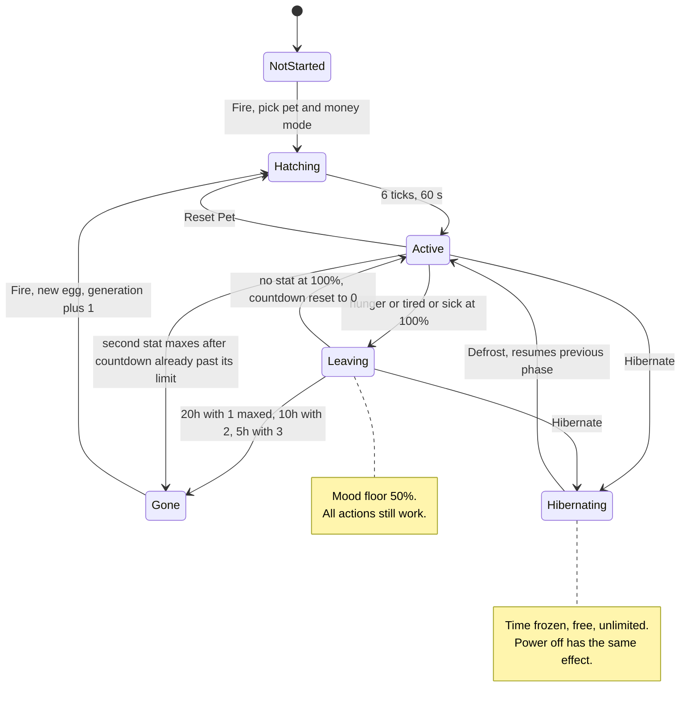
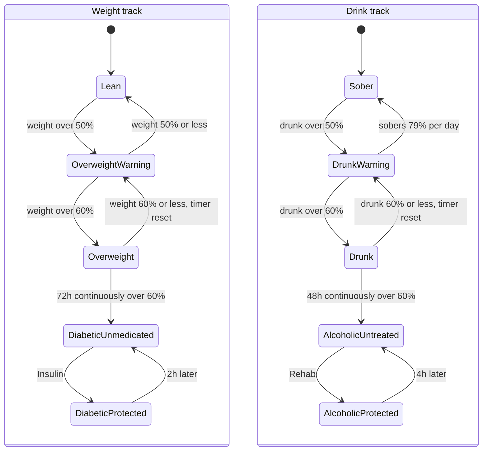
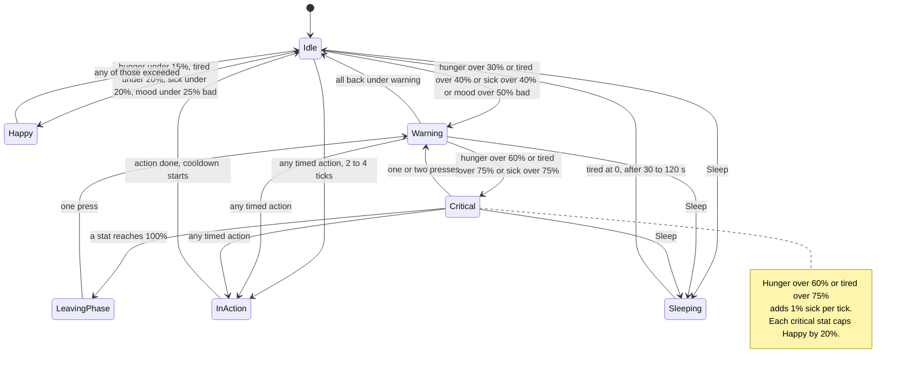
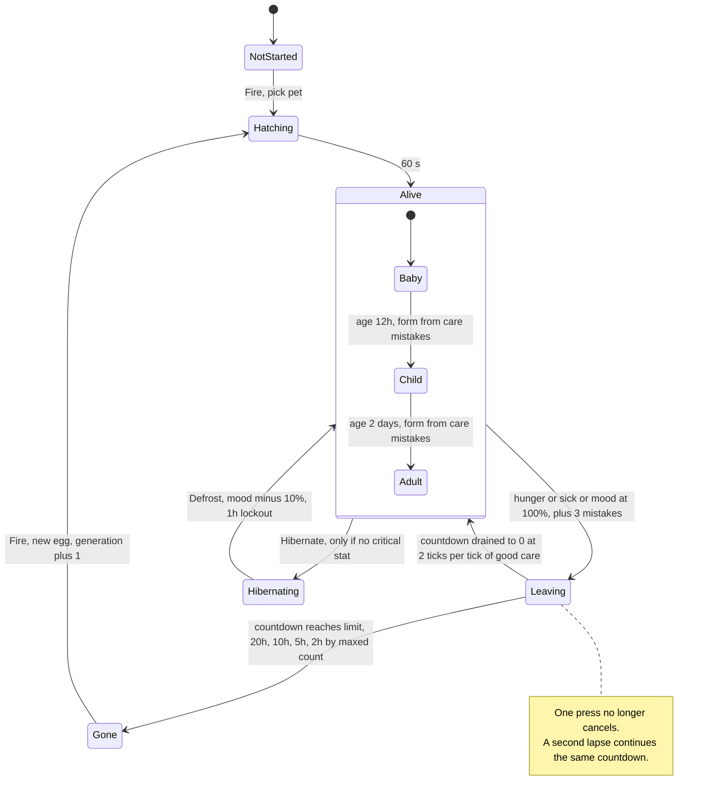
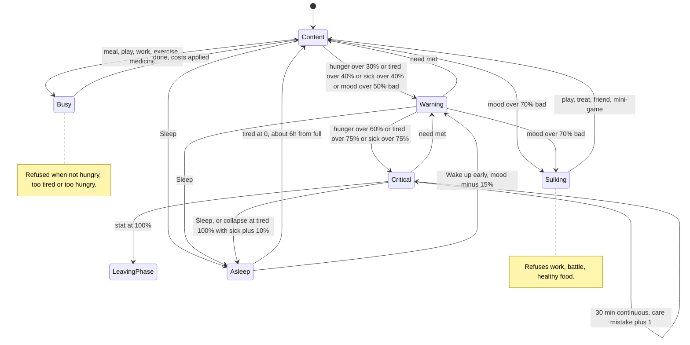

# BornPets game rules: audit and redesign proposals

Source read: worktree `BornHack-Cyberegg-fable6`, branch `ranzbak/fable-06-layering` (HEAD `710371f`). Report only, nothing in the repo was changed.
All numbers are the **Classic** preset unless stated. 1 tick = 10 s, 360 ticks = 1 h, 8640 ticks = 1 day. Stats are internal `u16`, 0 = good, 65535 = bad; 655 = 1 %. Percentages below are "percent bad" (the UI shows the inverse).
Paths are relative to `src/game/` unless they start with another directory. Nim is ignored (being deleted).

Measurements come from the existing `simulate_game` binary and a throwaway crate in the scratchpad (`simx/`, uses the real engine through the `simulator` feature).

---

## 1. Summary

- **Care is limited by cooldown throughput, not by decisions.** The pet burns about 185 % hunger per day (119 % from time plus about 65 % from the hunger cost of sleeping). One Apple restores 12 % and then locks Feed for 2 minutes. That is about 15 Apples a day, each followed by a wait. The same shape applies to Heal and Play. This is the "spam" feeling: stand at the badge, press the same item, wait for the timer, repeat.
- **Every bad state is escaped with one or a few presses, and nothing sticks.** A pet with hunger, tired, sick and mood all at 100 % bad is back under 10 % on all four in 49 minutes with 17 presses. `Leaving` (the death countdown, 20 h) resets to zero the moment one press takes the maxed stat off 100 %. In a 30-day simulated run a sloppy player spent 555 hours in `Leaving` and the pet never left.
- **Sleep is not sleep.** It is a 30 to 120 second button that converts tiredness into hunger (100 % tired costs 56 % hunger). There is no night, no bedtime, no wake item in the menu.
- **Happiness has no consequences and is nearly free.** It cannot make the pet leave, its two "boost" constants are 0, and it is restored 30 % per press. "Only pets" gives the same +30 % as "Play now" but pays 20 HAX instead of costing 10 and has no stat cost. Mesh friend beacons add +40 % / +10 % with no player input. The owner's example (one "Play now" and the bar is full) is what happens whenever mood is 30 % down or less, and mood only drops 36 % per day.
- **Mini-games do not feed the pet loop and do not reward skill.** A win gives a flat 15 HAX and +4.6 % hunger, nothing for mood, regardless of difficulty or score. Tic Tac Toe pays for a draw on either difficulty. BornJeweled pays for one match followed by Cancel. With money off, winning is a net penalty.
- **Money has more faucets than sinks.** Only pets yields 138 HAX/h with no cost. Battles against a cached friend yield 20 HAX per 2 minutes with no penalty for losing and no need for the friend to be present. Being broke pays 5 times more (100 HAX) for a mood penalty that does not matter.
- **Diabetes is a cliff that can be button-mashed away.** Unmedicated it adds 1 % sick per tick (0 to 100 % in 17 minutes; the base rate takes 7.6 days). Insulin protects for 2 h. But the Aspirine cooldown suppresses all sick gain, including the diabetes penalty, so Aspirine every 4.5 minutes neutralises it. The simulator's "perfect" player does exactly that: 70 heals per day.
- **Several things are dead or decorative:** drinks have no upside at all, Cake is strictly worse than everything, traits barely do anything, age does nothing, there are no growth stages, four threshold constants are unreachable.
- **Docs describe an older game** (the `drained` stat, Relax, "Play zeroes miserable", inspiration rewards).

---

## 2. Current game, as implemented

### 2.1 Stats

| Stat (internal) | Shown as | Passive change while awake | While asleep | Time 0 to 100 % | What it drives |
|---|---|---|---|---|---|
| `hunger` | Hunger bar | +9/tick; frozen during Feed and its 12-tick cooldown (`engine/mod.rs:951`) | +3109/tick (4.7 %/tick) (`engine/mod.rs:1050`, `thresholds.rs:173`) | 20.2 h awake | over 60 %: sick condition and "critical"; 100 %: Leaving |
| `tired` | Tired bar | +14/tick, minus 655 every 120 ticks, net +8.5/tick (`engine/mod.rs:962-980`) | minus 3275 / 6550 / 9825 per tick by tier (`engine/mod.rs:1034`) | 21.3 h (docs say 13 h) | over 75 %: sick condition and "critical"; 100 %: Leaving |
| `sick` | Healthy bar | +1/tick base; +655/tick while hunger over 60 % or tired over 75 % (+1310 if miserable at 70 % or more); +655/tick per untreated diabetes or alcoholism; frozen during Heal and its 24-tick cooldown (`engine/mod.rs:983-1003`) | same | 7.6 days base; 17 minutes with any condition active | over 75 %: "critical"; 100 %: Leaving; scales battle HP |
| `miserable` | Happy bar | +655 every 240 ticks (165 ticks with three stats over 60 %); frozen during Play and its 48-tick cooldown (`engine/mod.rs:1015`) | does not change | 2.8 days | at 70 % or more doubles the condition, diabetes and alcoholism sick rates. Nothing else. Never causes Leaving. Floor of 20 % per critical stat, 50 % while Leaving (`engine/mod.rs:626`) |
| `weight` | Fit bar | +1/tick always (13 %/day) plus food and drink (`engine/mod.rs:1007`) | same | 7.6 days from drift alone | over 50 %: OVERWEIGHT banner; over 60 % for 72 h: permanent diabetes (`engine/mod.rs:1121`) |
| `drunk` | Sober bar | minus 6/tick (79 %/day) | same | n/a | over 50 %: DRUNK banner; over 60 % for 48 h: permanent alcoholism (`engine/mod.rs:1138`) |
| `money` | "N H" | none | none | n/a | prices, only when the pet was created "with money". Starts at 100 |
| `age_ticks` | age in stats / realm | +1 per tick, not while hibernating or powered off | same | n/a | nothing (recorded in Unicorn Realm) |
| traits `vitality`, `curiosity`, `resilience` | Rolled stats | fixed, rolled 25 to 75 % at hatch | | | vitality: starting sick 6 to 19 %; curiosity: Play costs times 0.3 to 0.8; resilience: nothing in care. All three feed battle stats |
| `wins`, `losses`, `generation` | Health status | counters | | | nothing |

There is no thirst, hygiene, discipline or growth stage.

Game time is **uptime**: `now_tick()` is `uptime_ms / 10000` and `last_update_tick` is set to 0 on load (`lifecycle.rs:39`, `lifecycle.rs:121`). A powered-off badge is a paused pet.

### 2.2 Actions

Shared gate for timed actions (`engine/mod.rs:1170`): pet alive (Active or Leaving), not sleeping, no other action running, this action's cooldown at 0, price affordable when money is on.

| Action (menu) | Effect | Duration + cooldown | Price | Extra precondition | Where |
|---|---|---|---|---|---|
| Feed: Salad | hunger -8.4 %, weight +0.2 % | 2 + 12 ticks | 15 H (20 hard) | | `engine/food.rs:43`, `engine/mod.rs:840` |
| Feed: Apple | hunger -12 %, weight +0.6 % | 2 + 12 | 15 H (20 hard) | | same |
| Feed: Frikandel | hunger -18.6 %, weight +1.7 % | 2 + 12 | 10 H | | same |
| Feed: Pizza | hunger -20.4 %, weight +1.8 % | 2 + 12 | 10 H | | same |
| Feed: Cake | hunger -7.2 %, weight +2.1 %, no mood effect | 2 + 12 | 10 H | | same |
| Heal: Aspirine | sick -45 % | 3 + 24 | 1 H | | `engine/mod.rs:849` |
| Heal: Insulin | no stat change; blocks the diabetes sick penalty for 720 ticks (2 h) | 2 + 720 | 15 H (45 hard) | diabetic | `engine/mod.rs:1244` |
| Heal: Ozempic | weight -40 %, hunger -4.6 % | 2 + 4320 (12 h) | 15 H (45 hard) | none | `engine/mod.rs:867` |
| Heal: Rehab | blocks the alcoholism sick penalty for 1440 ticks (4 h) | 3 + 1440 | 15 H (75 hard) | alcoholic | `engine/mod.rs:1285` |
| Play: Play now | miserable -30 %; hunger +1.2 to 3.2 %, tired +2.4 to 6.4 % (by curiosity) | 4 + 48 | 10 H | | `engine/mod.rs:852`, `engine/mod.rs:887` |
| Play: Only pets (money mode only) | at 20 H or more: +20 H and miserable -30 %. Under 20 H: +100 H and miserable +30 % | 4 + 48 | free | | `engine/mod.rs:898` |
| Play: Battle | win: +20 H, win counter. Loss: loss counter. No stat effect | instant + 12 | free | at least one cached friend | `battle.rs:300`, `engine/mod.rs:1849` |
| Play: mini-games | on win: +15 H, hunger +4.6 %, that game locked 18 ticks | n/a | free | | `engine/mod.rs:1342` |
| Play: music | nothing | | | | |
| Rest: Sleep | tired to 0 at 5 / 10 / 15 % per tick; hunger +4.7 % per tick; all actions blocked; auto-wake at tired 0 | 3 to 12 ticks | free | | `engine/mod.rs:1298`, `engine/mod.rs:1030` |
| Exercise | weight -20 %, tired +6 %, hunger +3 % | 3 + 36 | free | | `engine/mod.rs:861` |
| Drink: Water | nothing | 2 + 24 | 15 H | | `engine/drink.rs:50` |
| Drink: Cola | weight +1.6 % | 2 + 24 | 10 H | | same |
| Drink: Beer / Wine / Whiskey | drunk +15 / 22.5 / 37.5 %, weight +2 / 1.4 / 0.6 % | 2 + 24 | 10 H | | same |
| Hibernate / Defrost | freezes everything, unlimited, free | | free | not Gone | `engine/mod.rs:1318` |
| NFC station tap | sets hunger, sick or tired to 0 | 5 min per station type, RAM only | free | pet not Gone | `station.rs:77-79` |
| Mesh friend beacon (passive) | new friend: miserable -40 %. Known friend, at most once per 4 h per friend: -10 % | | | | `engine/mod.rs:1834`, `friends.rs:89`, `friends.rs:513` |

Measured sleep cost (scratch sim): from 100 % tired 12 ticks and +56 % hunger; from 75 %: 7 ticks, +33 %; from 50 %: 4 ticks, +18 %; from 30 %: 3 ticks, +14 %.

There is no way to wake the pet from the menu (`modal.rs:176` lists only Sleep; `GameState::wake` is only called by the simulator policies).

### 2.3 Mini-games

| Game | Reward condition | Does skill change the reward? |
|---|---|---|
| Tic Tac Toe | win or draw, either difficulty (`tictactoe.rs:162-167`) | No. "Normal" AI blunders 35 % of moves; "Impossible" always allows a draw. Same 15 H |
| Lights Out | solved (`lightsout.rs:157`) | No. Move count is shown but unused |
| Black Hole | win or tie, either difficulty (`blackhole.rs:209-213`) | No |
| BornJeweled | score above 0 when closed, including an early Cancel (`bornjeweled.rs:117-125`) | No. One match then Cancel pays the same as a 30-move game |
| Battle | deterministic sim of own live stats against the friend's last broadcast stats | No input at all. Care quality matters a little (care average is 30 % of Attack, fitness part of Defense and Speed) |

All rewards go through `award_inspiration` (`engine/mod.rs:1342`): flat `MINIGAME_HAX_REWARD = 15`, flat `MINIGAME_HUNGER_COST = 3000`, cooldown only on a win, only for that game, not saved (a reboot clears it). Losing or quitting costs nothing. No mini-game changes mood.

### 2.4 Timers and ticks

- Engine is delta-time: `update()` applies elapsed ticks piecewise between threshold crossings (`engine/mod.rs:540`). `next_wake_tick()` schedules the next wake, at most 180 ticks (30 min) ahead (`engine/mod.rs:1436`). Any rule change that adds a rate boundary must be added to both `ticks_to_next_rate_change` (`engine/mod.rs:646`) and `next_wake_tick`.
- Hatching: 6 ticks (60 s) on hardware.
- Save: every 90 ticks (15 min) or immediately on phase change, money change, hibernate, name.
- Leaving countdown thresholds: 1 maxed stat 7200 ticks (20 h), 2 maxed 3600 (10 h), 3 maxed 1800 (5 h) (`thresholds.rs:213`). The counter keeps its value when a second stat maxes, so the pet can go straight to Gone at that moment. It resets to 0 when no stat is at 100 % (`engine/mod.rs:1091`).
- Buzzer alert on each upward step Neutral, Warning, Severe, Leaving (`lifecycle.rs:376`).

Thresholds: warning at hunger over 30 %, tired over 40 %, sick over 40 %, miserable over 50 %; critical at hunger over 60 %, tired over 75 %, sick over 75 % (`thresholds.rs:180-186`, `engine/to_display.rs:141-163`).

### 2.5 Configuration knobs

- **No per-pet tuning exists.** `PETS.CFG` is only `PREFIX=NAME` (roster and sprites). All seven pets play identically (`pets_cfg.rs`).
- Global preset Classic or Casual, chosen in settings, applied at boot (`engine/thresholds.rs:159`, `:263`). Casual: hunger and tired at half speed, Apple -20 %, Aspirine -75 %, leaving times doubled, insulin window 4 h.
- `BORNPETS.CFG` on the USB drive overrides 21 of the roughly 75 threshold fields (`engine/thresholds.rs:472`). A `*` marks a customised game.
- Per pet at creation: money on or off, hard mode (prices only).
- Constants not in the table: `HAPPINESS_STEP`, all HAX prices and rewards (`engine/mod.rs:91-123`), food and drink multipliers, station and friend cooldowns.

### 2.6 What the simulator says

`cargo run --bin simulate_game --features simulator` (money off, 60 days, seed 42):

| Profile | Outcome | Actions |
|---|---|---|
| perfect (acts every tick) | survives 60 d | 5.2 per hour, around the clock |
| attentive, checks every 15 min | gone on day 6.3 | |
| checks every 30 min or 1 h | gone on day 6.3 | |
| absent | gone after 0.9 day (21 h) | 0 |
| never feeds | gone on day 1.1 | |
| never sleeps | gone on day 1.3 | |

Why day 6.3: none of the simulated policies exercise or give insulin. Weight drifts to 60 % by about day 3, diabetes sets in 72 h later, sick then maxes in 17 minutes. The "perfect" player survives only by pressing Aspirine 978 times in 14 days (scratch trace: 184 feeds, 978 heals, 15 plays, 26 sleeps; weight pinned at 100 %, diabetic from day 6). So the balance tool no longer measures the game that ships.

Scratch "human session" runs (30 days, money off; the player opens the badge every N hours and presses the best available item every tick for the session length; 8 h human night with no sessions):

| Player | Result |
|---|---|
| every 3 h, 5 min session, Salad + exercise | gone on day 2.1. Feed throughput cannot keep up (2 Salads per session) |
| every 3 h, 5 min, Pizza, no exercise | alive at 30 d, diabetic, sick and mood hit 100 %, 606 h spent in Leaving |
| every 3 h, 5 min, Pizza + exercise | same: the session is too short to ever reach Exercise in the queue |
| every 4 h, 10 min, Pizza + exercise | alive, not diabetic, about 16 presses per day, worst hunger 99 %, sick 100 %, 7.7 h in Leaving |
| every 6 h, 20 min, Pizza + exercise | alive, 172 h in Leaving |
| every 8 h, 20 min, Pizza + exercise | alive, 130 h in Leaving |
| every 6 h, 10 min, Pizza + exercise | gone on day 6.5 |

Reading: survival depends on how many minutes you spend waiting out cooldowns, and hardly on what you choose. Sitting at "about to leave" for days has no lasting effect.

---

## 3. State diagrams (current)

### 3.1 Lifecycle

Permanent flags, independent of phase:

### 3.2 Moment-to-moment condition (while Active)

Display priority is action, then sleeping, then leaving, then critical, then warning, then happy or idle (`engine/to_display.rs:91`).

---

## 4. Problems found

Severity: **High** = breaks the balance-and-skill goal directly. **Medium** = degenerate or misleading, but local. **Low** = dead weight or polish.

**P1. Care is a cooldown queue (High).**
Daily hunger load is about 185 %. Apple gives 12 % per 14-tick cycle, so about 15 Apples (36 minutes of press-and-wait) per day, or 9 Pizzas. Feed, Heal, Play and Exercise are all "small fixed step, short cooldown, no upper limit per day". There is no decision in pressing the same item again when the timer ends. `thresholds.rs:196-205`, `engine/mod.rs:840-860`.

**P2. Cooldowns pause decay (Medium).**
Hunger is frozen during the Feed cooldown, sick during the Heal cooldown, mood during the Play cooldown (`engine/mod.rs:951`, `:983`, `:1015`). Pressing as soon as a cooldown ends means the stat never decays. This also creates P9.

**P3. Sleep is a 2-minute conversion button (High).**
`SLEEP_RECOVERY_FAST = 9825` is 15 % per tick. Full recovery takes 12 ticks. `SLEEP_HUNGER_COST = 3100` per tick makes each sleep cost 14 to 56 % hunger, which is the main reason so many Feed presses are needed. The pet is awake 99.8 % of the time. Sleep has no rhythm, no "lights out", no cost for waking, and no wake item. `engine/mod.rs:1030-1059`, `thresholds.rs:170-175`, `modal.rs:176`.

**P4. Leaving is escaped with one press and leaves no trace (High).**
`check_leaving` zeroes the countdown when no stat is exactly at 65535 (`engine/mod.rs:1091-1099`). One Aspirine (1 HAX, sick 100 % to 55 %) or one Pizza cancels 19 hours of accumulated countdown. Total wreck to healthy takes 49 minutes. Nothing records that it happened.

**P5. Happiness does not matter (High).**
`HUNGER_MISERABLE_BOOST` and `TIRED_MISERABLE_BOOST` are 0 in both presets (`thresholds.rs:164-167`). `count_maxed` ignores `miserable` (`engine/mod.rs:522`), so a pet at 0 % happy forever never leaves. The only effects are a doubling of sick rates that are already fatal, and 7.5 % of battle Attack. The `feed_and_sleep` sim profile ends with mood at 100 % bad and dies of something else.

**P6. Happiness is trivially restored, and playing does not cost what it should (High, the owner's example).**
Play now gives a flat +30 % (`HAPPINESS_STEP`, `engine/mod.rs:98`, `:890`). Mood drops only 36 % per day, so one press a day refills the bar. The energy cost is 2.4 to 6.4 % tired, and there is no "too tired to play" check: a pet at 99 % tired plays happily. Until commit `0e877ff` Play zeroed the stat outright, and GAME.md still says so.

**P7. Only pets dominates Play now (High).**
Same +30 % mood, same cooldown length (but its own cooldown, so both can be used back to back), pays 20 HAX instead of costing 10, no hunger or tired cost (`engine/mod.rs:898-915`). In money mode Play now is never the right choice.

**P8. Being broke pays five times more (Medium).**
Under 20 HAX, Only pets pays 100 HAX for -30 % mood (`engine/mod.rs:904`). Mood does not matter (P5) and the next hobby press gives the 30 % back. Keeping the balance low is the best income strategy.

**P9. Aspirine suppresses diabetes and alcoholism (High).**
The whole sick block, including `diabetes_penalty` and `alcoholism_penalty`, is skipped while `cooldown_heal > 0` (`engine/mod.rs:983`). Aspirine at 1 HAX every 27 ticks makes Insulin (15 or 45 HAX) and Rehab (15 or 75 HAX) unnecessary.

**P10. Condition and diabetes rates are a cliff (High).**
`SICK_CONDITION_RATE`, `DIABETES_SICK_RATE`, `ALCOHOLIC_SICK_RATE` are all 655 per tick (`thresholds.rs:178`, `:226`, `:252`): sick goes 0 to 100 % in 17 minutes, against 7.6 days at the base rate. Once hunger passes 60 % the player has 17 minutes before Leaving. Insulin lasts 2 h, so a diabetic pet is at sick 100 % every morning. Combined with P4 this is both too harsh (constant alarms) and toothless (one press fixes it).

**P11. Diabetes arrives by default (Medium).**
Weight rises 13 % per day with no input (`WEIGHT_RATE = 1`). A player who never opens the top-row Exercise menu is diabetic on day 7.5 no matter what they feed. The only warning is a small banner from 50 %. Exercise is last in every realistic press queue.

**P12. Mini-game rewards ignore skill (High).**
See 2.3. Draws pay, Normal difficulty pays the same as hard, BornJeweled pays for one match, move counts and scores are ignored. `award_inspiration` takes no score argument.

**P13. Mini-games do not feed the pet loop (High).**
A win gives HAX and hunger +4.6 %, nothing for mood (`engine/mod.rs:1342-1357`). The function is still called `award_inspiration` but the stat it fed was removed. With money off, the only effect of winning is a hungrier pet, and losing is free.

**P14. Battle is a free HAX tap (Medium).**
20 HAX per win, 12-tick cooldown, no cost, no loss penalty, opponent is a cached snapshot that never needs to be in range (`battle.rs:300-314`, `engine/mod.rs:1849`). Pick the weakest cached friend and press every 2 minutes: up to 600 HAX/h.

**P15. Friend boosts are large, passive and repeatable (Medium).**
+40 % mood for a new friend, +10 % per known friend every 4 h (`engine/mod.rs:1834`). Beacons are flooded across the mesh every 15 minutes, so no physical meeting is needed. The friends list holds 20 and evicts the oldest (`friends.rs:246`); an evicted friend counts as new again. At a festival with more than 20 badges on SHDW this keeps mood near 100 % with zero input. Not verified on real hardware density.

**P16. Station taps and hibernation remove all tension (Medium).**
A station tap sets a stat to 0 outright (`station.rs:77-79`), also while Leaving. Hibernate is free, unlimited, allowed while Leaving, and powering off does the same. A player can freeze the pet at any bad moment and for any length of time. Station cooldowns and mini-game cooldowns live in RAM, so a reboot clears them.

**P17. Drinks have no upside (Medium).**
Water does nothing for 15 HAX. Cola only adds weight. Alcohol only adds drunk and weight. There is no thirst, no mood effect. Alcoholism needs drunk over 60 % for 48 h straight, which means a Whiskey about every 3 hours around the clock; it cannot happen by accident. The whole Drink icon (one of eight menu slots) and the Rehab item are effectively unreachable content.

**P18. Dominated food (Low).**
Cake: least hunger relief, most weight, no mood effect (docs promise a mood boost). Frikandel is Pizza minus 10 %. Healthy food costs more HAX and makes the cooldown queue longer; the Salad-only player starves on day 2.

**P19. Traits and age are decorative (Medium).**
Vitality sets only the starting sick value. Curiosity scales a cost that is already negligible. Resilience is unused outside battle. Age has no effect. There are no growth stages, so nothing accumulates from caring well, and the Unicorn Realm record of a well-kept pet and a neglected one differ only in age.

**P20. Absence is all-or-nothing (Medium).**
An untouched pet is fine for about 12 h, then sick maxes in 17 minutes, then it is Gone at 21 h. But time only runs while the badge is powered, and Leaving resets on one press. Depending on battery habits the pet is either unkillable or dead after one long day. The human's 8-hour night alone takes hunger to 40 % and trips the warning buzzer.

**P21. Unreachable or unused constants (Low).**
`LEAVING_THRESHOLDS[4]` (only three stats are counted), `MISERABLE_INTERVAL_MIN` (the interval cannot go below 165), `MISERABLE_DRAIN_THRESHOLD`, `HUNGER_MISERABLE_BOOST`, `TIRED_MISERABLE_BOOST`, `cooldown_relax` (kept for save layout), `Toast::Relax`, `Toast::Inspired`. `modal.rs:425`: selecting Battle from the generic `activate` path shows the Rehab toast.

**P22. The balance simulator is stale (Medium).**
Policies never exercise, medicate, drink, earn or spend money, and act with machine timing. `tests/game_engine.rs` asserts on these profiles, so the tests pass while describing a player that does not exist. See 2.6.

---

## 5. Doc versus code mismatches

| Doc | Says | Code |
|---|---|---|
| `GAME.md:48-58` | Six stats including **Drained**; miserable speeds up drained | `drained` removed (commit `0e877ff`); stats are hunger, tired, sick, miserable, weight, drunk |
| `GAME.md:81` | Cake: "big mood boost" | Cake has no mood effect (`engine/food.rs:52`) |
| `GAME.md:87`, `:351`, `:379` | Play now "zeroes miserable" | minus 30 % per press |
| `GAME.md:88-89`, `:130-131`, `:141`, `:153` | mini-games "boost inspiration / reduce drained" | +15 HAX, +4.6 % hunger, no mood |
| `GAME.md:92` | Rest has a **Relax** item | Rest has only Sleep (`modal.rs:176`) |
| `GAME.md:93-98` | Exercise and drinks give "drained relief"; Water is "refreshing" | no such effects; Water does nothing |
| `GAME.md:86-90` | Play menu lists Battle, Play now, Tic Tac Toe, Lights Out, music | also Only pets, Black Hole, Nim, BornJeweled |
| `GAME.md:113-114` | Only pets: "if broke, forced work pays more" | true, but not documented that hobby also gives +30 % mood and broke gives -30 % |
| `GAME.md:116-117` | Spending list omits Play now | Play now costs 10 HAX |
| `GAME.md:121-124` | Hard mode: "healthy food and drinks cost more" | only Salad and Apple (20) and treatments change; drink prices do not (`engine/drink.rs:71`) |
| `GAME.md:303` | Battle cooldown 120 s "same as every other action" | 120 s is correct, other actions differ |
| `GAME.md:333` | Resilience "reserved for future use" | used for battle Defense |
| `GAME.md:345` | Tired fills in about 13 h | 21.3 h net of passive recovery |
| `GAME.md:346`, `:352-354` | Drained interval, drained feedback loops | removed |
| `GAME.md:361-368` | "4 critical stats", floor up to 80 % | three stats count, maximum floor 60 % |
| `GAME.md:376-384` | Feed "reduces hunger and drained"; Relax row; Medicate cooldown "2-3 hours" | no drained; no Relax; Insulin 2 h Classic, 4 h Casual; Ozempic, Drink, Rehab, Only pets rows missing |
| `GAME.md:394-399` | Leaving table has a 4-stat row (about 2 h) | unreachable |
| `GAME.md:13-17` | Roster Bartholomeus, Cat, Slug, Panda | `PETS.CFG` ships seven pets |
| `GAMES.md:11-17`, `:211` | win reduces `drained`; BornJeweled awards `add_drained_relief(score / 6)` | flat reward, no score scaling, function does not exist |
| `USER_GAMES.md:15-21` | "four decaying stats", Drained "most important", "top row" action icons | see above; main actions are the bottom row |
| `USER_GAMES.md:42`, `:55-87` | `BORNPETS.CFG` keys `DRAINED_INTERVAL`, `DRAINED_INTERVAL_MISERABLE`, `FEED_DRAINED_RELIEF`, `RELAX_DRAINED_RELIEF`, `RELAX_HUNGER_COST`, `PLAY_DRAINED_COST` | not in `BORNPETS_CFG_KEYS`; silently ignored |
| `USER_GAMES.md:156-165` | animation IDs for Critical drained, Warning drained, Relaxing | states no longer exist |
| `USER_GAMES.md:178` | cooldown limits "how often you can play for stat reduction" | cooldown starts only on a win; the reward is HAX |
| `README.md:275` | station commands "feed, heal, inspire, sleep" | no inspire station (`station.rs:77-79`); `Toast::StationInspire` is unused |
| `station.rs:11` (code comment) | stat "restored to full" | correct, and worth stating in player docs: a station tap is a full reset |
| `engine/mod.rs:1804` (comment) | save every 15 minutes | correct (90 ticks); `lifecycle.rs` comments agree |

---

## 6. Proposed improvements

Guiding idea: keep it a virtual pet. Fewer, heavier care actions on a daily rhythm; every action costs something in another stat; neglect leaves a mark; mini-games and the mesh feed the pet's mood. Target: 4 to 6 check-ins of 1 to 2 minutes per day, around 12 to 15 presses per day in total, each a choice. This also suits e-paper: every press is a slow refresh, so fewer and more meaningful presses is better.

None of the proposals leaves the virtual-pet genre. I13 (growth stages) is the largest new mechanic and is classic virtual-pet territory; it is flagged for its art cost.

**None of the proposed numbers have been simulated.** They are sized from the current rates. I1 should come first so the rest can be tuned with a tool.

Order is by value for effort. "Tuning" means constants and a few lines; "Mechanic" means new logic or state.

### I1. Make the simulator describe real players (Tuning of tools, do first)
Fixes: P22. Enables everything else.
- Add policies to `engine/sim.rs`: `human_3_checkins` (acts for 12 ticks at 08:00, 13:00, 18:00, 23:00, human night 8 h), `human_6_checkins`, `spammer` (acts every tick for 2 h per day), `weekend_absent` (36 h gap). Each uses the full action set including Exercise, Insulin, sleep.
- Report per profile: days survived, presses per day, hours in each severity, care mistakes (I5), diabetic yes or no.
- Replace the assertions in `tests/game_engine.rs` with the design targets: 3 check-ins survives 14 days with at most a few mistakes; 6 check-ins has none; the spammer does no better than 6 check-ins; 24 h absent is Leaving but not Gone; 48 h absent is Gone.
- Scope: `engine/sim.rs`, `src/bin/simulate_game.rs`, `tests/game_engine.rs`. No firmware or save impact.

### I2. Meals instead of nibbles (Tuning)
Fixes: P1, P2, P18.
- Hunger load becomes about 100 % per day (see I3 for the sleep part). Three meals a day cover it.
- Food values (hunger relief / weight gain / mood): Salad 25 % / +0.5 % / 0. Apple 30 % / +1 % / 0. Frikandel 45 % / +4 % / +5 %. Pizza 50 % / +5 % / +5 %. Cake 10 % / +5 % / +15 %. Healthy food is slower and dearer; junk is fast, cheap, cheerful and fattening; Cake is a treat.
- "Not hungry": Feed is refused with a toast while hunger is under 20 %, except Cake (a snack is always accepted). This replaces the cooldown as the limiter. `FEED_COOLDOWN` stays at 12 ticks only to cover the animation, and it no longer freezes hunger decay.
- Implementation: `FEED_HUNGER_RELIEF` 3930 to 9830, `FEED_WEIGHT_GAIN` 200 to 330, new multipliers plus a mood field in `engine/food.rs`, one precondition in `GameState::feed`, drop the `cooldown_feed == 0` condition at `engine/mod.rs:951` and `:1050` and in the two rate estimators. A `can_feed_meal` flag in `PetStats` so the menu can grey out and say why.
- Save impact: none.
- UI: the refusal needs a toast text ("not hungry"). Three presses a day instead of fifteen.

### I3. Real sleep (Tuning plus a small mechanic)
Fixes: P3, part of P1 and P20.
- Awake: tired fills in about 16 h. Set `TIRED_RATE` to 11 and drop passive recovery (`TIRED_PASSIVE_RECOVERY = 0`).
- Asleep: one flat rate, `SLEEP_RECOVERY = 30` per tick, so 100 % takes about 6 h and 50 % about 3 h. Hunger while asleep rises at half the awake rate (4 per tick; `SLEEP_HUNGER_COST` becomes a reduction, or simply a separate `SLEEP_HUNGER_RATE`). Mood does not decay while asleep. A night costs about 13 % hunger instead of 56 %.
- Add **Wake up** to the Rest menu (`GameState::wake` exists). Waking with tired over 30 % costs 15 % mood (grumpy). This is the trade-off: you can interrupt sleep to feed or play, at a price.
- A pet that reaches 100 % tired falls asleep by itself and takes +10 % sick (collapsed). It no longer counts as a maxed stat for Leaving while it is asleep and recovering.
- Result: the natural routine is "put the pet to bed when you go to bed". The pet sleeps through the human night, so the morning check-in finds a rested, moderately hungry pet instead of alarms. A day pet / night pet split is not needed.
- Implementation: `apply_sleep_decay`, the three tier constants collapse to one, `ticks_to_next_rate_change` and `next_wake_tick` sleep sections get simpler, `modal.rs` Rest list gains `Item::WakeUp`-style item (name it differently from the hibernate one), toast.
- Save impact: none (`is_sleeping` is already saved).
- UI: the sleeping sprite is on screen for hours, which is what e-paper is good at. `SLEEP_ANIM_UNTIL_TICK` (`lifecycle.rs:454`) becomes unnecessary.

### I4. Play costs energy, and a tired pet will not play (Tuning)
Fixes: P6, P7, P8.
- Play now: mood +20 %, tired +10 %, hunger +5 %, cooldown 30 minutes (180 ticks), free of HAX. Refused with a toast when tired is over 75 % ("too tired") or hunger over 60 % ("too hungry"). Curiosity scales the mood gain (I12), not the cost.
- Only pets becomes plain work: +25 HAX, tired +15 %, hunger +8 %, mood -10 %, same refusal rule, cooldown 1 h. Remove the broke branch; a broke pet earns the same 25. Work now competes with play for the pet's energy, which is the trade-off money mode is missing.
- Implementation: `HAPPINESS_STEP`, `PLAY_*` constants, the `Action::OnlyPets` completion block, two precondition checks in `start_action` callers, prices in `modal.rs:286`.
- Save impact: none.

### I5. Leaving cannot be cancelled with one press; mistakes are counted (Mechanic, small)
Fixes: P4, P20, part of P19.
- Leaving countdown no longer resets. While no stat is maxed it runs **down** at 2 ticks per tick. The pet returns to Active when the counter reaches 0. A pet that was 10 h into leaving needs 5 h of good care before it is safe, and a second lapse in that window continues from where it was.
- Add `care_mistakes: u8`. +1 each time a stat stays critical for 30 minutes continuously, and +3 on each entry into Leaving. Shown in Health status and stored in the Unicorn Realm record. Used by I10 and I13.
- Count `miserable` as a fourth leaving stat (see I6), which makes `LEAVING_THRESHOLDS[4]` live.
- Implementation: `check_leaving` (`engine/mod.rs:1091`), one timer per critical stat or one shared `critical_ticks: u16`, `health_view.rs`, `PetRecord`.
- **Save impact: yes.** +1 byte `care_mistakes`, +2 bytes `critical_ticks`. `from_bytes` currently rejects any other version (`engine/mod.rs:2010`), which would wipe every pet. Add a v2 to v3 upgrade path (read 97 bytes, default the new fields) and extend `tests/save_format.rs`. Realm record format changes too if mistakes are stored there.

### I6. Happiness has consequences (Tuning)
Fixes: P5.
- Mood at 100 % bad counts as a maxed stat for Leaving (add to `count_maxed` in `engine/mod.rs:522` and `engine/to_display.rs:80`).
- A sulking pet (mood over 70 % bad) refuses work and battles, and eats only junk food and Cake. This is the virtual-pet "discipline" beat without a new stat.
- Slow the base mood decay slightly so it is a daily concern, not hourly: keep 240 ticks per 1 %.
- Implementation: two lines plus preconditions and toasts. Save impact: none. Remove or use `HUNGER_MISERABLE_BOOST` / `TIRED_MISERABLE_BOOST`.

### I7. Sickness comes from neglect, and medicine is not a spam button (Tuning)
Fixes: P9, P10, P11.
- `SICK_CONDITION_RATE` 655 to 45 (100 % in about 4 h of a critical stat, instead of 17 minutes). Miserable variant 90.
- `DIABETES_SICK_RATE` and `ALCOHOLIC_SICK_RATE` 655 to 15 (100 % in about 12 h unmedicated). Insulin window 8 h (`MEDICATE_COOLDOWN = 2880`), Rehab window 12 h. Two or three doses a day, one of them before bed.
- Aspirine: -40 %, cooldown 1 h (360 ticks), and its cooldown stops only the base rate and the condition rate, never the diabetes or alcoholism penalty (move those two terms outside the `cooldown_heal == 0` check at `engine/mod.rs:983` and `:1062`, and in `sick_rate_approx`).
- Weight drift only while the pet is well fed: apply `WEIGHT_RATE` only when hunger is under 30 %. An overfed, idle pet gains weight; a normally fed pet holds steady; diabetes comes from junk food and no exercise, not from the calendar.
- Exercise: unchanged effect (-20 %), tired +10 %, hunger +6 %, refused when tired over 75 %.
- Save impact: none. `cooldown_*` fields are `u16`, all values fit.

### I8. Mini-games pay in mood, scaled by how well you played (Mechanic, small)
Fixes: P12, P13.
- Replace `award_inspiration(game)` with `minigame_result(game, grade)` where grade is 0 to 3. Mood +5 % per grade (max +15 %), HAX 5 per grade (max 15). Starting a mini-game costs tired +5 % and starts that game's cooldown (30 minutes), whether you win or not; refused when the pet is too tired (same rule as Play).
- Grades: Tic Tac Toe: Normal win 1, Impossible draw 2, loss 0, Normal draw 0. Lights Out: solved 1, within 1.5 times the minimum move count 2, at the minimum 3 (the solver masks at `lightsout.rs:59` already give the minimum). Black Hole: easy win 1, hard tie 2, hard win 3. BornJeweled: score 300 / 800 / 1500 for grades 1 / 2 / 3, no reward for an early Cancel below 300.
- Why: the mini-games become the skilled way to cheer the pet up (up to +15 % against Play now's flat +20 % with a higher energy cost), which is the "side feature that feeds the pet loop" role.
- Implementation: `engine/mod.rs:1342`, four call sites, toasts showing the grade. Save impact: none (cooldowns stay transient; consider saving them, see open questions).

### I9. Social features that need presence (Tuning)
Fixes: P14, P15.
- Friend boost: new friend +15 % mood, reunion +5 %, capped at +20 % per day in total. Option: only count beacons received with zero hops, so "met" means physically near.
- Battle: costs the challenger tired +10 %; win gives +10 % mood and 10 HAX, loss gives -5 % mood. Per-friend cooldown 1 h. HAX only if the friend's beacon was seen in the last 30 minutes; otherwise it is a "sparring" fight for the record only.
- Implementation: `engine/mod.rs:1834-1863`, `friends.rs` (daily cap counter, per-friend last-battle tick), `battle.rs:300`.
- Save impact: friend record +4 bytes if the per-friend battle tick is persisted (own KV namespace, own format); a RAM-only version needs none.

### I10. Stations and hibernation as help, not reset (Tuning)
Fixes: P16.
- Station tap: improves the stat by 50 percentage points instead of setting it to 0, and gives +10 % mood. Still a strong reward for walking to a station, no longer an erase button.
- Hibernate: not allowed while Leaving or while any stat is critical ("fix me first"). On defrost: mood -10 % and a 1 h lockout before hibernating again.
- Implementation: `station.rs:77-79`, `GameState::hibernate`. Save impact: none if the lockout is RAM only.

### I11. Drinks that tempt (Tuning)
Fixes: P17.
- No thirst stat. Give drinks effects in existing stats: Water: sick -5 %, free of weight (cheap small health care, 5 HAX). Cola: tired -10 %, weight +2 % (a pick-me-up). Beer / Wine / Whiskey: mood +15 / +20 / +30 %, drunk +15 / 22 / 37 %, weight as now. While drunk is over 60 %: tired rises 50 % faster and the pet refuses work, mini-games and battles.
- Alcoholism onset from 48 h continuous to a rolling total: 12 h spent over 60 % drunk within the pet's life (the existing `drunk_ticks` counter, just not reset to 0 when sober; halve it per sober day if a way back is wanted).
- Why: alcohol becomes the cheap, fast mood fix with a real long-term risk, which is the same shape as junk food and weight.
- Save impact: none (`drunk_ticks` is already saved).

### I12. Traits as personality (Mechanic, small)
Fixes: P19.
- Vitality: scales the sick condition rate and Aspirine strength by 0.75 to 1.25. Curiosity: mood decays 0.75 to 1.25 times as fast, and Play and mini-game mood gains scale the same way (a curious pet bores quickly but is easy to delight). Resilience: scales the time before a critical stat counts as a care mistake (20 to 40 minutes) and the leaving thresholds by 0.75 to 1.25.
- Show one line per trait in the Rolled stats screen saying what it does.
- Save impact: none (traits are saved).
- Optional, in genre: a per-pet-kind modifier line in `PETS.CFG` (`0=Bartholomeus,hunger=90,tired=110`) so species differ. Needs `pet_registry` changes.

### I13. Growth stages shaped by care (Mechanic, larger; needs art)
Fixes: P19, gives I5 its payoff.
- Stages by age: Baby (first 12 h: hunger 1.5 times faster, sleeps more, cannot work or battle), Child (to day 2), Adult (from day 2). At each transition the care-mistake count picks a form: for example 0 to 2 mistakes "Star", 3 to 6 "Regular", 7 or more "Rascal". The form sets a small permanent modifier (Star: mood decays slower, battle +10 %; Rascal: refuses healthy food more often) and a title shown next to the name, in beacons and in the Unicorn Realm.
- Cheap version without new sprites: stage and form are text only (title in the stats screen, friends list, realm) plus the modifiers. Full version: per-stage or per-form sprites, which multiplies the PCX set for seven pets. **Art cost is the real scope here.**
- Save impact: yes, +1 byte (stage and form). Do it in the same format bump as I5. Beacon format +1 byte if the title is broadcast (`friends.rs` `BEACON_SIZE`, keep the old size accepted).

### I14. Cleanup and docs (Tuning)
Fixes: P21 and section 5.
- Remove `MISERABLE_DRAIN_THRESHOLD`, unused toasts, the wrong toast at `modal.rs:425`; rename `award_inspiration`.
- Rewrite `GAME.md` sections Stats, Actions, Mini-Games, Detailed Stats; `GAMES.md` "Why play" and BornJeweled reward; `USER_GAMES.md` stats table, `BORNPETS.CFG` key list (generate it from `BORNPETS_CFG_KEYS`), animation ID table; `README.md:275`.
- Add the new constants to `BORNPETS_CFG_KEYS` so the owner can tune on a badge without reflashing.

### Summary table

| # | Proposal | Kind | Fixes | Save format |
|---|---|---|---|---|
| I1 | Realistic simulator policies and targets | tools | P22 | no |
| I2 | Meals, "not hungry", food trade-offs | tuning | P1 P2 P18 | no |
| I3 | Real sleep, wake item, grumpy wake | tuning + small | P3 P1 P20 | no |
| I4 | Play costs energy; work replaces Only pets | tuning | P6 P7 P8 | no |
| I5 | Leaving decays slowly; care mistakes | mechanic | P4 P20 P19 | **yes** |
| I6 | Mood can make the pet leave or sulk | tuning | P5 | no |
| I7 | Softer sick rates; Aspirine no cure-all; weight from overfeeding | tuning | P9 P10 P11 | no |
| I8 | Graded mini-game rewards in mood | mechanic, small | P12 P13 | no |
| I9 | Presence-based friends and battles | tuning | P14 P15 | friends KV, optional |
| I10 | Stations and hibernate limited | tuning | P16 | no |
| I11 | Drinks with a temptation trade-off | tuning | P17 | no |
| I12 | Traits as personality | mechanic, small | P19 | no |
| I13 | Growth stages from care quality | mechanic, art | P19 | **yes** |
| I14 | Cleanup and docs | tuning | P21, docs | no |

A sensible first batch is I1, I2, I3, I4, I6, I7: constants and a handful of preconditions, no save change, and it removes the spam loop. I5 and I13 should share one save-format bump.

### What a day looks like after the first batch (design target, unverified)

| Time | Check-in | Presses |
|---|---|---|
| Morning | pet woke by itself, hunger about 45 %: meal; insulin if diabetic | 1 to 2 |
| Midday | meal; a mini-game or Play | 2 |
| Afternoon | work for HAX or exercise (not both, energy) | 1 |
| Evening | meal; play or meet friends | 2 |
| Bedtime | Sleep | 1 |

Skipping one check-in gives a warning, skipping two gives a critical stat and a care mistake, a whole day gives Leaving, two days gives Gone. Pressing more often gains nothing: the pet is not hungry, too tired, or on a 30 to 60 minute cooldown.

### Proposed state diagrams

Lifecycle:

Condition while alive:

---

## 7. Open questions for the owner

1. **Should time pass while the badge is off?** Today power-off is a free pause. The watch feature has a clock; if it survives power-off, the engine could apply catch-up (capped at, say, 12 h) on boot. Without that, any neglect rule can be dodged with the power switch.
2. **Session target.** Is 4 to 6 short check-ins per day right for a festival, or should a pet survive on 2 to 3? This sets every rate in I2, I3 and I7. Casual mode could be the 2 to 3 version.
3. **Real night or pet-relative sleep?** I3 proposes pet-relative (sleep whenever tired, about 6 h). An alternative is clock-based bedtime using the badge clock. Clock-based is closer to the classic toys but depends on the clock being set.
4. **How final is leaving?** Options: as now (Gone, new egg), or the pet "runs away" and can be coaxed back once at a cost. Also: should old age end a pet (classic) or can a well-kept pet live for the whole event?
5. **Is diabetes meant to stay permanent, and the joke content (Ozempic, alcohol, rehab, "Hard mode US") meant to stay prominent?** I7 and I11 keep it and make it playable. If it is mostly a gag, it could be simplified instead.
6. **Stations: full reset or partial?** A full reset is a strong crowd-pleaser at an event but removes all consequences. I10 proposes 50 points.
7. **Money mode: one game or two?** With money off, work, prices and HAX rewards vanish. Should the balance be tuned for money on (the default at pet select) with money off as an easy mode, or must both be equally balanced?
8. **Save migration.** Is wiping pets on a firmware update acceptable before the event, or is a v2 to v3 upgrade path required (I5, I13)?
9. **Art budget for growth stages.** Text-only titles, or new sprites per stage or form for seven pets?
10. **Mesh presence.** Should "meeting a friend" require direct radio range (zero hop), or is anywhere on the mesh fine? How many SHDW badges are expected in range at the event? This decides how strong I9's cap must be.
11. **Should mini-game and station cooldowns survive a reboot?** Today a reboot clears them. Persisting them costs a few save bytes.
12. **Per-species differences.** Should the seven pets differ in needs (I12 option), or stay cosmetic as `USER_GAMES.md` states?

---

## Not verified

- Nothing was run on hardware. Buzzer alerts, banners and refresh behaviour were read from code only.
- Mesh behaviour (how many beacons a badge really receives, friend eviction churn) is inferred from `friends.rs`, not observed.
- Casual preset was read but not simulated.
- `tests/game_engine.rs` and `tests/save_format.rs` were not run; only the `simulate_game` binary and the scratch crate were.
- `battle_view.rs`, `health_view.rs`, `traits_view.rs`, `realm_view.rs`, `input.rs`, `pet_select.rs` were only skimmed or grepped for reward and state calls.
- All proposed numbers are hand-sized and need a simulator pass (I1) before anyone trusts them.
- The owner's "drained" example could not be reproduced literally: the `drained` stat no longer exists on this branch. The closest live behaviour is P6 (Play now refilling the Happy bar) and P7.
