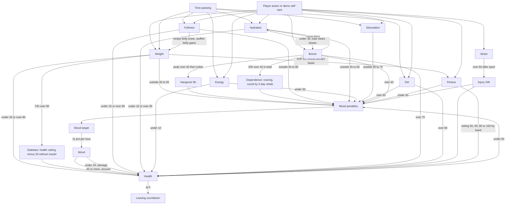
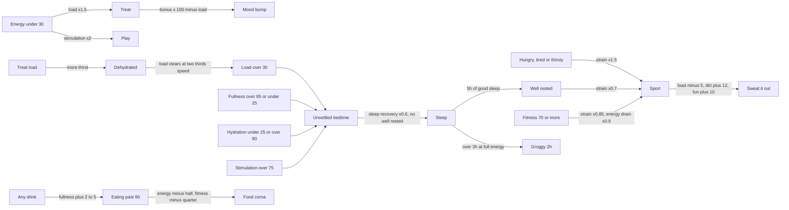
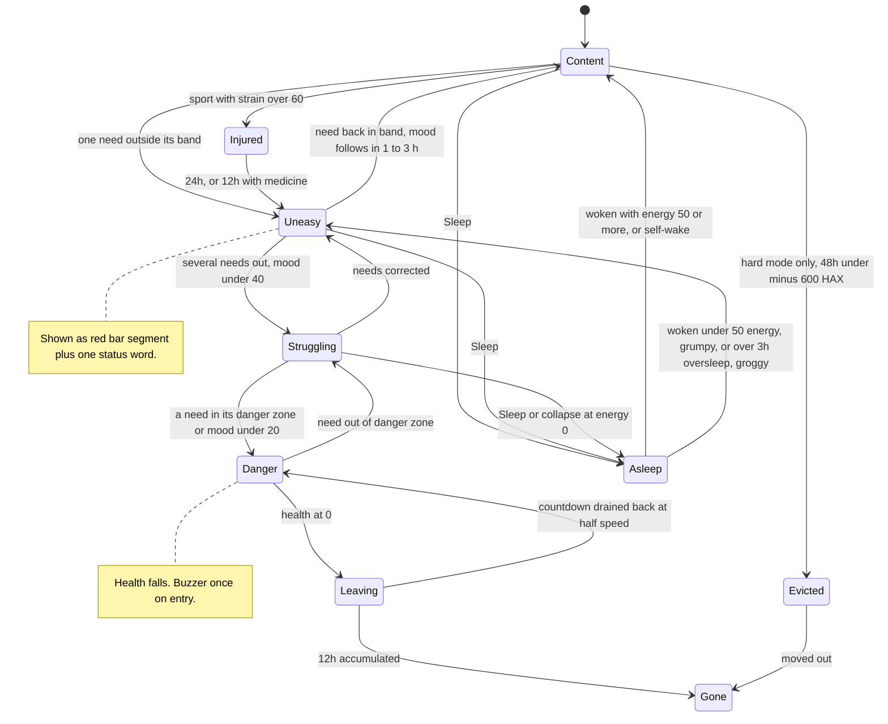
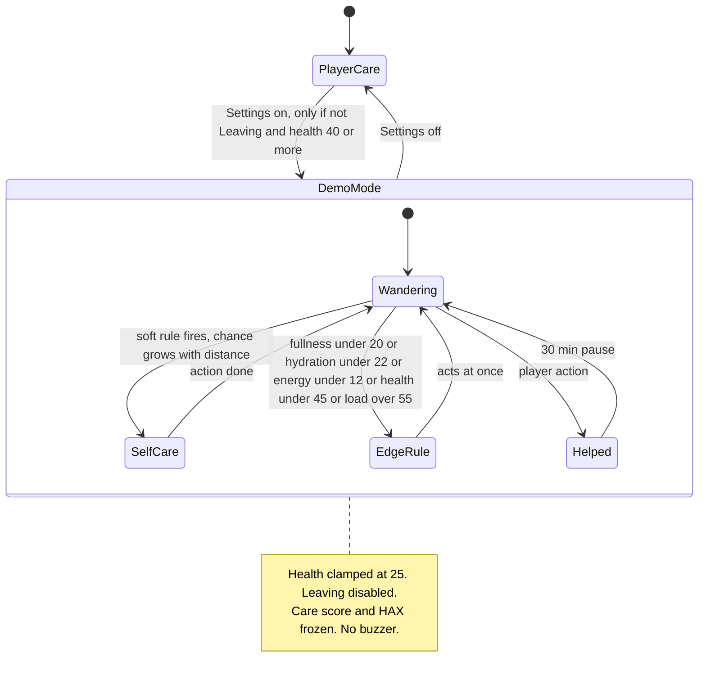
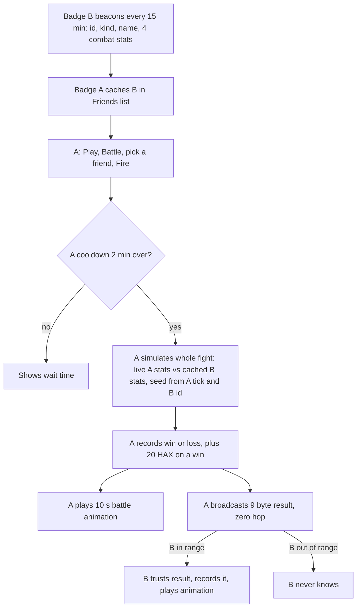
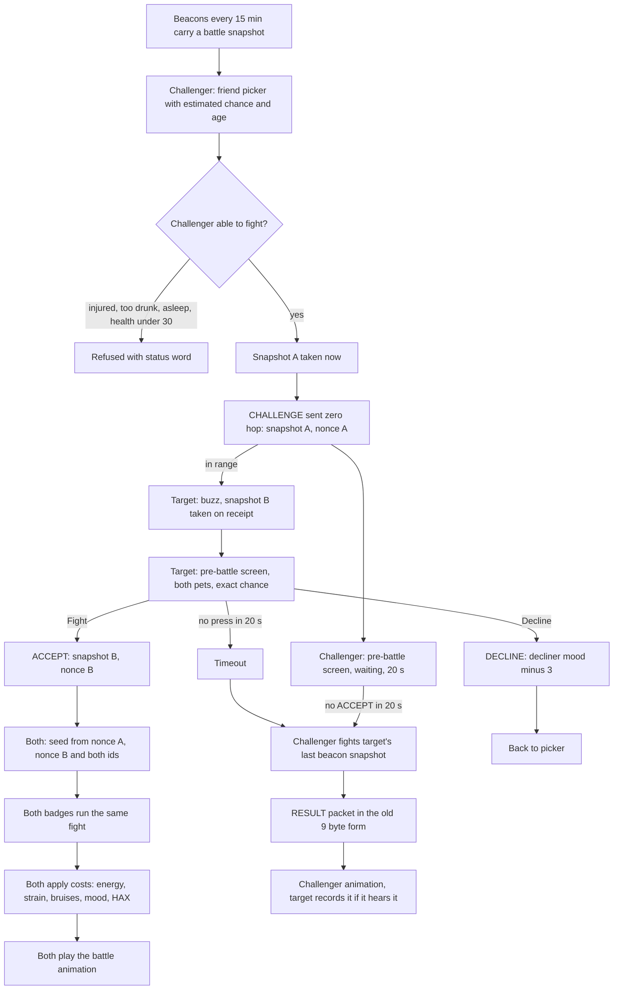

# BornPets design v2: comfort bands, trade-offs and a self-caring demo mode

Report only. Nothing in the repo was changed. The audit of the current rules is in `bornpets-game-rules.md` next to this file; this document replaces its section 6 (proposals).

The model was prototyped and tuned in a standalone integer-only Rust crate: `prototypes/bornpets-simv2/src/main.rs` (no dependency on the firmware engine, about 400 lines). Every number marked **(sim)** below is the value in that prototype and produced the result table in section 7. Everything marked **(guess)** has not been simulated.

**Current results are in section 18** (owner decisions of section 17 applied and re-simulated) and the NFC station format is in section 19.

**Earlier revision:** weight is now separate from fitness, booze separate from junk food, Rehab and Ozempic have new rules, Relax and injury remedies were added (section 15), and hard mode became a healthcare satire with debt and eviction (section 16). Sections 15 and 16 hold the current rules and result tables; 13.5 and earlier tables are kept as history.

**Engine constraint (owner):** the existing delta engine stays. Section 13 describes how the model runs on it, lists the boundaries, and holds the current result tables (step oracle against delta engine). Where sections 6 to 8 and 12.3 show older numbers, section 13.5 is authoritative.

Units: stats keep the existing `u16` scale, 0..65535, 655 = 1 %. In this document a stat is a **level** (100 % = full, rested, fit, and so on), which is the inverse of today's internal "bad-high" values. Rates are given per minute (6 engine ticks). The prototype has a one-minute step driver, kept as a test oracle, and a delta driver that advances one closed-form step per segment.

---

## 1. Design model

**One rule for the whole game:** every need has a comfort band. Inside the band the pet is content. Outside it, on either side, mood drops in proportion to the distance. Far outside, health takes damage. No action sets a stat to "good"; actions move a level by a dose, and a dose that overshoots the band is as bad as neglect.

**Three layers:**

| Layer | What | Speed | Changed by |
|---|---|---|---|
| Needs | fullness, hydration, energy, stimulation, cleanliness, treat load, strain, fitness | minutes to hours | time and actions |
| Mood | one value that follows a target computed from the needs | about 11 % per hour | never set directly (small instant bumps from treats only) |
| Health | slow result of where the needs and mood have been | 10 to 30 % per day | time in danger zones, time in good mood, a little by medicine |

Mood cannot be fixed with one press because it only drifts toward its target. Health cannot be fixed with one press because it recovers at most 31 % per day and only while mood is good.

### Stats: reused, re-meant, added, removed

| v2 need | Existing field | Change |
|---|---|---|
| **Fullness** | `hunger` | inverted, and now two-sided: too full is a state too |
| **Energy** | `tired` | inverted; sleep recovers it slowly; oversleep exists |
| **Mood** | `miserable` | inverted; becomes an output that follows a target |
| **Health** | `sick` | inverted; slow; capped by fitness |
| **Fitness** | new field | condition, changes over days; raised by sport and active play, lowered by inactivity, Relax, and carrying excess weight |
| **Weight** | `weight` | body mass, its own two-sided stat (15.2); raised by junk, cake, cola, overeating; lowered by sport and an empty belly |
| **Booze** | `drunk` | alcohol only (15.3). Junk food and cake give a mood bump with a 3-hour tolerance timer and add weight instead |
| **Hydration** | none | **new**. Thirsty below, waterlogged above. Follows from having drinks in the game |
| **Stimulation** | none (can take the unused `cooldown_relax` slot) | **new**. Boredom below, overstimulation above |
| **Strain** | none | **new**, short-lived. Sport load; too much at once is an injury |
| **Cleanliness** (stored as dirt) | none | **new**. The classic hygiene need |
| Timers: well-rested, injured, groggy, oversleep, sleep minutes | none | **new** small counters |
| `diabetic`, `alcoholic`, `overweight_ticks`, `drunk_ticks` | kept | become chronic conditions fed by the new levels (section 4, guess) |
| Money, traits, wins, generation, age | kept | unchanged |
| Action cooldowns (`cooldown_feed`, `cooldown_heal`, `cooldown_play`, ...) | kept in the struct | no longer the limiter. Only the action animation time blocks a repeat. Medicine keeps a real cooldown |

Nothing is removed from the save layout. The freeze of a stat during its action cooldown (audit P2) is removed.

### Integer math

All curves are piecewise linear with two or three segments: `if level < LO { (LO - level) * num / den }`. Multipliers are percent integers applied as `rate * m / 100`. The only division is by constants. No floats, no tables larger than the five foods and five drinks. One update step is about 60 integer operations.

**The delta engine stays.** Every rule in this document is piecewise linear with thresholds, which is what `update()` and `next_wake_tick()` need. Section 13 gives the boundary list and the four rules that were simplified to fit. An earlier draft proposed a one-minute step loop; that is withdrawn.

---

## 2. Curves per need

All values **(sim)** unless marked.

### 2.1 Passive rates (per minute)

| Need | Awake | Asleep | In plain terms |
|---|---|---|---|
| Fullness | -54 | -30 | 100 % empties in 20 h awake; a night costs about 22 % |
| Hydration | -45 times the thirst step | -20 times the thirst step | a 16 h day costs 66 %, a night 15 %. Thirst step by treat load: under 15 % times 1.0, 15 to 40 % times 1.1, 40 to 70 % times 1.25, over 70 % times 1.4 |
| Energy | -36 (times multipliers, section 3) | +120 times sleep quality | a 16 h day costs 53 % before actions; 0 to 100 % takes 9 h of good sleep |
| Stimulation | -40 | -90 down to 40 %, then holds | a 16 h day costs 59 %; the pet settles while asleep but does not get bored |
| Dirt | +8 | +8 | 17 % per day from time alone |
| Treat load | -36, or -24 while dehydrated | same | 79 % per day (same as today's `DRUNK_SOBER_RATE`); one beer clears in 4.5 h, or 7 h on a thirsty pet |
| Strain | -80 | -80 | one sport session (35 %) clears in 4.8 h |
| Fitness | -4 above 50 %, -2 from 25 to 50 %, -1 below 25 % | same | 8.8 % per day when fit, slower when already unfit |

### 2.2 Bands and penalties

Mood target = 100 % minus the sum of the penalties below, floored at 0. Mood moves toward the target by at most 120 per minute (11 % per hour).

| Need | Comfort band | Low side | High side | Health danger zone |
|---|---|---|---|---|
| Fullness | 35 to 80 % | hungry: 1.5 mood points per point below 35 | stuffed: 1 per point above 80 | below 15 %: -40/min (100 % in 27 h). Above 95 %: -8/min |
| Hydration | 35 to 85 % | thirsty: 1.5 per point below 35 | waterlogged: 1 per point above 85 | below 15 % (parched): -40/min. Above 95 %: -8/min |
| Energy | 30 % and up | tired: 1.5 per point below 30 | oversleep, see 2.4 | below 10 % awake: -8/min. At 0 the pet collapses asleep and loses 3 % health |
| Stimulation | 30 to 75 % | bored: 1 per point below 30 | overstimulated: 1.5 per point above 75 | none directly |
| Dirt | 0 to 60 % | washing a clean pet (dirt under 25 %) annoys it: mood -10 | dirty: 1 per point above 60 | above 85 %: -10/min |
| Booze (alcohol only, 15.3) | 0 to 40 % | none; the benefit is the tipsy bonus | sloppy: 1 per point above 40; a hangover follows next day | above 70 %: -40/min |
| Weight (15.2) | 35 to 65 % | underweight: 0.5 per point below 35 | overweight: 0.5 per point above 65 | below 20 %: -10/min. Above 80 %: -4/min and the diabetes counter |
| Strain | 0 to 60 % | none | above 60 % after a sport session: injury | injury: -5 % health once, 24 h no sport or play, mood target -20 |
| Fitness | 40 % and up | sluggish: 0.5 per point below 40 | none | caps health in four steps, see section 4 |
| Health | 50 % and up | 1 per point below 50 | | 0 %: Leaving |
| Groggy flag | | | mood target -10 for 2 h | |

Worked example: fullness 20 %, everything else in band. Penalty (35 - 20) * 1.5 = 22, mood target 78 %. Add stimulation 10 %: another 20, target 58 %.

### 2.3 Actions as doses

| Action | Effect (percentage points) |
|---|---|
| Salad | fullness +20, hydration +8, fitness +1, dirt +10 |
| Apple | fullness +25, hydration +8, dirt +10 |
| Frikandel | fullness +35, weight +2, mood +6 (junk tolerance), dirt +10 |
| Pizza | fullness +40, weight +2, mood +8 (junk tolerance), dirt +10 |
| Cake | fullness +10, weight +3, mood +15 (junk tolerance), dirt +5 |
| Water | hydration +30, load -5, fullness +4 |
| Cola | hydration +20, fullness +4, mood +3, energy +8, weight +1; no booze |
| Beer / Wine / Whiskey | hydration +15 / +8 / 0, fullness +5 / +2 / 0, treat (mood +12 / +15 / +20, energy +5, load +15 / +20 / +30), stimulation +5 |
| Play now | stimulation +25, energy -5, fullness -3, hydration -4, fitness +2, dirt +3 |
| Mini-game, grade 0 to 3 | stimulation +10 + 7 per grade, energy -3 |
| Meeting a friend | stimulation +15 |
| Sport | fitness +12, strain +35, energy -10, fullness -8, hydration -12, stimulation +10, load -5, dirt +12. If strain ends above 60 %: injury instead of the fitness gain |
| Wash | dirt -70 |
| Sleep / Wake | section 2.4 |
| Medicine | health +10; on an injured pet instead 12 h off the injury and booze +10; cooldown 4 h |
| Relax | stimulation -25, strain -15, energy +3, fitness -1 |
| Insulin / Ozempic / Rehab | see 15.4 |

**Eating has no refusal and no cooldown.** Anything above 80 % fullness is "excess": the pet loses energy equal to half the excess (food coma) and gains weight equal to a quarter of it. Two pizzas on a half-full pet put it at 100 %, cost about 10 % energy and 5 % fitness, and leave it stuffed for hours.

**Alcohol and thirst.** A beer carries some fluid (+15) but its load makes the pet lose water faster for hours and, once the pet is thirsty, the load itself clears a third slower. Beer is a net gain in water at low load and a net loss when stacked; wine barely hydrates; whiskey not at all. Salty junk food works the same way through the shared treat load.

**Drinks take belly space.** Every drink except whiskey adds 2 to 5 points of fullness. Three waters and a full meal overshoot the fullness band.

**Treats have diminishing returns (tolerance).** The mood and energy part of a treat is multiplied by (100 - current load) %. First beer of the day: mood +12. A beer on 60 % load: +4.8. The load it adds is never reduced. So a little helps and a lot only harms.

**Medicine (guess):** giving it to a pet above 80 % health adds 10 % treat load instead of health. Do not medicate a healthy pet.

**Work, battle (guess, not simulated):** Only pets: +25 HAX, energy -15, stimulation +10, mood target -5 for 1 h. Battle: stimulation +20, energy -10, strain +15.

### 2.4 Sleep (replaces the rejected fixed 6 h timer)

- **Sleep** puts the pet to bed. It stays asleep until a button press that performs a care action, or the explicit **Wake up** item. There is no timer the player has to wait out.
- **Looking does not wake it.** Stats, health screen, friends list and mini-games are available while it sleeps. Mini-games played while the pet sleeps are for the player only: no stimulation, no HAX.
- **Recovery** is +120/min times sleep quality. From a normal bedtime level of 30 % a full recovery takes about 6.5 h. A 1 h nap gives +11 %.
- **Grumpy wake:** waking the pet while energy is under 50 % costs 10 % mood. A nap taken at 45 % that reaches 55 % can be ended for free; a pet put to bed at 15 % needs about 3 h before it can be woken without a grumble. This replaces the "under 1 h" rule with one the player can read from the energy bar.
- **Oversleep:** minutes asleep at 100 % energy count as oversleep. More than 3 h of it makes the pet groggy on waking (energy -10, fitness -2, mood target -10 for 2 h). The counter resets only once energy has dropped below 85 % again, so repeatedly re-sending a rested pet to bed adds up.
- **Self-wake:** after 12 h in bed or 4 h of oversleep, whichever comes first. A pet put to bed at midnight with 30 % energy wakes by itself around 10:30.
- **Well rested:** 5 h or more of full-quality recovery in one sleep gives a "well rested" state for 16 h (sport sweet spot raised, section 3).
- **Collapse:** at 0 % energy the pet falls asleep on its own and loses 3 % health.

Sleep optimum in practice: about 6.5 to 9.5 h in bed. Less leaves the next day short of energy; more makes it groggy.

---

## 3. Interaction matrix

Thirteen rules. Each is one `if` in the engine and one line in the player docs. All **(sim)**.

| # | When | Effect | Type | What it asks of the player |
|---|---|---|---|---|
| 1 | Sport while hungry (fullness under 35 %), tired (energy under 30 %) or thirsty (hydration under 35 %) | strain gain times 1.5 | amplifies risk | eat, drink and rest before sport |
| 2 | Well rested | strain gain times 0.7 | counteracts | a good night allows a second session |
| 3 | Fitness 70 % or more / under 40 % | energy drain times 0.9, strain times 0.85 / energy drain times 1.25 | long-term amplifier | fitness makes every day easier |
| 4 | Treat load | treat bonus times (100 - load) %; above 40 % energy drain times 1.5 and mood penalty; above 70 % health damage | dose-response | one or two treats a day, spaced |
| 5 | Treat while tired (energy under 30 %) | load gained times 1.5 | amplifies | a nightcap on an exhausted pet hits hard |
| 6 | Unsettled at bedtime: load over 30 %, fullness over 85 % or under 25 %, hydration under 25 % or over 90 %, or stimulation over 75 % | sleep recovery times 0.6, and that sleep does not count toward well rested | amplifies | last beer and last game well before bed; no big meal at bedtime |
| 7 | Stimulation while tired (energy under 30 %) | stimulation gain doubled. Above 75 % stimulation: energy drain times 1.5 | amplifies | playing with an exhausted pet overstimulates it |
| 8 | Overeating (above 80 %) | energy minus half the excess, fitness minus a quarter | counteracts spam | meals sized to the gap |
| 9 | Sport and Water | load -5 each. Sport also gives stimulation +10, dirt +12 and costs 12 % hydration | counteracts | sweat out a hangover, then drink; sport means a wash |
| 10 | Oversleep over 3 h | groggy 2 h | two-sided sleep | do not park the pet in bed |
| 11 | Treat load | water loss times 1.1 / 1.25 / 1.4 from 15 / 40 / 70 % load | amplifies | junk and alcohol make thirsty |
| 12 | Dehydrated (hydration under 35 %) | treat load clears at two thirds speed | amplifies | a hangover on a dry pet lasts half as long again: water with the beer |
| 13 | Any drink | fullness +2 to +5 | counteracts spam | drinks and meals share the belly; drink between meals |

Chains the player will discover: beer at 23:00 then bed gives poor sleep, no "well rested", so tomorrow's sport is riskier and the pet tires earlier. Two sport sessions need a bigger lunch, which is safe only because sport burned the fullness. A cake cheers a bored pet now but the next treat is worth less.

---

## 4. Wellbeing and long-term health

**Mood (now).** Follows the target from section 2.2. A pet with every need in band reaches 100 % within a few hours. One need slightly out costs 10 to 20 points; two or three out puts it at 40 to 60 %.

**Health (weeks).** Per minute **(sim)**:

- Damage: the danger zones in section 2.2, plus -10/min while mood is under 20 %.
- Recovery: +14/min (31 % per day) while mood is 60 % or more; +5/min (11 % per day) while mood is 40 to 60 %; none below 40 %.
- **Fitness ceiling:** health cannot recover above a cap set by the fitness band: under 25 % fitness the cap is 55 %, 25 to 50 % gives 65 %, 50 to 70 % gives 80 %, 70 % and up gives 100 %. An unfit pet tops out at 55 % health and has little reserve when something goes wrong. Health above the ceiling drifts down to it at 3/min.
- Net of both: a pet in a danger zone but otherwise cheerful loses slowly; a miserable one loses fast.

**Leaving.** Only health at 0 % starts the leaving countdown. It runs 12 h, and it drains back at half speed while health is above 0 (the audit's proposal I5), so one press no longer cancels it. Gone after 12 accumulated hours.

**Slow recovery from mistakes.** A pet starved to 20 % health needs about 3 good days to be back at 100 %. A pulled muscle takes a day. A hangover takes 4 to 8 hours. A lost fitness level takes about a week of daily sport. None of these has a shortcut: medicine gives +10 % health per 4 h.

**Care score (guess).** Two counters: awake minutes, and awake minutes with mood at 60 % or more. Their ratio is the pet's care score, shown in Health status and stored in the Unicorn Realm. It feeds:

- Growth forms at age 12 h and 2 days (the audit's I13): score over 85 % "Star", 60 to 85 % "Regular", under 60 % "Rascal". Text title first; sprites only if the art budget allows.
- Lifespan: none. A well-kept pet lives as long as the player keeps it; the score is the bragging right.

**Chronic conditions (guess).** Fitness under 25 % for 72 h in total: diabetic, health ceiling -20 % unless Insulin was given in the last 8 h. Treat load over 70 % for 12 h in total: dependent, load decays at half speed and treat bonuses are halved unless Rehab was given in the last 12 h. Both replace the 17-minute sick cliff of the current code.

**Traits (guess).** Vitality: health recovery times 0.8 to 1.2. Curiosity: stimulation decay times 0.8 to 1.2 (a curious pet bores faster). Resilience: width of every comfort band plus or minus 5 points.

---

## 5. Feedback: reading the pet

The player must be able to find the optimum by looking, not by reading a table.

1. **Bars with a band, on a two-page stats view (approved by the owner).** `stat_bar.rs` draws each bar with two small bracket ticks marking the comfort band; the fill is black inside the band and **red outside it** (the panel has red). The existing popover (`modal.rs` `draw_stats_view`, line 985: 132 x 132, margin 10, border 2, title 18 px, bars 15 px high at 15 px pitch, 60 px label column, 60 px bar, name / generation / age footer) holds five bars, so the nine v2 values go on two pages.

   - **Page 1 "Needs"** (what to act on now): Full, Water, Energy, Fun, Clean. Exactly five bars at today's geometry.
   - **Page 2 "Body"** (slow results): Health, Fit, Weight, Booze, Mood as five bars at the same geometry as page 1, then one condition line (the two most pressing of injured, hung over, groggy, well rested, diabetic, dependent, in rehab, uninsured, overdue) and the care score in the footer row. It grows out of today's `health_view.rs` (condition rows plus Fit and Sober bars).
   - **Left / Right** flips the page, the title bar shows `1/2` or `2/2`, one partial refresh per flip. Fire and Cancel behave as today.
   - **The separate Health status menu entry goes away.** Page 2 carries everything it showed (conditions, Fit, the old Sober bar as Treats). Its remaining lines, the battle record and the "Neglect -> permanent" explanation, move to the Friends / Battle screen and to the docs. One screen fewer to maintain; if the owner prefers to keep the entry, it can simply open the stats view on page 2.
   - Mood stays visible on the main screen through the status line, so it does not need to be on page 1.
   - Strain is not a bar: it shows as the `sore` / `injured` condition line and as a small mark at the end of the Fit bar.
   - **Fallback, not the plan:** a single page of eight thin bars (about 8 px high, no number). Documented only in case two pages test badly.

   Mock-up at real geometry (132 x 132 popover, one character is about 7 px wide, one text row 15 px). `[` and `]` are the band ticks; `#` is black fill, `!` is red fill outside the band.

   ```text
   +------------------------------------+   y = 10   popover edge (2 px border)
   | Needs                          1/2 |   title bar, 18 px
   +------------------------------------+
   | Full    ####[######]....   62      |   bar row 1, y = 32
   | Water   !!!.[......]....   21      |   bar row 2  (red: thirsty)
   | Energy  ####[#######...    71      |   bar row 3  (band has no upper tick)
   | Fun     ####[####..]....   48      |   bar row 4
   | Clean   ####[#########]    90      |   bar row 5, y = 92  (shown as cleanliness)
   |                                    |
   | Bram  Gen 2 | 3d 4h                |   footer, as today
   +------------------------------------+   y = 142
     label 60 px   bar 60 px   value

   +------------------------------------+
   | Body                           2/2 |
   +------------------------------------+
   | Health  ##########]....    64      |   ] = ceiling set by fitness (and diabetes)
   | Fit     ####[#.........    31      |   red below the 40 % tick
   | Weight  ....[#####]!!..    72      |   band 35 to 65; red past it
   | Booze   ####....[......    28      |   tick at 40 %: fill past it is red
   | Mood    ##########....     71      |
   | hung over   in rehab               |   two most pressing conditions
   | Bram  Care 82 % | 3d 4h            |   footer: care score replaces generation here
   +------------------------------------+
   ```

   Page 2 uses five bar rows like page 1, one condition row in the gap above the footer, and puts the care score in the footer; if more than two conditions are active the line shows the two most pressing and a `+1`.
2. **One status line under the pet** (replaces the corner banners): the single largest penalty, as a word, with a second word if two are large. Vocabulary: `peckish`, `hungry`, `starving`, `stuffed`, `thirsty`, `parched`, `waterlogged`, `sleepy`, `exhausted`, `groggy`, `bored`, `wired`, `grubby`, `filthy`, `tipsy`, `hung over`, `sore`, `injured`, `unfit`, `poorly`, and when nothing is out: `content`, or `well rested`. Black text; red only for health danger zones.
3. **Sprites that already exist** for the main conditions: Warning/Critical hungry, tired, sick, Warning miserable, Happy, Idle, plus all action animations. Stuffed, wired, grubby and hung over have no art; the status line carries them (see 8.3 for the art list).
4. **Toasts that name the cause.** After an action the toast says what happened and why when a rule fired: `food coma`, `pulled a muscle: sport while hungry`, `grumpy: woken too early`, `restless night: late beer`, `barely felt that one` (treat at high load), `annoyed: not dirty`, `sloshing` (drink on a full belly), `still hung over: needs water`. This is how the interaction rules are taught.
5. **Menu hints.** Menu rows get a short suffix when the pet's state makes the item a poor choice: `Pizza (full)`, `Water (not thirsty)`, `Beer (thirsty)`, `Exercise (sore)`, `Exercise (hungry)`, `Exercise (thirsty)`, `Beer (3rd today)`, `Wash (clean)`, `Play (sleepy)`. The item still works; the hint is a warning, not a lock.
6. **Diary screen** under Stats: the last 6 cause-and-effect events with their age (`2h ago: restless night, late beer`). Costs 6 bytes of RAM per entry; need not be saved.
7. **Buzzer** only when a need enters a health danger zone, not at band edges.

All of this is text and bar drawing on existing screens. No new buttons. Each press still causes one partial refresh.

---

## 6. Several viable paths

Simulated for 30 days each (section 7). Each routine has one or two "look at the bar first" rules, as a person would. In all of them the player gives water at a check-in whenever hydration is under 55 % (two waters if under 25 %); that habit is included in the press counts.

**A. Balanced** (about 12 to 13 presses a day)
08:00 wake, apple. 10:30 play. 13:00 apple. 15:30 sport. 18:00 wash. 18:30 pizza. 20:30 mini-game, one beer. 23:30 salad if under 55 % full, sleep.
Result: mood 98 % average, fitness 96 %, health 98 %, 12.5 presses a day. Often slightly groggy from 8.5 h in bed.

**B. Sporty** (about 14 presses)
07:30 wake, apple and salad. 09:30 sport. 12:30 wash if grubby, pizza. 16:30 sport. 17:00 wash. 18:30 apple (plus salad if under 45 %). 20:30 play. 22:30 sleep. No treats beyond the lunch pizza.
Result: mood 90 %, fitness 96 %, health 98 %, never injured, well rested every day. Trade-off: two washes, the most water and the largest food bill; stimulation runs low because sport replaces play.

**C. Lazy with treats** (about 11 presses)
10:00 wake, pizza. 14:00 cake and cola. 16:00 sport every second day, otherwise play. 19:00 pizza or frikandel. 21:30 wash if grubby, mini-game. 01:00 sleep (9 h in bed).
Result: alive and stable, mood 68 %, but fitness bottoms out at 3 %, so health is capped at about 51 %; groggy 11 times in 30 days. A viable pet with no reserve.

**D. Party animal** (about 13 presses; sleeps 03:00 to 11:00)
11:00 wake, wash if grubby, water, frikandel. 14:00 sport every second day, otherwise apple. 16:30 beer with a friend. 19:00 pizza. 21:00 beer with a friend. 23:30 mini-game. 01:30 water, apple if peckish. 03:00 sleep.
Result: mood 77 %, the best-stimulated pet, fitness 0 %, health capped at 50 %. Two beers a day spaced 4.5 h apart need water alongside; with hydration in the model this path lost ground (it was mood 85 %, fitness 23 % before) because sport on a dry pet does less and the load lingers.

**E. Reader** (reactive: five check-ins, picks by what the bars show)
Result: mood 98 %, health 95 %, fitness 91 %, 12.8 presses a day. Reading the pet matches or beats every fixed plan.

**Spam and neglect, same model:**

| Player | What happens |
|---|---|
| Pizza every 30 min | permanently stuffed, food coma, fitness 0: gone on day 1.2 |
| Play every 30 min | wired and exhausted: gone on day 1.7 |
| Sport every 30 min | injured on the second press, three injuries: gone on day 2.9 |
| Beer every 30 min | load above 70 % within hours: gone on day 1.4 |
| Cake every 30 min | gone on day 1.2 |
| Water every 30 min | waterlogged and stuffed from the belly rule: gone on day 2.1 (too harsh, see 7.3) |
| Wash every 30 min | constant annoyance: gone on day 2.5 (too harsh, see 7.3) |
| Never drinks, otherwise balanced | parched within a day: gone on day 2.2 |
| Sleep every 30 min | alive but groggy 29 times, fitness 0, health 49 % |
| Old habit: top every bar up at each check-in | 10 injuries, mood 46 %: gone on day 13.5 |
| 4.5 h of sleep a night, otherwise balanced | declines, gone on day 11.4 |
| Twice a day, big meals, two waters | alive, mood 73 %, fitness 1 %, health 50 % |
| Once a day | gone on day 2.0 |
| Absent | gone on day 1.7 |
| Neglect plus medicine every 30 min | gone on day 3.0: medicine does not replace care |

---

## 7. Simulation

### 7.1 Setup

`prototypes/bornpets-simv2`, run with `cargo run --offline -q`. Integer math only, 30 days. Every run is done twice, once with the one-minute step oracle and once with the delta driver, and printed side by side. Actions are instant, actions are instant, start state: fullness 60, hydration 65, energy 80, stimulation 50, fitness 60, dirt 10, mood 70, health 85. Player routines are deterministic. Demo runs use a xorshift32 PRNG with different seeds.

### 7.2 Results before the delta-engine rework

Kept for the record of how hydration changed things. **Current numbers are in 13.5.**

| Routine | Outcome | Avg mood | % time mood 60+ | End health | Min health | End fitness | Presses/day | Injuries | Groggy | Grumpy wakes |
|---|---|---|---|---|---|---|---|---|---|---|
| Balanced | alive | 98 | 99 | 98 | 78 | 96 | 12.5 | 0 | 12 | 0 |
| Sporty | alive | 90 | 100 | 98 | 84 | 96 | 13.8 | 0 | 0 | 0 |
| Lazy with treats | alive | 68 | 68 | 51 | 44 | 3 | 11.1 | 0 | 11 | 0 |
| Party animal | alive | 77 | 87 | 50 | 48 | 0 | 12.8 | 0 | 0 | 0 |
| Reader (reactive) | alive | 98 | 100 | 95 | 82 | 91 | 12.8 | 0 | 3 | 0 |
| Short sleeper (4.5 h) | gone day 11.4 | 60 | 53 | 0 | 0 | 0 | 10.9 | 0 | 0 | 20 |
| Spam pizza | gone day 1.2 | 18 | 18 | 0 | 0 | 0 | 36.6 | 0 | 0 | 26 |
| Spam play | gone day 1.7 | 14 | 10 | 0 | 0 | 99 | 52.6 | 0 | 0 | 32 |
| Spam sport | gone day 2.9 | 33 | 30 | 0 | 0 | 14 | 12.9 | 3 | 0 | 30 |
| Spam beer | gone day 1.4 | 27 | 25 | 0 | 0 | 11 | 43.2 | 0 | 0 | 15 |
| Spam cake | gone day 1.2 | 19 | 18 | 0 | 0 | 0 | 46.5 | 0 | 0 | 27 |
| Spam water | gone day 2.1 | 25 | 13 | 0 | 0 | 0 | 45.4 | 0 | 0 | 26 |
| Never drinks (else balanced) | gone day 2.2 | 40 | 27 | 0 | 0 | 66 | 8.9 | 0 | 0 | 1 |
| Spam sleep | alive | 67 | 86 | 49 | 47 | 0 | 13.0 | 0 | 29 | 0 |
| Spam wash | gone day 2.5 | 23 | 12 | 0 | 0 | 0 | 43.7 | 0 | 0 | 20 |
| Old habits (max all bars) | gone day 13.5 | 46 | 25 | 0 | 0 | 0 | 18.8 | 10 | 0 | 20 |
| Neglect + spam medicine | gone day 3.0 | 24 | 24 | 0 | 0 | 40 | 10.1 | 0 | 0 | 52 |
| Twice a day | alive | 73 | 85 | 50 | 45 | 1 | 10.2 | 0 | 0 | 0 |
| Once a day | gone day 2.0 | 45 | 42 | 0 | 0 | 48 | 4.3 | 0 | 0 | 1 |
| Absent | gone day 1.7 | 28 | 26 | 0 | 0 | 48 | 0.0 | 0 | 0 | 0 |

Demo mode (section 8), 30 days:

| Run | Thriving (mood 80+) | Fine (60-79) | Off (40-59) | Poorly (20-39) | Miserable | Self-care actions/day | Player presses/day | Min health | End health | Hours in Leaving |
|---|---|---|---|---|---|---|---|---|---|---|
| Demo alone, seed 1 | 55 % | 37 % | 6 % | 0 % | 0 % | 13.1 | 0 | 67 | 72 | 0 |
| Demo alone, seed 2 | 61 % | 32 % | 5 % | 0 % | 0 % | 13.0 | 0 | 66 | 86 | 0 |
| Demo alone, seed 3 | 64 % | 30 % | 4 % | 0 % | 0 % | 12.9 | 0 | 59 | 85 | 0 |
| Demo alone, seed 4 | 57 % | 36 % | 5 % | 0 % | 0 % | 12.6 | 0 | 68 | 78 | 0 |
| Demo alone, seed 5 | 55 % | 37 % | 6 % | 0 % | 0 % | 13.2 | 0 | 65 | 81 | 0 |
| Demo + one player look a day, seed 1 | 58 % | 33 % | 7 % | 0 % | 0 % | 11.4 | 1.0 | 65 | 86 | 0 |
| Demo + one player look a day, seed 2 | 56 % | 35 % | 7 % | 0 % | 0 % | 11.9 | 1.0 | 64 | 71 | 0 |

No demo run reached Leaving, and none came near the 25 % safety clamp (lowest health seen: 59 %).

### 7.3 What the simulation shows, and its limits

- The four routines and the reactive reader are viable with different end states. Every single-button spam is worse than any balanced routine. Neglect ends the pet in about 2 days.
- A player needs 11 to 14 presses a day, against about 15 feeds plus everything else today. Hydration added about 1.5 to 2.5 of those (two to three waters).
- **Hydration cost the indulgent paths most.** Party animal went from mood 85 %, fitness 23 %, health 61 % to mood 77 %, fitness 0 %, health 50 %. The top-every-bar-up player went from alive to gone on day 13.5, and the short sleeper from day 15.3 to day 11.4. Balanced, sporty and reactive players are unchanged or better. This is the intended direction (drink has a second price), but the party path may now be too narrow; not retuned.
- **Spam water kills in 2 days**, mostly through the belly rule (48 waters a day is +190 % fullness). Too harsh for a harmless mistake; cap the belly effect or make a waterlogged pet refuse to drink. Not yet tuned.
- **Lazy with treats sits at fitness 3 %.** It is stable only because of the health ceiling. If the owner wants a comfortable lazy path, sport every second day must be enough to hold about 30 % fitness; that needs junk food's fitness cost removed or the low-fitness decay set to 0. Not yet tuned.
- **Spam wash kills the pet** (day 2.5), which is too harsh for a harmless mistake. The annoyance should have its own 30-minute cooldown or shrink on repeats. Not yet tuned.
- **Balanced is groggy 12 nights in 30** from 8.5 h in bed. Either the 3 h oversleep allowance should be 4 h, or this is the intended "8 h is slightly too long" lesson. Owner's call.
- **The daily helper made no measurable difference** to the demo pet (and woke it early a few times). The demo policy already catches what the helper would fix. See open question 8.
- Mood for a balanced player is often at 100 %. If "always happy" is too easy for an attentive player, narrow the bands by 5 points; not done here.
- Not in the simulation: money and prices, work, battles, chronic conditions, medicine overuse, traits, growth forms, Casual preset, action durations, the buzzer, and anything about display or battery.
- Player routines were run with one starting state and no randomness. Real players are noisier; the port into `engine/sim.rs` (section 10, phase 0) should add jitter of plus or minus 30 minutes to every check-in.

---

## 8. Demo mode: the pet that looks after itself

Owner's intent: a companion that lives on the desk, covers all of its own needs, is not always happy, never reaches Leaving, is pleasant to watch without being distracting, and can still be helped.

### 8.1 Policy

Same engine, same bands, same actions. Demo mode adds one function, `demo_policy`, evaluated **only at engine events** (a boundary, a timer, the end of an action, a player press). There is no periodic poll. State: six scheduled times, one flag, one `u8` temperament value, and the existing xorshift PRNG (`platform::xorshift32`, seeded once from the TRNG). All **(sim)**; the scheduling is described in 13.3.

Every 6 hours (a timer) the pet draws a temperament `lz` from 0 to 15. It shifts all its thresholds: a high value is a lazy, sloppy half-day; 0 is a diligent one. This is what makes its condition wander.

Order of checks, first match wins:

| Step | Condition | Action |
|---|---|---|
| asleep, napping | nap end time reached (40 to 100 min) | wakes |
| asleep | fullness under 18 %: at once. Energy reaches 97 %: after a delay of 10 to 120 min drawn once | wakes |
| **edge** | fullness under 20 % | eats a pizza, at once |
| **edge** | hydration under 22 % | drinks water, at once |
| **edge** | energy under 12 % | goes to sleep, at once |
| **edge** | health under 45 % and medicine available | takes medicine, at once |
| **edge** | treat load over 55 % | does nothing but drink water, every 20 to 60 min |
| soft | first true of: hydration + lz under 45 %; fullness + lz under 33 %; energy + lz/2 under 24 %; dirt - lz over 62 %; stimulation + lz under 24 % with energy over 25 % and not injured | one delay of 10 to 90 min is drawn when a soft condition first becomes true; when it runs out the pet acts on the first true condition: drinks (water 70 %, cola 20 %, beer 10 %, cola instead if load is over 15 %), eats (apple 40 %, salad 15 %, pizza 25 %, frikandel 12 %, cake 8 %, and a 15 % chance of a cake on top), sleeps, washes, or plays (30 % of those a self-played mini-game) |
| soft | fitness under 70 %, strain under 15 %, energy over 45 %, fullness over 40 %, hydration over 38 %, not injured | exercises after a delay of 1 to 6 h drawn once |
| whim | own timer, redrawn at 3 to 13 h | load under 15 %: a beer or a cake. Load 15 to 45 %: 35 % chance of one beer too many. Otherwise, if energy under 55 % and stimulation under 45 %: a nap |

The soft thresholds sit a few points **outside** the comfort bands on purpose: the pet reacts once it is already a little hungry, bored, tired or grubby. That, the temperament, and the whims give the measured spread of about 65 % thriving, 30 % fine, 4 % off (section 13.5).

It sleeps by its own energy, not by the clock, so it will sometimes be asleep in the afternoon and awake at night. If the owner wants it to keep office hours, add the badge clock to the sleep rule (open question 9).

### 8.2 The floor

Three layers, so "never Leaving" does not depend on tuning:

1. **Policy edge rules** (the four "always" rows) act before any health danger zone is reached: it eats at 20 % and drinks at 22 % (danger starts at 15 % for both), sleeps at 12 % (danger at 10 %), stops indulging at 55 % (danger at 70 %).
2. **Engine clamp:** while demo mode is on, health cannot go below 25 %.
3. **Leaving is disabled:** the leaving countdown does not run in demo mode.

In the five 30-day runs layer 1 alone was enough (minimum health 73 %); layers 2 and 3 never engaged.

Long-term effects still apply inside the floor: an unfit demo pet has a lower health ceiling, a pet with a hangover is hung over. The care score (section 4) is **not** counted while demo mode is on, and no care mistakes or growth-form changes are recorded.

### 8.3 How it looks on the desk

**Pacing.** About 12.5 self-care actions a day, so one visible event roughly every 2 hours on average, with stretches of 4 to 6 hours of sleep. Between events the screen is still.

- Demo mode uses a **calm idle**: the idle frame advances once every 5 minutes instead of every 10 seconds. Today the idle animation is the badge's largest battery consumer (FAQ.md: "wakes every few seconds"); this cuts display updates from about 8600 a day to about 300. **(guess; battery effect not measured)**
- A self-care action plays its existing animation for its frames at the normal 10 s rate (2 to 5 frames), then returns to calm idle. All partial refreshes.
- Full refresh (the flash) only when the pet goes to sleep or wakes, which doubles as ghost clearing, and at most once an hour otherwise.
- The engine wakes only at events: about 32 a day for a demo pet (12.5 self-care actions and about 19 status changes), plus a cap wake-up when nothing happens for 2 hours. See 13.4.

**Variety from existing sprites.** Every pet in `assets/to-badge` has these animation files today (frame counts differ per pet, 1 to 5):

| Moment | Existing animation |
|---|---|
| content | Idle `01`, Happy `02` |
| eats | Feeding `0C` |
| drinks water, cola or a beer | Drinking `25` |
| plays, self-played mini-game | Playing `0F` |
| exercises | Exercising `23` |
| sleeps, naps | Sleeping `10` |
| takes medicine | Healing `0D` / Medicating `24` |
| peckish / hungry | Warning hungry `09` / Critical hungry `05` |
| sleepy / exhausted | Warning tired `08` / Critical tired `04` |
| bored, off mood | Warning miserable `0B` |
| poorly | Warning sick `07` / Critical sick `03` |
| pottering about, a "hobby" surprise | Only pets `28` |
| lounging, bored-idle | Relaxing `0E`: files are still on the badge for all seven pets but no longer mapped in `anim_files.rs` |
| hung over, groggy | Critical/Warning drained `06` / `0A`: also still shipped and unmapped |

So demo mode needs **no new art** to be varied: it can use 16 existing animations, three of them currently orphaned. Whether the orphaned frames look right for their new meaning needs a look at the actual pictures; I checked that the files exist, not what they show.

**New art that would improve it** (per pet, 1 to 2 frames each): washing; stuffed; wired/overstimulated; injured (until then Critical sick stands in). Washing is the only action with no fitting stand-in; until it has art, show Relaxing `0E` with the toast "having a wash".

**Behaviour matches mood.** This falls out of the policy: tired pets nap instead of playing (play needs energy over 25 %), rested pets exercise, lazy half-days show more lounging and later meals. Small surprises: the whims (a cake, a beer, a nap), a self-played mini-game, and an occasional `Only pets` "hobby" moment used as a pure animation with no stat effect (1 % chance per check, guess).

**Tone.** One calm status line under the pet, black text, changing only when the state changes: `had an apple`, `had some water`, `napping`, `out for a run`, `fancied a beer`, `a bit bored`, `having a wash`, `one too many...`. No red, no toast pop-ups, **no buzzer and no LED** in demo mode. Single exception: if health drops under 35 % the line turns red and reads `could use a hand`; an optional single chirp for that is off by default.

### 8.4 Player help

- All normal actions work in demo mode at any time. Because the model has dose-response instead of cooldowns, there is nothing separate to share: the player's apple and the pet's own apple fill the same fullness level, a third treat is worth less whoever gave it, and overfeeding a pet that just ate causes a food coma. Medicine's 4 h cooldown is one shared counter.
- After any player action the policy **pauses for 30 minutes** (guess), so the pet does not immediately act on top of the player.
- The pet reacts visibly: the Happy animation and the line `thanks!` when the action moved a need toward its band; the normal cause toasts (`food coma`, `annoyed: not dirty`) when it did not.
- Helping is most useful on a lazy half-day, when the pet lets itself drift. The simulation's once-a-day helper did not change the averages, so this is a nicety, not a need (open question 8).

### 8.5 Rules around the mode

| Topic | Proposed rule |
|---|---|
| Switching | Settings menu item "Demo mode: on/off" on the game settings screen, plus a small `DEMO` tag where the HAX balance is drawn |
| Saved | Yes, one byte in the pet save, so a desk pet survives a reboot |
| HAX | Frozen. Self-care is free; nothing is earned. Player-initiated actions in demo mode are free too |
| Mini-games | Playable for fun. They give stimulation, no HAX |
| Friends / mesh | Beacons continue, with a flag bit so other badges can show "desk pet". Friend meetings give stimulation as normal |
| Battles | **Owner decision: a demo pet battles only other demo pets**, because a self-caring pet against a player-raised pet is not a fair fight. Normal pets and demo pets cannot challenge each other; see 12.5 |
| Age | Counts |
| Care score, growth forms, care mistakes | Not counted in demo mode. A pet that spent more than a quarter of its life in demo mode is recorded as "self-raised" in the Unicorn Realm |
| Cheating by switching | Demo cannot be turned on while the pet is Leaving or health is under 40 %: "fix me first". Turning it on overnight to dodge neglect is allowed, at the price that those hours do not count toward the care score and count toward "self-raised". Design choice: open question 7 |
| Hibernate | Still exists; demo mode is the living alternative to it |

---

## 9. Diagrams

### 9.1 How needs become mood and health



### 9.2 Interactions



### 9.3 Pet condition states



### 9.4 Play mode and demo mode



---

## 10. Implementation plan (for the fixer agent)

Each phase builds and is testable on its own.

**Phase 0. Port the prototype into the simulator. No firmware impact.**
Copy the model from `prototypes/bornpets-simv2/src/main.rs` into a new `src/game/engine/v2.rs` behind the `simulator` feature only: `rates`, `thresholds`, `seg_len`, `advance(dt)`, `update_to`, the actions and the demo policy. Keep both drivers: `advance(1)` per minute as the **test oracle**, and the delta driver. Port the routines as `Policy` implementations in `engine/sim.rs`, with check-in jitter. Tests in `tests/game_engine_v2.rs`: (1) delta against oracle for every routine, tolerance one point on mood, health, fitness and identical counts of injuries, except the knife-edge routine noted in 13.5; (2) the design targets (five routines alive at 30 days; every spam routine below every balanced routine on mood; absent gone before day 3; demo never Leaving over 5 seeds); (3) a wake-up budget: engine wake-ups per day for the balanced routine and for a demo pet must stay under fixed limits, so a later rule change that adds boundaries is caught.

**Phase 1. Tuning-only fixes that can ship before the new engine. No save change.**
These remove the worst of today's spam without the band model: Aspirine cooldown no longer suppresses the diabetes and alcoholism penalties (`engine/mod.rs:983`, `:1062`); `SICK_CONDITION_RATE`, `DIABETES_SICK_RATE`, `ALCOHOLIC_SICK_RATE` from 655 to 45 / 15 / 15; Only pets loses its mood bonus and its broke bonus (`engine/mod.rs:898`); mini-game reward only on a real win (`tictactoe.rs:162`, `bornjeweled.rs:117`); the wrong toast at `modal.rs:425`. Docs fixes from the audit's section 5.

**Phase 2. Engine v3: bands, doses, interactions.**
- `engine/mod.rs`: `GameState` gains `hydration`, `stim`, `strain`, `dirt`, `fitness` (u16 each; `weight` keeps its field and becomes body mass), `hangover`, `rehab`, `recovering`, `junk_tolerance`, `ozempic_effect` timers (u16 each); the existing `drunk_ticks`, `overweight_ticks`, `alcoholic`, `diabetic`, `cooldown_medicate`, `cooldown_ozempic` are reused as the dependence counter, diabetes counter, the two flags, insulin cover and Ozempic cooldown; `sleep_min`, `oversleep_min`, `good_sleep_min`, `rested_min`, `injured_min`, `groggy_min` (u16 each), `care_good_min`, `care_awake_min` (u32 each), `demo` (u8), `demo_lazy` (u8). **`update()` keeps its shape**: consume the running action, then loop over segments until the delta is used up. What changes is inside the loop: `ticks_to_next_rate_change` becomes the table-driven solver of 13.2 (nearest threshold ahead per need, timers, then the mood and health zone check), and `apply_awake_decay` / `apply_sleep_decay` become one `advance(dt)` that applies the regime's rates. `consume_action_ticks` applies doses at action end. `apply_miserable_floor` and the interval counters go away (mood is a chase, not an interval). `next_wake_tick` returns the earliest of: action end, the next boundary at which the *displayed* state changes (found by running the same solver forward on a copy until `PetStats::status` or the animation differs), the demo timers, and a cap raised from 180 to 720 ticks (2 hours). Everything stays in ticks and `u16`/`u32`; per-minute rates in this document are per 6 ticks, so either keep 6-tick units internally or multiply thresholds through.
- `engine/thresholds.rs`: add the constants from sections 2 to 4 to the `thresholds_table!`, Classic values from this document, Casual = bands 5 points wider and health damage halved (guess). Add them to `BORNPETS_CFG_KEYS`.
- `engine/food.rs`, `engine/drink.rs`: per-item dose table (fullness, hydration, fitness, treat mood, treat energy, load, dirt).
- `engine/to_display.rs`: `DisplayAnim` selection from the largest penalty; re-map animation IDs `06`, `0A`, `0E` in `engine/anim_files.rs`.
- `PetStats`: levels, band flags and a `status: StatusWord` enum for the UI.
- **Save format v3.** `from_bytes` rejects anything but version 2 today (`engine/mod.rs:2010`), so without an upgrade path every pet is wiped. Proposal: bump `SAVE_FORMAT_VERSION` to 3, `SAVE_SIZE` 97 to 184 (87 new bytes appended: 13 for fitness and the five new timers plus one flag byte, 17 for hard mode (16.3), and the earlier 57: the 32 from before plus the demo pet's six scheduled times as `u32` ticks and its armed flag; they must be saved or a reboot would re-roll every pending delay) after `hard_mode`, existing offsets untouched). Add `from_bytes_v2(&[u8; 97]) -> GameState` and have `lifecycle::try_load` try v3 first, then v2. Conversion: fullness = clamp(100 % - hunger, 25 %, 80 %); energy = 100 % - tired; mood = 100 % - miserable; health = 100 % - sick; fitness = 60 % (new field, no old value); weight = 50 % + old overweight level / 2 (the old `weight` field counted up from lean to obese, so 0 maps to the middle of the new band and 100 to the top); booze = drunk; hydration 60 %; stimulation 50 %; dirt 20 %; all new timers 0; flags and money copied. Internally the fields can stay "bad-high" to keep the layout, as long as the accessors are consistent; decide once and note it at the top of the struct. Extend `tests/save_format.rs` with a v2 fixture.
- Unicorn Realm `PetRecord` gains care score and the self-raised flag: its own version byte and upgrade path in `lifecycle.rs`.

**Phase 3. UI: reading the pet.**
`stat_bar.rs` (band ticks, red out-of-band fill, optional ceiling tick); `modal.rs` `draw_stats_view` becomes two pages with Left / Right and a `1/2` title (page 1: five need bars at today's geometry; page 2: four body bars, condition lines, care score); `health_view.rs` is folded into page 2 and its menu entry removed (battle record moves to the Friends / Battle screen); `mod.rs` (status line replaces the four corner banners; cause toasts), `modal.rs` (Wash item under Rest or a new icon; `Wake up` and `Relax` items under Rest; the Heal menu gets the new Rehab course, Ozempic and Insulin rows; menu hint suffixes; remove availability locks that the dose model no longer needs), `health_view.rs` (care score, well rested / injured / groggy), new small diary view. `lifecycle.rs`: buzzer only on danger-zone entry.

**Phase 4. Demo mode.**
New `engine/demo.rs` with `demo_policy(&mut GameState, rng)` as in 8.1 and 13.3. It is called from inside the segment loop after each segment and once more after any action; it never schedules a periodic wake. Its six scheduled times and its policy thresholds are fed to the solver (`seg_len`) and to `next_wake_tick`, so the CPU sleeps until the pet's next intended action. The health clamp and leaving bypass live in `advance`. `settings.rs` toggle with the "fix me first" guard; `lifecycle.rs` suppresses the buzzer; display loop in `src/bin/embassy.rs` (around line 717) uses the 5-minute calm idle when `demo` is set; status line vocabulary; beacon flag bit in `friends.rs` (keep the old beacon size accepted). Save impact: the two demo bytes are already in the v3 layout from phase 2.

**Phase 3a. NFC stations (section 19.7).** New signed plaintext format with the three old phrases kept as aliases; `station.rs` only.

**Phase 5a. Hard mode (section 16).** Depends on phase 2 and on the money layer. In order: signed `money` and the affordability checks in `modal.rs` (debt); the pay path with deductible, copay and insurance in `engine/mod.rs`; insulin creep and the half dose; surprise bills (pending bill as a scheduled event, small bill screen, text table in a new `engine/satire.rs` so the strings sit in one place); eviction (countdown, status words, `PetRecord` reason bit, farewell text in `mod.rs`); prior authorization last. Every delayed item (bill, authorization, insurance lapse, plan week, eviction) is a timer handed to the solver and to `next_wake_tick`; none polls. Tests: the money runs of 16.2 as regression (working healthy player never under -150; diabetic with two shifts positive; non-workers evicted). Crowdfunding and the cross-border pharmacy go into the battle protocol phase (12.7) as two more SHDW message types.

**Phase 5. Long-term layer.**
Care score display, growth forms (text first), chronic conditions on the new levels, traits as modifiers, work and battle costs, mesh presence rules from the audit's I9. Each is small once phase 2 exists.

**What ships first as tuning only:** phase 1. The band model itself cannot be done as tuning because it needs new state.

---

## 11. Open questions for the owner

**Answered by the owner on 2026-11-13: see section 17, which overrides the proposals below.** Kept for the reasoning. Battle questions are in section 12.8.

1. **Hygiene: in or out?** It is the one need added purely because classic virtual pets have it. It adds a menu item, a bar, and one animation per pet. The model works without it.
2. **How forgiving should the lazy path be?** Today it survives with fitness near zero and health capped at about 50 %. Is that the right price, or should light activity be enough to stay moderately fit?
3. **How happy should a good player's pet be?** A reactive player reaches 97 % average mood. Narrower bands would make "content" harder to hold.
4. **Oversleep allowance.** 3 h (an 8.5 h night is slightly too long) or 4 h?
5. **Should a short-sleeping pet die** (day 15 in the simulation) or just be permanently worn out?
6. ~~Alcohol and junk as one treat load, or separate?~~ **Resolved by the owner:** separate. Booze is alcohol only; junk food adds weight and has a 3-hour mood tolerance (15.3).
7. **Demo mode and cheating.** Proposed: free to switch except when the pet is in trouble; demo hours do not count toward care score and mark the pet "self-raised". Alternatives: a demo pet is a separate save slot, or a one-way choice at hatching.
8. **Does player help in demo mode need to matter?** In the simulation it does not change the outcome. If it should, make the demo pet a little worse at one thing (for example it never exercises on its own) so that the player has a role.
9. **Should the demo pet follow the badge clock** (asleep at night, awake in office hours), or its own rhythm as simulated?
10. **Chronic conditions:** keep diabetes and alcohol dependence as permanent flags on the new levels, or drop them now that health and the fitness ceiling carry the long-term consequences?
11. **Time while powered off** (from the audit): still open, and it matters more now, because slow recovery only means something if time cannot be paused for free.
12. **Save migration:** is the v2 to v3 upgrade path required, or may pets be reset once?
13. ~~Hydration bar: its own bar or shared row?~~ **Resolved by the owner:** two-page stats view, Needs (Full, Water, Energy, Fun, Clean) and Body (Health, Fit, Treats, Mood, conditions). See section 5. Remaining small choice: drop the separate Health status menu entry (proposed) or keep it as a shortcut to page 2.
14. **How much should drinks fill the belly?** At 4 to 5 points per drink a fixed diet plus three waters overshoots fullness. Lower it to 2, or keep it as the reason to drink between meals?
15. **Has hydration made the party path too hard?** It dropped from mood 85 % to 77 % and from fitness 23 % to 0 %. Options: beer hydrates more (+20), or the thirst multiplier is halved again.
16. **Should a waterlogged pet refuse water** instead of being harmed by it?
21. **Can diabetes be reversed?** In the prototype it is permanent. Option: a pet that holds weight under 65 % and fitness over 60 % for 7 days loses it.
22. **Fat and unfit as a fighter.** With weight and fitness split it wins 33 % and never beats a fit pet. Intended (mass only pays if you can move), or should it keep a puncher's chance?
23. **Money sink in normal mode.** One shift a day leaves about 20 HAX a day unspent. Higher prices, something to buy (toys, a hat), or leave it?
24. **Eviction line.** Fixed at -600 with a 48-hour countdown. Should it scale with the pet's age, or stay fixed so it is easy to explain?
25. **Hard-mode diabetic.** One shift a day ends in eviction around day 28; two shifts are safe. Is "a chronically ill pet must work double" the intended joke, or too bleak?
26. **Prior authorization appeal:** a button the player must press (one extra visit), or automatic as in the prototype?
27. **Thin and unfit** (after Ozempic without sport) wins 2 % of battles. Too harsh?
17. **Engine wake cap.** Keep today's 30 minutes (a v2 player's pet then wakes about as often as an idle pet does today, a demo pet about 40 % more), or raise it to 2 hours (everything drops below today)? The longer cap also means saves happen at most every 2 hours when nothing changes.
18. **Idle animation rate.** The engine is not what drains the battery on the pet screen; the 10-second animation frame is (up to 8640 refreshes a day against a few dozen from the game). Should the calm 5-minute idle proposed for demo mode apply to normal play as well, or only to single-frame idles?
19. **Stepwise fitness ceiling and thirst.** Both were made stepwise so the delta engine can solve them. Acceptable, or is a smooth ceiling worth an extra boundary type (health against a moving line)?
20. **Demo pet reaction time.** It now waits a random 10 to 90 minutes after a need turns uncomfortable, regardless of how bad it gets before the edge rule. Should the delay be shorter when the temperament is diligent?

---

## 12. Battles

Prototype: `prototypes/bornpets-simv2/src/battle.rs` (formula, win-rate matrix) and `lifestyle()` in `prototypes/bornpets-simv2/src/main.rs`. Run with `cargo run --offline -q -- battle`.

### 12.1 How a battle works today

Read in full: `battle.rs`, `battle_view.rs`, the beacon and friend-record code in `friends.rs`.

- **Who:** any pet can challenge any entry in its Friends list (up to 20 badges whose beacon was ever received). The friend does not need to be in range, awake or alive.
- **Radio:** every badge broadcasts a 22-byte beacon on SHDW about every 15 minutes: device id (2), pet kind, generation (2), name (12 + length), and four combat numbers (attack, defense, speed, max HP) (`friends.rs:33-45`). The receiver caches them in the friend record. After a fight the challenger broadcasts a 9-byte result, zero-hop: both ids, who won, both HP percentages, both pet kinds (`battle.rs`, `BattleResultMsg`; the older 7-byte form is still accepted).
- **Outcome:** decided entirely on the challenger's badge, at once. Its own live stats against the friend's cached numbers, up to 20 rounds, faster pet strikes first, damage = attack minus half the defender's defense, times a random 80 to 120 % (`battle.rs:118`). The seed is the challenger's tick counter mixed with the friend's id (`battle.rs:308`).
- **The target** learns the result only if it is in direct range when the packet is sent. It then trusts the packet: it records the loss or win and plays the animation. It never recomputes or checks anything (`battle.rs:352`).
- **Stats** come from care: attack from curiosity and the average of the four care bars, defense from resilience and fitness, speed from fitness and vitality, HP from vitality times health; diabetic or alcoholic costs 10 points each (`battle.rs:51`).
- **Rewards and costs:** win +20 HAX and a win on the record; loss a loss on the record. No stat cost, no risk. Cooldown 12 ticks (2 minutes).
- **Player choice:** which friend to pick. Nothing else. No preview of the odds.
- **Display:** a friend picker, then a two-stage full-screen animation of 5 s each (both pets standing, then winner and loser poses with HP bars and a WIN/LOSE banner, `+20 HAX`). Each pet has three battle sprites: stand `20`, won `21`, lost `22` (`engine/anim_files.rs:94-96`).



Weak points for the redesign: the opponent takes no part; the result cannot be checked; stale stats; no cost, so it is a HAX tap (audit P14); the player cannot see why a fight was won or lost.

### 12.2 Proposed battle on the v2 model

**Principle.** A fight is a test of the pet's whole condition at that moment. A pet in good overall shape wins most often. Mass and drink are specialisations on top, each with a price inside the fight and a larger price in daily life. "Battling is here and now": the pet fights in the state it is in when challenged.

> **Superseded in part by 15.7:** mass is now body weight, not lack of fitness; speed and stamina come from fitness. The table below is the earlier version; 15.7 has the current formulas, builds, matrix and lifestyles.

#### Five battle qualities

Each quality is built from a few needs. All inputs are percentages 0 to 100; traits are 25 to 75. `mass = 100 - fitness`. A lean pet feels its drink more: `eff_load = load * (50 + fitness) / 100` (a fit pet at 90 % fitness feels a beer as 1.4 beers; a heavy pet at 20 % feels it as 0.7). All **(sim)**.

| Quality | Formula | Fed by |
|---|---|---|
| **Power** (damage per hit) | `28 + mass*22/100 + courage`; minus `(40-mood)/3` if mood under 40, plus 3 if mood 80 or more; minus `(strain-40)/4` if strain over 40 | mass, drink, mood, soreness |
| **Guard** (damage soaked) | `resilience/5 + mass*22/100 - eff_load/8` | resilience, mass; drink makes it reckless |
| **Speed** (who strikes first, hit and dodge) | `20 + fitness*50/100 + vitality/5`; minus `(fullness-80)*3/4 + 4` if stuffed; minus `(hydration-85)/2 + 3` if waterlogged; plus 5 if well rested; minus 10 if groggy | fitness, vitality, belly, water, sleep |
| **Stamina** (rounds at full strength) | `1 + energy*(40+fitness)/2600 + (vitality-50)/25`; minus `1 + (35-fullness)/15` if hungry; minus `1 + (35-hydration)/15` if thirsty; plus 1 if well rested | energy, fitness, vitality, fed, watered, sleep |
| **Focus** (hit-chance points) | `(curiosity-50)/5`; minus `(30-stim)/2` if bored; minus `(stim-75)` if wired; minus `eff_load/6`; minus `(eff_load-40)*5/4` if over 40; minus `(40-mood)/4` if mood under 40; minus `(dirt-60)/4` if filthy; minus `(35-hydration)/3` if thirsty; minus 5 if groggy; plus 5 if well rested | stimulation band, drink, mood, cleanliness, hydration, sleep, curiosity |
| **HP** | `(45 + vitality/2) * health/100 + mass*20/100` | health, vitality, mass |

`courage` is the liquid-courage tent: `eff_load*8/30` up to 30, then `8 - (eff_load-30)*8/30` down to 0 at 60. Peak +8 power. Above 40 the pet gets sloppy fast (focus), above 60 the courage is gone and only the sloppiness is left.

Injured: power and speed times 0.6. Minimums: power 5, speed 5, HP 15, stamina 0.

Which need has which sweet spot in a fight:

| Need | Too little | Sweet spot | Too much |
|---|---|---|---|
| Fullness | hungry: stamina -1 to -3 | 35 to 80 % | stuffed: speed -4 to -19 |
| Hydration | thirsty: stamina -1 to -3, focus down to -11 | 35 to 85 % | waterlogged: speed -3 to -10 |
| Energy | few full-strength rounds | high | n/a (oversleep shows as groggy: speed -10, focus -5) |
| Stimulation | bored: focus down to -15 | 30 to 75 % | wired: focus down to -25 |
| Treat load | no courage | one drink for a lean pet, two to three for a heavy one | sloppy, then useless; hangover next day (energy, mood, groggy) |
| Fitness / mass | heavy: power, guard, HP up; speed and stamina down | either end is a build | lean: speed and stamina up; power and guard down |
| Strain | n/a | under 40 % | sore: power down; over 60 % after the fight: injury |
| Mood | power and focus down | 80 % or more: power +3 | n/a |
| Cleanliness | n/a | under 60 % dirt | filthy: focus down to -10 |
| Health | HP scales with it | high | n/a |
| Sleep | groggy | well rested: speed +5, stamina +1, focus +5 | n/a |

Growth form and care score **(guess)**: a "Star" form gets focus +2; nothing else. Babies (first 12 h) cannot battle.

#### The fight

Up to 10 rounds. Each round the faster pet strikes first (equal speed: coin flip from the seed).

```
tired     = round > stamina                  (for attacker and defender separately)
speed'    = tired ? speed*60/100 : speed
hit%      = clamp(72 + (speedA' - speedD')/3 + focusA, 15, 95)
damage    = max(3, (tired ? power*60/100 : power) - guardD/2) * rand(85..115) / 100
```

A pet at 0 HP loses. After 10 rounds the higher remaining HP percentage wins; a tie is a coin flip from the seed. PRNG: xorshift32 (`platform::xorshift32`), 2 draws per strike.

How the builds play out: a heavy pet hits for about 40 % more and soaks more, but lands fewer hits on a fast pet and is "tired" from round 3. A lean pet lands more, dodges more and stays at full strength for 4 to 6 rounds. Short fights favour mass; long fights favour fitness and rest.

**No input during the fight.** The slow screen and the here-and-now rule both argue against it. The player's skill is the pet's condition when the fight happens and the decision to fight or decline with the odds in view. A pre-fight stance (rush / steady / guard) was considered and left out; see the open questions.

#### What a battle costs

Applied to both pets when the fight is live (12.4), to the challenger only when it is a fallback fight against a cached snapshot. All **(sim)** for the challenger.

- Energy -10, hydration -8, stimulation +20, dirt +8.
- Strain +20; times 1.5 if hungry, tired or thirsty, times 0.7 if well rested. If strain ends above 60 %: injury (24 h, health -5 %), same rule as sport. So sport and a fight on the same evening is a risk, and a second fight straight after is a bigger one.
- Bruises: health minus (100 - remaining HP %) / 20, so up to -5 %.
- Mood bump +8 on a win, -8 on a loss.
- Cooldown **(guess)**: 30 minutes per pet, 1 hour per pair.
- Refused outright with a status word: injured, asleep, health under 30 %, eff_load over 70 ("too drunk to fight"), hibernating, baby.

### 12.3 Balance

#### Builds

"Fit" = fitness 90, energy 75, mood 85, health 95. "Heavy" = fitness 20, energy 70, mood 75, health 60 (its ceiling). "Average" = fitness 60, energy 70, mood 75, health 85. Others are the average pet with one thing wrong. Traits 50 for all. One beer = load 15.

| Build | Power | Guard | Speed | HP | Stamina | Focus |
|---|---|---|---|---|---|---|
| Fit, sober | 33 | 12 | 75 | 68 | 4 | 0 |
| Fit, one beer | 38 | 10 | 75 | 68 | 4 | -3 |
| Fit, two beers | 38 | 7 | 75 | 68 | 4 | -9 |
| Well rested (fitness 75, energy 95) | 36 | 15 | 72 | 68 | 6 | +5 |
| Average | 36 | 18 | 60 | 67 | 3 | 0 |
| Heavy, sober | 45 | 27 | 40 | 58 | 2 | 0 |
| Heavy, two beers | 50 | 25 | 40 | 58 | 2 | -3 |
| Heavy, three beers | 53 | 24 | 40 | 58 | 2 | -5 |
| Heavy, wasted (load 70) | 48 | 21 | 40 | 58 | 2 | -19 |
| Wired (stimulation 92) | 36 | 18 | 60 | 67 | 3 | -17 |
| Bored (stimulation 8) | 36 | 18 | 60 | 67 | 3 | -11 |
| Hungry (fullness 18) | 36 | 18 | 60 | 67 | 1 | 0 |
| Stuffed (fullness 95) | 36 | 18 | 45 | 67 | 3 | 0 |
| Thirsty (hydration 25) | 36 | 18 | 60 | 67 | 2 | -3 |
| Parched (hydration 10) | 36 | 18 | 60 | 67 | 1 | -8 |
| Waterlogged (hydration 96) | 36 | 18 | 52 | 67 | 3 | 0 |
| Exhausted (energy 15) | 36 | 18 | 60 | 67 | 1 | 0 |
| Hung over (load 50, groggy, mood 45) | 38 | 12 | 50 | 67 | 2 | -32 |
| Injured | 20 | 18 | 36 | 67 | 3 | 0 |

#### Win-rate matrix (sim)

Percentage of 2000 fights won by the row pet against the column pet.

| row \ col | Fit sober | Fit 1 beer | Fit 2 beers | Well rested | Average | Heavy | Heavy 2 beers | Heavy 3 beers | Heavy wasted | Wired | Bored | Hungry | Stuffed | Thirsty | Parched | Waterlogged | Exhausted | Hung over | Injured | **Avg** |
|---|---|---|---|---|---|---|---|---|---|---|---|---|---|---|---|---|---|---|---|---|
| Fit sober | 49 | 46 | 55 | 57 | 69 | 54 | 58 | 54 | 77 | 82 | 79 | 90 | 79 | 79 | 92 | 73 | 90 | 96 | 99 | **73** |
| Fit 1 beer | 52 | 50 | 67 | 55 | 71 | 57 | 59 | 57 | 81 | 84 | 79 | 93 | 79 | 81 | 95 | 74 | 92 | 96 | 99 | **76** |
| Fit 2 beers | 43 | 34 | 50 | 38 | 53 | 52 | 49 | 49 | 74 | 71 | 66 | 81 | 64 | 67 | 84 | 57 | 80 | 91 | 97 | **63** |
| Well rested | 45 | 43 | 60 | 49 | 82 | 61 | 63 | 63 | 81 | 91 | 87 | 98 | 90 | 91 | 99 | 84 | 98 | 97 | 100 | **79** |
| Average | 32 | 28 | 46 | 18 | 50 | 43 | 45 | 45 | 72 | 69 | 63 | 84 | 68 | 71 | 89 | 62 | 84 | 96 | 99 | **61** |
| Heavy | 44 | 40 | 50 | 36 | 54 | 49 | 48 | 49 | 70 | 71 | 68 | 90 | 64 | 72 | 94 | 56 | 91 | 93 | 99 | **66** |
| Heavy 2 beers | 43 | 42 | 50 | 36 | 52 | 51 | 50 | 47 | 71 | 70 | 63 | 86 | 65 | 68 | 90 | 59 | 86 | 93 | 99 | **65** |
| Heavy 3 beers | 42 | 43 | 50 | 37 | 52 | 51 | 49 | 49 | 72 | 69 | 62 | 88 | 61 | 71 | 89 | 57 | 86 | 92 | 99 | **65** |
| Heavy wasted | 22 | 18 | 23 | 18 | 28 | 30 | 30 | 30 | 50 | 41 | 35 | 50 | 37 | 38 | 57 | 33 | 53 | 74 | 98 | **39** |
| Wired | 19 | 14 | 28 | 8 | 32 | 26 | 29 | 29 | 58 | 50 | 41 | 57 | 47 | 48 | 66 | 40 | 59 | 88 | 98 | **43** |
| Bored | 21 | 20 | 34 | 11 | 37 | 33 | 36 | 36 | 64 | 58 | 48 | 69 | 54 | 56 | 75 | 48 | 67 | 91 | 99 | **50** |
| Hungry | 9 | 6 | 17 | 1 | 14 | 9 | 13 | 12 | 48 | 41 | 29 | 50 | 27 | 32 | 62 | 24 | 50 | 87 | 99 | **32** |
| Stuffed | 21 | 22 | 34 | 11 | 29 | 34 | 36 | 34 | 63 | 53 | 44 | 71 | 50 | 53 | 77 | 35 | 72 | 88 | 99 | **48** |
| Thirsty | 20 | 18 | 34 | 8 | 29 | 27 | 31 | 30 | 59 | 53 | 46 | 67 | 46 | 49 | 74 | 40 | 65 | 92 | 99 | **46** |
| Parched | 6 | 4 | 13 | 0 | 10 | 5 | 8 | 8 | 41 | 33 | 24 | 39 | 22 | 25 | 51 | 17 | 37 | 81 | 99 | **26** |
| Waterlogged | 26 | 27 | 41 | 16 | 34 | 40 | 42 | 43 | 68 | 62 | 50 | 77 | 64 | 60 | 81 | 50 | 75 | 94 | 99 | **55** |
| Exhausted | 9 | 6 | 19 | 1 | 16 | 8 | 15 | 12 | 48 | 39 | 30 | 50 | 29 | 33 | 59 | 23 | 49 | 86 | 99 | **32** |
| Hung over | 3 | 4 | 9 | 1 | 4 | 6 | 7 | 7 | 25 | 10 | 7 | 12 | 12 | 7 | 16 | 5 | 12 | 49 | 63 | **11** |
| Injured | 0 | 0 | 1 | 0 | 0 | 0 | 0 | 0 | 1 | 0 | 0 | 0 | 0 | 0 | 0 | 0 | 0 | 33 | 50 | **1** |

Reading it:

- **Overall condition wins.** The three well-kept builds (well rested, fit with one beer, fit sober) average 73 to 79 %. Any single need out of band drops an average pet from 61 % to 26 to 55 % (thirsty 46 %, parched 26 %, waterlogged 55 %). Hung over or injured is close to an automatic loss.
- **No build dominates.** Among the top builds every matchup is between 43 and 57 %. Well rested is the best all-rounder and still only 45 and 43 % against a fit sober or one-beer pet.
- **Mass is a real alternative, slightly behind.** Heavy builds average 65 to 66 %, hold 40 to 44 % against the fit builds and beat everything out of condition. The lifestyle run below shows a pet that goes all the way (fitness 0) does better still.
- **Drink has a sweet spot that depends on the body.** One beer helps a fit pet (73 to 76 %); two hurt it (63 %). A heavy pet is about level on two or three beers (65 to 66 %) and falls apart when wasted (39 %). In this tuning drink is a small edge for the lean and roughly neutral for the heavy on average, shifting which opponents they beat. If the owner wants drink to be a clearer boost for the heavy build, raise the courage peak from 8 to 12; not done here because at 12 the fit one-beer build dominated the earlier matrix.
- Not rock-paper-scissors in the strict sense: the cycle at the top is weak (differences of 5 to 15 points). The strong effect is condition, as the owner asked.

#### Lifestyles over 30 days (sim)

Each pet fights at 20:00 every day against the average pet and pays the battle costs. The win percentage is 200 seeded fights per day from that day's 20:00 snapshot.

| Lifestyle | Outcome | Avg mood | End health | Min health | End fitness | Load at fight | Injuries | Fights fought / refused | Win % vs average pet | Power / guard / speed / stamina / focus (day 20) |
|---|---|---|---|---|---|---|---|---|---|---|
| Fit fighter: one sport, clean diet sized to the fullness bar, bed 22:30 | alive | 97 | 97 | 79 | 95 | 0 | 0 | 30 / 0 | 61 | 31 / 10 / 76 / 4 / 0 |
| Fit fighter with one beer at 19:30 | alive | 98 | 97 | 79 | 95 | 13 | 0 | 30 / 0 | 69 | 36 / 8 / 77 / 4 / -1 |
| Brawler: no sport, pizza, cake or cola, two beers at 19:30, bed 01:00 | alive | 70 | 50 | 34 | 0 | 35 | 0 | 30 / 0 | 59 | 57 / 30 / 31 / 2 / +3 |
| Same brawler without battles | alive | 69 | 50 | 49 | 0 | 0 | 0 | 0 | n/a | |
| Fit fighter, 6 battles a day | alive | 79 | 63 | 55 | 48 | 0 | 11 | 86 / 94 | 28 | 35 / 17 / 63 / 1 / 0 |
| Brawler, 6 battles a day | gone day 5 | 50 | 0 | 0 | 0 | 32 | 3 | 17 / 13 | 12 | |

All of these players give water when hydration is under 55 % at a check-in. With a fixed diet that ignored the fullness bar, the fit fighter's waters pushed it over the fullness band every day and it ended at fitness 1 % and health 41 %: drinks and meals share the belly, and the routine above sizes its meals to the bar.

Head to head, same days, 200 fights per day:

| Matchup | Result |
|---|---|
| Fit fighter (sober) vs brawler | brawler wins 62 % |
| Fit fighter with one beer vs brawler | fit fighter wins 56 % |
| Fit fighter sober vs fit fighter with one beer | sober fighter wins 60 % |

**What the brawler gains:** it beats a sober fit pet 62 % of the time and an average pet 59 % of the time, with no sport.

**What the brawler pays:**

- Health capped at 50 % (fit fighter: 97 %), with a low of 34 % after bad days. It is one hangover or one injury away from the danger zone; the fit pet has 45 points of reserve.
- Mood 70 % average against 97 %, so a lower care score and, if growth forms are used, a "Regular" or "Rascal" instead of a "Star".
- Fitness 0: sluggish every day (energy drains 25 % faster), and on the chronic-condition rule of section 4 it becomes diabetic within days.
- No margin for excess: the same routine with one more late beer and a daily cake, which was my first version, was **gone on day 6**. The brawler path exists but is narrow.
- Six battles a day kills it by day 5 (three injuries). The fit pet survives six a day but takes 11 injuries, halves its fitness, drops to 28 % against the average pet and has to refuse half its challenges.

**One thing that is not clearly paid for:** a single beer half an hour before a fight raises the fit fighter from 61 to 69 % against the average pet and costs nothing measurable in the 30-day run (mood 98, health 97). Against the sober fit fighter on the same days it loses 60 %, although the static matrix has it slightly ahead (52 %); the two measurements disagree and I have not tracked down which condition differs on the day. Treat the value of the pre-fight beer as unsettled.

### 12.4 Here and now: challenge, pre-battle screen, protocol

#### Flow

1. **Picker (challenger).** The friend list shows each friend with an estimated chance from their last beacon, marked as an estimate with its age: `Bram ~55% 8m`.
2. **Challenge.** Fire sends a CHALLENGE packet with the challenger's snapshot, taken at that moment. The challenger's screen shows the pre-battle view with its estimate and "waiting".
3. **Target, on the spot.** The target badge buzzes once, takes its own snapshot on receipt, and shows the pre-battle screen with both pets and the exact chance. Two choices: **Fight** or **Decline**. There is no "later" and nothing can be done to the pet while the screen is up: care actions are blocked until the answer, and the snapshot is already taken, so nothing done afterwards could change the fight anyway.
4. **Answer window: 20 seconds.** Fight sends ACCEPT with the target's snapshot and its nonce. Both badges now hold the same two snapshots and the same seed, compute the same fight, apply the costs and play the animation.
5. **No answer in 20 seconds** (badge in a pocket, out of range, asleep, old firmware): the challenger's badge fights the target's **last beacon snapshot**. Caught off guard, so be it. The challenger gets the full result; the target gets the result packet if in range and records it. HAX and mood are awarded only if that beacon is at most 30 minutes old; older than that it is a sparring result for the record only **(guess)**.
6. **Decline** sends DECLINE. Proposed cost: mood -3 for the decliner ("backed down") and no record entry. Whether declining should cost anything is an open question.

A sleeping pet is woken by a challenge only if its player presses Fight; that wake-up follows the normal grumpy rule.



#### The pre-battle screen

One partial refresh, text and bars only, 152 x 152. It reuses the bar drawing from `stat_bar.rs` (five thin bars per side, mirrored), the name-label helper from `battle_view.rs` (`draw_anim_names`) and the two `20` standing sprites already used by the battle animation, scaled as they are today.

```text
+--------------------------------------+
| Bram            vs            Lotte  |   names (wrapped like today)
| [pet A]                     [pet B]  |   standing sprites, 0x20
|                                      |
| Pow ######....      ....##########   |   five mirrored bars, own pet left
| Grd ####......      ......########   |
| Spd ##########      ........####..   |
| Sta ########..      ..........####   |
| Foc #######...      .....#########   |
| HP  68                        58     |
|                                      |
| + well rested       + heavy          |   up to two factor lines per side
| - peckish           - 2 beers        |   + helps, - hurts (red)
|                                      |
|            62 % to win               |   bold, own point of view
|     Fire: fight    Cancel: decline   |
+--------------------------------------+
```

- **Factor lines** are the two largest contributions on each side, taken from the terms of the formula in 12.2: `well rested`, `tipsy`, `heavy`, `quick`, `in high spirits` as plus; `hung over`, `sloppy`, `hungry`, `stuffed`, `thirsty`, `parched`, `waterlogged`, `worn out`, `bored`, `wired`, `sore`, `injured`, `filthy`, `groggy`, `down` as minus. They are derived on each badge from the flag bits in the snapshot, so both show the same words.
- **The chance** is computed by running the real fight function 64 times with seeds 0 to 63 on the two snapshots and counting wins, rounded to the nearest 5 %. 64 fights of at most 10 rounds with integer math is about 20 000 simple operations, a few milliseconds on the nRF52840 **(guess, not measured)**. Both badges run the same 64 seeds on the same two snapshots, so they show the same figure (the target sees 100 minus the challenger's number). It is honest by construction: it is the fight formula, not an approximation of it.
- The challenger's screen first shows the estimate from the beacon snapshot with a `~`, and replaces it with the exact figure when the ACCEPT arrives (one more partial refresh) before the animation starts.
- The fight animation itself stays as it is today: two stages, standing then won/lost poses, HP bars, banner.

#### What goes over the radio

**Battle snapshot, 8 bytes:** power, guard, speed, HP, stamina (u8 each), focus (i8), 2 flag bytes (well rested, tipsy, sloppy, hung over, groggy, hungry, stuffed, thirsty, waterlogged, bored, wired, sore, injured, filthy, heavy, low mood). A third flag byte carries the **demo-pet bit** (required: it decides who may fight whom, 12.5) and the growth-form bit, making the snapshot 9 bytes.

| Packet | Content | Size | Routing |
|---|---|---|---|
| Beacon v2 | today's 22 bytes, with the four existing stat bytes reused as power, guard, speed, HP, plus stamina, focus, 2 flag bytes | 26 | as today |
| CHALLENGE | type, challenger id, target id, snapshot A (8), nonce A (2) | 15 | zero hop |
| ACCEPT | type, both ids, snapshot B (8), nonce B (2) | 15 | zero hop |
| DECLINE | type, both ids | 5 | zero hop |
| RESULT | today's 9-byte layout unchanged | 9 | zero hop |

Seed = xorshift32 mix of nonce A, nonce B and both device ids. For the fallback fight nonce B is 0.

**Compatibility.** A 22-byte beacon from old firmware is still accepted: stamina defaults to 3, focus to 0, flags to none. Old firmware reads only the first 22 bytes of a 26-byte beacon (`from_bytes` checks `len >= 22`) and sees usable attack, defense, speed and HP numbers. The new packets use new `data_type` values so old firmware ignores them; the RESULT keeps `PET_BATTLE_TYPE` and its layout, so an old badge still records fights against it, and a new badge still accepts a result from an old one as it does today.

**Privacy.** The snapshot tells anyone on the SHDW channel that a pet is tipsy, hung over, injured or filthy, every 15 minutes. That is part of the fun and it is what makes the picker's estimate possible. If that is too much, send the flag bytes only in CHALLENGE and ACCEPT and leave the beacon with the six numbers.

**Stale data.** The picker's estimate can be up to a beacon interval old and is marked with its age. The figure on the pre-battle screen after ACCEPT is exact. Only the fallback fight uses stale data, and that is the stated rule: you fight the pet as it last showed itself.

**Cheating.** SHDW is one shared key and ids are 2 bytes, so a modified badge can send any snapshot. Accepted, with three cheap limits: (1) each quality is range-checked against what the formula can produce (power at most 61, guard 37, speed 90, HP 102, stamina 8, focus -60 to +15) and a snapshot outside it is refused; (2) power plus speed cannot both be high, since both come from fitness: reject if `power + speed > 130`; (3) the target could choose its nonce after seeing the challenger's to pick a winning seed. Closing that needs a commit round (a hash first, the nonce after) and one more packet each way. I would not spend the air time: nothing of value moves between players, and a cheater's record is only its own.

### 12.5 Rewards, demo mode, care score

- **Win:** +10 HAX (live fight, or fallback against a beacon at most 30 minutes old), mood +8, a win on the lifetime record and on the head-to-head record with that friend, and a current win streak shown in Health status **(HAX amount and streak are guesses)**.
- **Loss:** mood -8, a loss on the records, the same energy, strain and bruise costs as the winner.
- **Care score:** no direct effect. Battles reach it only through mood, like everything else.
- **Demo mode (owner decision): demo pets fight only demo pets.** A self-caring pet against a player-raised pet is not a fair fight in either direction, so the two pools are separate.
  - The demo-pet bit travels in every beacon and snapshot. The friend picker shows only friends in the same mode; the others are listed greyed out with `demo` or `player` and cannot be picked.
  - A CHALLENGE from the other pool is refused automatically with a DECLINE, without buzzing or showing the pre-battle screen, and with no decline cost. Both badges check the bit, so a modified challenger gains nothing from leaving it out of the beacon: the target checks its own mode too.
  - The fallback fight against a last beacon snapshot (no answer in 20 s) is only allowed when that snapshot is in the same mode.
  - Switching mode while a challenge is open cancels it.
  - Between two demo pets the fight is a normal fight: the player can challenge from a desk pet, the pre-battle screen and win chance work as usual, and costs apply within the demo floor (health clamp, no Leaving). A demo pet does not start fights on its own.
  - When a demo pet is challenged by another demo pet and nobody presses a button within the 20 seconds, it accepts (desk pets are left on desks). Open question 6.
  - Records: demo-vs-demo results go to a separate demo win/loss count, so they never mix with the player record. HAX stays frozen in demo mode, so a win pays only mood.
- **Spam:** limited by the costs, not the cooldown. Six fights a day wrecked both simulated lifestyles.

### 12.6 Feedback on the badge

- **Form word** on the Battle menu row and in Health status, from the pet's own 64-fight chance against the reference average pet: `top form` (65 % or more), `fit to fight` (50 to 64), `off form` (30 to 49), `in no state` (under 30). Refusal states replace it: `too drunk to fight`, `injured`, `asleep`.
- **Why:** the same two plus and two minus factor lines as on the pre-battle screen, shown under the form word. A player learns the formula by watching which lines appear.
- **After the fight:** the existing result banner, plus one line naming the decisive factor when one side had a large penalty (`Lotte was sloppy`, `Bram ran out of steam in round 3`), and the cost toast (`sore`, `pulled a muscle`).
- **Art:** nothing new is required; stand, won and lost sprites exist for every pet. Optional, one frame per pet each: a stumble for a sloppy miss, a puffed-up "courage" pose. Without them the text line carries it.

### 12.7 Implementation: phase 6 (battle v2)

Depends on phase 2 (engine v3), because the snapshot is built from the new needs.

- `battle.rs`: replace `CombatStats` and `derive_combat_stats` with the six-field snapshot and the formula in 12.2; replace `simulate` with the fight in 12.2; add `win_chance(a, b) -> u8` (64 seeded fights); add the CHALLENGE / ACCEPT / DECLINE messages with new `data_type` constants; keep `BattleResultMsg` and `on_battle_result` unchanged for old peers; add the range checks; add a small pending-challenge state (peer id, both snapshots, nonce, deadline tick).
- `friends.rs`: `PetBeacon` 22 to 26 bytes with the length-based fallback; `FriendRecord` gains stamina, focus, flags (2) and the per-pair cooldown tick: `FRIEND_RECORD_SIZE` 36 to 44. The friends blob has no version byte today, only a count; add one and convert on load by length (old length = 1 + 20*36).
- `fw/mesh/meshcore` (`push_grp_data`): dispatch the three new `data_type` values on the SHDW slot.
- `battle_view.rs`: picker rows with estimate and age; the pre-battle screen; the 20-second wait; factor lines; the decisive-factor line on the result. `stat_bar.rs`: a thin mirrored bar variant.
- `engine/mod.rs`: `record_battle` applies the costs from 12.2; `BATTLE_COOLDOWN` 12 to 180 ticks; refusal conditions; mood and HAX. `lifecycle.rs`: buzzer on an incoming challenge; block care actions while the pre-battle screen is open.
- `engine/demo.rs`: auto-accept rule for demo-vs-demo challenges.
- Mode separation: demo bit in beacon and snapshot (third flag byte); `battle.rs` refuses a CHALLENGE or fallback fight across modes on both sides; `battle_view.rs` greys out other-mode friends in the picker; `engine/mod.rs` keeps a separate demo win/loss count (2 bytes in the v3 layout); switching mode cancels a pending challenge.
- **Pet save format:** no new fields beyond phase 2 (cooldown, wins and losses exist). A win-streak counter would add 1 byte; put it in the v3 layout if wanted.
- Tests: port `prototypes/bornpets-simv2/src/battle.rs` as unit tests (determinism from the same seed and snapshots on "both sides"; the matrix as a regression table with a tolerance).

### 12.8 Open questions (battle)

**Answered by the owner on 2026-11-13: see section 17.**

1. **Should declining cost anything?** Proposed: mood -3. Alternatives: free, or counted as a loss on the record after three declines in a day.
2. **No answer within 20 seconds:** fight the last beacon snapshot as proposed, or no fight at all? The first matches "caught off guard, so be it"; the second means a badge in a pocket is safe.
3. **How strong should drink be?** As tuned, one beer is a small, currently free edge for a fit pet and about neutral for a heavy one. A higher courage peak makes the drunk brawler stronger but risks making one beer always correct.
4. **Is the all-out brawler (fitness 0) winning 62 % against a sober fit pet acceptable**, given its health cap and narrow margin? If not, cap mass's contribution at fitness 20.
5. **Pre-fight stance** (rush / steady / guard) as a single choice on the pre-battle screen: adds a little skill and one more thing to explain. Left out for now.
6. ~~Demo pets as opponents~~ **Resolved by the owner:** demo pets battle only demo pets (12.5). Remaining choice: should an unattended demo pet auto-accept a challenge from another demo pet (proposed), or only fight when its player presses Fight?
7. **Condition flags in the beacon:** broadcast to everyone, or only inside a challenge?
8. **Battle HAX** when the money layer is on: 10 per win as proposed, or none, so that fighting is for the record and the mood only.

---

## 13. Running v2 on the existing delta engine

Owner constraint: battery matters, so the delta engine stays the algorithm that drives progress. This section replaces the earlier proposal of a one-minute step loop and the 10-minute demo poll. Both are gone from the design. The one-minute loop survives only as a test oracle in the simulator.

### 13.1 How the delta engine works today

Read: `engine/mod.rs` `update` (540), `ticks_to_next_rate_change` (646), `consume_action_ticks` (832), `consume_cooldowns` (925), `apply_awake_decay` (947), `apply_sleep_decay` (1030), `check_leaving` (1091), `next_wake_tick` (1436); `lifecycle::cycle` (256); the display loop in `src/bin/embassy.rs` (1464-1477).

- **No periodic tick.** `update(now)` is called when something asks for the state (a render, a button, a wake). It computes `delta = now - last_update_tick` and catches up in one call.
- **Piecewise catch-up.** Inside `update` the delta is consumed in segments. For each segment the engine asks `ticks_to_next_rate_change()`: the smallest time until any stat crosses a threshold that would change a rate, or a cooldown ends, or a sleep tier changes. Within that segment every stat moves by `rate * segment` in one multiply (`mul_dt`), interval counters fire `total / interval` times, then leaving and diabetes checks run and the loop repeats. A 60-day gap is a few hundred iterations.
- **Boundary-based sleeping.** After an update, `next_wake_tick()` returns the earliest of: action end, any cooldown end, hunger or tired reaching its critical threshold, mood reaching its boost threshold, the leaving deadline, auto-wake from sleep, and a hard cap of `MAX_SLEEP_TICKS` (180 ticks, 30 minutes). The display loop sleeps until then when the current animation has a single frame (`embassy.rs:1477`). Saves piggyback on whatever wake happens (`needs_save`), no wake is scheduled for them.
- **Multi-frame animations defeat it.** When the shown animation has more than one frame, the loop wakes every 10 seconds to advance it (`embassy.rs:1464-1472`). That is 8640 wake-ups and refreshes a day on the game screen for a pet whose idle has 2 or more frames, against about 50 from the engine. This, not the game rules, is today's battery cost on the pet screen.

**What the engine requires of the rules:**

1. Between two boundaries every rate is constant, so a stat advances in closed form: `level += rate * dt`.
2. Every change of a rate is tied to something whose time can be computed: a level reaching a threshold at its current rate (`distance / rate`), or a countdown reaching zero.
3. Anything observable (animation, banner, buzzer) changes only at such a boundary, so the next wake can be scheduled exactly.

### 13.2 The v2 rules, reshaped to fit

The v2 model already has the right shape: needs move at fixed rates and everything interesting happens at band edges. Four rules did not fit and were changed; the rest map directly.

**Needs.** Each of the eight needs (fullness, hydration, energy, stimulation, dirt, treat load, strain, fitness) has one rate per regime. The regime is the set of answers to "which side of each threshold is each level on" plus the flags (asleep, injured, groggy, well rested). Multipliers (sluggish, hung over, wired, fit, thirst) are regime properties, so they are constant inside a segment.

**Mood** is a linear chase. The target is `100 % - sum of penalties`; each penalty is linear in one level, and levels are linear in time, so inside a segment the target is itself a straight line. Mood moves toward it at up to 120 per minute. Closed form over a segment: `mood_end = clamp(target_end, mood - 120*dt, mood + 120*dt)`. Boundaries: mood meets the target (`gap / (120 - target_rate)`), mood crosses one of its own thresholds (20, 40, 60 %), and the target changes slope (which only happens at a need threshold, already a boundary).

**Health** has a rate per regime: the sum of the active damage terms (each switched by a need or mood threshold) and the recovery term (switched by mood 40 and 60 %). It recovers up to a ceiling and drifts down to it from above. Boundaries: health reaches the ceiling, health crosses 50 % (mood penalty), 0 % (leaving), and in demo mode 45 % (medicine) and 25 % (clamp).

**Timers** (well rested, injured, groggy, medicine cooldown, sleep duration, oversleep, leaving countdown, action end) are countdowns, as today's cooldowns are.

#### Boundary list

Every boundary is one of three kinds, and the solver handles each kind with one piece of code, not one case per rule.

| Kind | Solved by | Count |
|---|---|---|
| **A. A need reaches a threshold** | `(threshold - level - 1) / rate` for the nearest threshold ahead in the direction of travel; a table of thresholds per need | 37 thresholds over 8 needs: fullness 0, 15, 25, 35, 80, 85, 95, 100; hydration 0, 15, 25, 35, 85, 90, 95, 100; energy 0, 10, 30, 50, 85, 100; stimulation 0, 30, 40, 75, 100; dirt 25, 60, 85, 100; treat load 0, 15, 30, 40, 70; strain 0, 15, 40, 60; fitness 0, 25, 40, 50, 70 |
| **B. A timer runs out** | the remaining count | 9: well rested, injured, groggy, medicine cooldown, 12 h in bed, 4 h oversleep, 3 h oversleep (groggy mark), leaving deadline, action end |
| **C. Mood or health reaches a line** | `gap / relative rate` | 9: mood meets target; mood at 20, 40, 60 %; health at ceiling, 50 %, 0 %; demo only: health at 45 % and 25 % |
| Demo mode adds | kind A thresholds and kind B timers | 15 policy thresholds (13.3) and 6 scheduled times |

Kind A is a loop over a constant table (8 needs, 4 to 8 entries each), not 37 hand-written cases: for each need, find the nearest table entry ahead and divide. Today's solver has about 20 hand-written terms; the table form is shorter. In the prototype the whole solver is `seg_len` (about 25 lines) plus `thresholds`.

The prototype solves kind A and B in closed form. For kind C it takes the candidate segment, advances a copy, and halves the segment if mood or health changed zone. Firmware can do the same (a copy is 130 bytes and an advance is a few dozen integer operations) or use the closed forms above; the halving version is simpler to get right and is what was verified.

A segment is at least one minute and stops one unit short of a threshold, so the crossing itself happens in a one-minute step. That keeps comparisons like `<` and `>=` exact without special cases.

#### Rules simplified for the delta engine

| Rule | Before | Now | Gameplay cost |
|---|---|---|---|
| Thirst from treat load | water loss times (200 + load) / 200, continuous | four steps by load: under 15 % times 1.0, 15 to 40 % times 1.1, 40 to 70 % times 1.25, over 70 % times 1.4 | none a player would notice; the steps sit on thresholds that already exist |
| Fitness ceiling on health | 50 % + fitness / 2, continuous | four steps: fitness under 25 % caps health at 55 %, 25 to 50 % at 65 %, 50 to 70 % at 80 %, 70 % and up at 100 % | slightly kinder to very unfit pets (55 instead of 50 to 52), and a visible jump when a fitness band is crossed, which is easier to explain |
| Demo pet's reaction | every 10 minutes a chance that grows with the distance past the threshold | when a need crosses its soft threshold, one delay of 10 to 90 minutes is drawn; the pet acts when it runs out (13.3) | the pet no longer reacts faster the worse things are; the edge rules cover that. Its wandering is unchanged in the results |
| Mood chase | per-minute step toward the target | closed form per segment | none; identical unless the target reverses faster than mood can turn, which the zone check catches |

Nothing else changed. Doses, bands, the thirteen interactions, sleep, injury, leaving and the battle formula are as before.

### 13.3 Demo mode without polling

The policy is evaluated only at engine events: a boundary, a timer, an action finishing, a player press. There is no periodic check.

- **Policy thresholds are boundaries.** In demo mode the threshold table gains the pet's own trigger levels: fullness 18, 20, 33 - lz, 41; hydration 22, 39, 45 - lz; energy 12, 24 - lz/2, 26, 46, 55, 97; stimulation 24 - lz, 45; dirt 63 + lz; treat load 45, 55. The solver ends a segment there like at any band edge.
- **Edge rules** (fullness under 20, hydration under 22, energy under 12, health under 45 with medicine available) act at the boundary itself, with no delay.
- **Soft rules.** When the first soft condition becomes true (thirsty, hungry, sleepy, grubby, bored, in that order), one delay of 10 to 90 minutes is drawn from the PRNG and stored as `demo_next`. That time is a kind B boundary. When it arrives the pet acts on whichever soft condition is first in the list then.
- **Sport.** When the pet is in shape for it (fitness under 70, strain under 15, energy over 45, fullness over 40, hydration over 38, not injured) a delay of 1 to 6 hours is drawn once.
- **Waking.** When energy reaches 97 % asleep, a delay of 10 to 120 minutes is drawn once. Naps carry their own end time (40 to 100 minutes).
- **Whims** (a treat, one too many, a nap) have their own timer, redrawn at 3 to 13 hours each time it fires.
- **Temperament** changes on a timer every 6 hours.
- **An action is itself an event**: after any action, by the pet or the player, the policy is evaluated once more so that conditions the action made true (for example "fed, so now fit for sport") arm their timers at once. Leaving this out made the delta pet exercise late and end 15 points less fit than the oracle; it is the one bug the oracle comparison caught.

State: six scheduled times (`demo_next`, `whim_next`, `lazy_next`, `nap_until`, `wake_at`, `sport_at`), one armed flag, the temperament byte. When nothing is pending and no need is near a threshold, the next wake is hours away.

### 13.4 Wake-ups and refreshes

Measured in the prototype (30 days each). A "status change" is any change of what the screen would show: the zone of a need (in band, out, danger), asleep, injured, groggy, leaving. Each needs one wake and one partial refresh. Engine wake-ups = status changes + the pet's own actions (demo) + cap wake-ups when nothing happens for longer than the cap.

Today's engine was measured with the real firmware code in `scratchpad/simx`: `update` then sleep until `next_wake_tick`.

| Pet | Status changes / day | Engine wake-ups / day, 30 min cap (today's `MAX_SLEEP_TICKS`) | Engine wake-ups / day, 2 h cap |
|---|---|---|---|
| **Today's engine**, untouched healthy pet | n/a | **50** (measured: the cap, plus two boundaries) | n/a |
| **Today's engine**, cared for at 6 check-ins | n/a | **181** in my harness (12.6 presses a day; each action adds an action-end and a cooldown-end wake, and the harness's own session steps are included, so read this as an upper figure) | n/a |
| v2 balanced / sporty / reactive player | 4 to 6 | 44 to 46 | 11 to 12 |
| v2 lazy / party player | 10 to 14 | 49 to 51 | 15 to 19 |
| v2 untouched pet (absent) | 12 | 56 | 19 |
| v2 demo pet | 31 to 33 (about 12.5 self-care actions + 19 zone changes) | 67 to 70 | 34 to 37 |

Add one wake per action for the end of its animation: about 12 a day for a player's pet, about 12.5 for a demo pet. v2 has no per-action cooldown timers, so the second wake per action that today's engine needs is gone.

A sleeping pet was not measured on its own. From the model: an 8 h sleep has about 3 boundaries (hunger and thirst entering their low zones, energy full), so about 16 wake-ups with the 30 min cap and about 5 with the 2 h cap.

Reading it:

- **With today's 30-minute cap** a player's v2 pet wakes the CPU about as often as an untouched pet does today (44 to 51 against 50) and far less than a cared-for pet does today, because the cooldown wakes are gone. A demo pet is above today's idle figure (about 69) because it does things 12 times a day.
- **The cap is what dominates.** Because every observable change is a computed boundary, the 30-minute cap is no longer needed for correctness. With a 2-hour cap a player's pet is at 11 to 19 engine wake-ups a day and a demo pet at 34 to 37, all below today's 50. I recommend 2 hours; saves then happen on real events and at least every 2 hours.
- **Display refreshes** are what actually cost energy. Today the game screen refreshes every 10 seconds whenever the shown animation has more than one frame: up to 8640 a day. v2 needs 4 to 14 refreshes a day for status changes plus two per action (start and end): about 30 to 40 a day for a player's pet and about 55 to 60 for a demo pet, before any idle animation. The idle animation is then the whole budget: at the calm rate of one frame per 5 minutes it is 288 a day; at one frame per 10 seconds it is 8640. The idle rate is a display decision, independent of the engine, and is the single largest battery lever on this screen.
- Not measured: actual current draw. These are wake and refresh counts only.

### 13.5 Delta engine against the step oracle

The prototype now has one set of rules (`rates`, `advance(dt)`, the policy, the actions) and two drivers: the **oracle** calls `advance(1)` every minute; the **delta** driver calls `advance(seg_len)` once per segment and only when the harness has an event (a player check-in, a battle, end of day) or an internal boundary. Each cell is oracle / delta.

| Routine | Outcome | Avg mood | End health | Min health | End fitness | Presses/day | Injuries | Groggy | Grumpy | Delta segments/day |
|---|---|---|---|---|---|---|---|---|---|---|
| Balanced | alive / alive | 98 / 98 | 100 / 100 | 76 / 76 | 96 / 96 | 12.5 / 12.5 | 0 / 0 | 12 / 12 | 0 / 0 | 46 |
| Sporty | alive / alive | 90 / 90 | 100 / 100 | 84 / 84 | 96 / 96 | 13.8 / 13.8 | 0 / 0 | 0 / 0 | 0 / 0 | 58 |
| Lazy with treats | alive / alive | 68 / 67 | 55 / 55 | 45 / 45 | 5 / 5 | 11.1 / 11.1 | 0 / 0 | 10 / 10 | 0 / 0 | 73 |
| Party animal | alive / alive | 76 / 77 | 55 / 55 | 48 / 48 | 0 / 0 | 12.8 / 12.8 | 0 / 0 | 0 / 0 | 0 / 0 | 85 |
| Reader (reactive) | alive / alive | 98 / 98 | 100 / 100 | 80 / 80 | 94 / 94 | 12.7 / 12.7 | 0 / 0 | 5 / 5 | 0 / 0 | 35 |
| Short sleeper (4.5 h) | gone d14.2 / d14.1 | 59 / 59 | 0 / 0 | 0 / 0 | 0 / 0 | 10.8 / 10.9 | 0 / 0 | 0 / 0 | 26 / 26 | 104 |
| Spam pizza | gone d1.2 / d1.2 | 18 / 18 | 0 / 0 | 0 / 0 | 0 / 0 | 36.6 / 36.6 | 0 / 0 | 0 / 0 | 26 / 26 | 105 |
| Spam play | gone d1.7 / d1.7 | 14 / 15 | 0 / 0 | 0 / 0 | 99 / 99 | 51.0 / 51.0 | 0 / 0 | 0 / 0 | 31 / 31 | 92 |
| Spam sport | gone d2.9 / d2.9 | 33 / 33 | 0 / 0 | 0 / 0 | 14 / 14 | 12.9 / 12.9 | 3 / 3 | 0 / 0 | 30 / 30 | 128 |
| Spam beer | gone d1.4 / d1.4 | 27 / 27 | 0 / 0 | 0 / 0 | 11 / 11 | 42.4 / 42.4 | 0 / 0 | 0 / 0 | 15 / 15 | 122 |
| Spam cake | gone d1.2 / d1.2 | 19 / 19 | 0 / 0 | 0 / 0 | 0 / 0 | 46.5 / 46.5 | 0 / 0 | 0 / 0 | 27 / 27 | 113 |
| Spam water | gone d2.1 / d2.1 | 25 / 25 | 0 / 0 | 0 / 0 | 0 / 0 | 45.4 / 45.4 | 0 / 0 | 0 / 0 | 26 / 26 | 106 |
| Never drinks | gone d2.2 / d2.2 | 40 / 40 | 0 / 0 | 0 / 0 | 66 / 66 | 9.0 / 9.0 | 0 / 0 | 0 / 0 | 1 / 1 | 78 |
| Spam sleep | alive / alive | 68 / 68 | 55 / 55 | 53 / 53 | 0 / 0 | 13.0 / 13.0 | 0 / 0 | 29 / 29 | 0 / 0 | 95 |
| Spam wash | gone d2.4 / d2.4 | 23 / 23 | 0 / 0 | 0 / 0 | 0 / 0 | 43.6 / 43.6 | 0 / 0 | 0 / 0 | 20 / 20 | 122 |
| Old habits (max all bars) | **gone d26.3 / alive** | 48 / 52 | 0 / 53 | 0 / 33 | 8 / 15 | 18.6 / 18.8 | 20 / 22 | 0 / 0 | 39 / 44 | 89 |
| Neglect + spam medicine | gone d3.1 / d3.1 | 23 / 23 | 0 / 0 | 0 / 0 | 39 / 39 | 10.0 / 10.0 | 0 / 0 | 0 / 0 | 52 / 52 | 118 |
| Twice a day | alive / alive | 73 / 73 | 55 / 55 | 49 / 49 | 1 / 1 | 10.2 / 10.2 | 0 / 0 | 0 / 0 | 0 / 0 | 74 |
| Once a day | gone d2.0 / d2.0 | 45 / 45 | 0 / 0 | 0 / 0 | 48 / 48 | 4.3 / 4.3 | 0 / 0 | 0 / 0 | 1 / 1 | 68 |
| Absent | gone d1.7 / d1.7 | 28 / 28 | 0 / 0 | 0 / 0 | 48 / 48 | 0 / 0 | 0 / 0 | 0 / 0 | 0 / 0 | 66 |

Demo mode (oracle / delta; the two draw their random numbers at slightly different moments, so individual runs differ and only the distribution is comparable):

| Run | Avg mood | Thriving / fine / off / poorly / miserable, oracle | same, delta | Self-care actions/day | Min health | End fitness | Hours in Leaving |
|---|---|---|---|---|---|---|---|
| Demo alone, seed 1 | 85 / 83 | 69 / 27 / 3 / 0 / 0 | 63 / 32 / 3 / 0 / 0 | 12.8 / 12.3 | 75 / 80 | 59 / 72 | 0 / 0 |
| Demo alone, seed 2 | 83 / 85 | 65 / 29 / 4 / 0 / 0 | 71 / 25 / 2 / 0 / 0 | 12.4 / 12.5 | 79 / 80 | 70 / 74 | 0 / 0 |
| Demo alone, seed 3 | 84 / 82 | 68 / 27 / 4 / 0 / 0 | 60 / 33 / 6 / 0 / 0 | 13.0 / 12.5 | 73 / 74 | 72 / 57 | 0 / 0 |
| Demo alone, seed 4 | 83 / 83 | 65 / 29 / 4 / 0 / 0 | 61 / 34 / 3 / 0 / 0 | 12.3 / 12.5 | 74 / 77 | 71 / 60 | 0 / 0 |
| Demo alone, seed 5 | 83 / 84 | 66 / 29 / 3 / 0 / 0 | 69 / 27 / 3 / 0 / 0 | 12.6 / 13.0 | 77 / 80 | 50 / 68 | 0 / 0 |
| Demo + daily helper, seed 1 | 83 / 83 | 66 / 27 / 5 / 0 / 0 | 64 / 29 / 5 / 0 / 0 | 11.5 / 11.6 | 80 / 78 | 57 / 75 | 0 / 0 |
| Demo + daily helper, seed 2 | 85 / 83 | 69 / 27 / 3 / 0 / 0 | 64 / 31 / 4 / 0 / 0 | 11.9 / 12.1 | 72 / 74 | 57 / 64 | 0 / 0 |

Battle lifestyles (30 days; identical columns omitted):

| Lifestyle | Avg mood | End health | Min health | End fitness | Injuries | Win % vs average pet |
|---|---|---|---|---|---|---|
| Fit fighter, 1 battle/day | 97 / 97 | 100 / 100 | 80 / 80 | 95 / 95 | 0 / 0 | 63 / 63 |
| Fit fighter + 1 beer before | 98 / 98 | 100 / 100 | 80 / 80 | 95 / 95 | 0 / 0 | 72 / 71 |
| Brawler, 1 battle/day | 71 / 71 | 55 / 55 | 38 / 38 | 0 / 0 | 0 / 0 | 62 / 62 |
| Fit fighter, 6 battles/day | 79 / 80 | 65 / 65 | 55 / 56 | 48 / 47 | 11 / 11 | 29 / 29 |
| Brawler, 6 battles/day | gone day 5 / gone day 5 | 0 / 0 | 0 / 0 | 0 / 0 | 3 / 3 | 11 / 11 |
| Head to head: sober fit fighter beats brawler | 36 % / 36 % | | | | | |
| Head to head: one-beer fit fighter beats brawler | 56 % / 55 % | | | | | |
| Head to head: sober fit fighter beats one-beer fit fighter | 61 % / 62 % | | | | | |

**Verdict.**

- **Player routines: the delta engine reproduces the oracle.** 19 of 20 rows agree to within one point on every column; most are identical. A day costs the delta engine 35 to 130 segments instead of 1440 steps.
- **One row disagrees: "old habits".** The oracle pet is gone on day 26.3, the delta pet is alive at day 30. This routine sits on a knife edge (20 injuries in 30 days, health near 0 for weeks), and a one-minute difference in when a threshold is seen flips individual injuries. The two versions agree until around day 20. I report it as a real, small divergence in a chaotic case, not as a match.
- **Demo mode agrees statistically, not run by run.** Across five seeds the oracle averages 83.6 mood and the delta 83.4; thriving time is 65 to 69 % against 60 to 71 %; self-care actions 12.3 to 13.0 a day in both; neither reaches Leaving or comes near the 25 % clamp (lowest health 73 and 74).
- **Battle snapshots agree**: the win rates computed from each day's 20:00 snapshot are within one point.
- The battle win-rate matrix in 12.3 does not depend on the engine and is unchanged.

These tables are the current results for the whole design. They supersede the numbers in sections 6 to 8 and 12.3 where those differ; the differences come from the two stepwise simplifications (for example lazy and party health now cap at 55 % instead of 50 to 52 %) and from the demo pet's new timing (it now thrives about 65 % of the time instead of 58 %).

---

## 14. Backgrounds: day and night, clean, healthy

Owner decisions (2026-11-13): pet sprites sit on top of backgrounds that combine as needed; dithered backgrounds; day and night follow the wall clock; ghosting handling stays simple and is only added if it shows up as a problem; the Jellyfish pet is removed as part of the v2 work.

### 14.1 Sprite transparency (audited)

The PCX format already has transparency: palette index 3 is skipped by the blitter (`sprite_loader.rs`), so anything drawn before the pet shows through. An audit of every pet PCX on main (`9e22fb8`) found:

- Panda, Badger, Seastar and Jellyfish: transparent around the pet in every frame.
- Bartholomeus, Cat, Slug: transparent around the pet in nearly every frame. White touching the frame edge is a prop or body part cut off by the edge (Slug's body, thought bubbles, "NOM NOM", the MISSING poster, the Bye sign, the bed), not background, and must stay white. An automatic flood fill from the edge was tried in preview and rejected: it hollows those shapes out.
- **Three frames paint a whole scene and would hide any background:** Cat sleeping frames 3 and 4 (`011002`, `011003`: black night sky, moon, hill) and Slug hibernating (`021300`: the "HYBERSTATION" scene, no transparent pixels). **Owner decision:** no redraw. The hibernating screen draws no background at all (14.2), so the Slug frame is fine as it is; the Cat sleeping frames keep their night scene and the interference with the background is accepted.

### 14.2 Layers

Drawn in this order on every pet-screen render:

1. **Base: time of day.** Day: plain white with a small sun. Night: a dithered sky (checker or Bayer 4x4 at about 50 % black, denser towards the top) with a few white star pixels and a moon. Not solid black: the pets have black outlines, which disappear on solid black; their white body fill keeps them readable on a dither.
2. **Condition overlays**, combined freely:
   - **Cleanliness, from neat to dirty, as items on the floor** (owner decision): dirt is shown only as discrete objects lying on the floor band, not as specks, sparkles or flies in the air. Each item is a small sprite or primitive with its own fixed floor slot, so the game can refer to it: an animation can step around it, wash can clear items one by one, and later features can attach to a specific item.

     | Dirt | Items on the floor (cumulative) |
     |---|---|
     | under 40 % | none: clean floor |
     | 40 % | crumbs |
     | 55 % | a banana peel |
     | 70 % | a crumpled can |
     | 85 % | a sock |
     | 95 % | a pizza box |

     Items appear in a fixed order in fixed slots, so getting dirtier adds an item and nothing moves. Each step is one dirt threshold (5 kind-A entries: 40, 55, 70, 85, 95; 85 already exists), one wake each at most. Washing clears the floor in one refresh. Optional later: the item reflects what caused the mess (a can after a cola or beer, a pizza box after pizza), which needs a small "last mess" field in the save.
   - **Healthy and content**: a row of grass tufts or a flower or two on the ground band.
   - **Poorly** (health danger zone): the ground band turns red-dithered, or a small red cross in a corner.
   - More can be added the same way (party lights for a high treat load, rain for a miserable mood) without new rules: each overlay is a function of one or two existing levels.
3. **The pet sprite** (transparent around the pet).
4. **Status line and UI.**

**Hibernating draws no background** (owner decision): the hibernation screen shows only its own sprite on white, as today.

All layers are drawn in code with `embedded-graphics` primitives and pixel patterns, not stored as images. That costs no flash file space and keeps every combination available. Image backgrounds remain possible later: removing the Jellyfish pet frees **75 clusters** (50 PCX files), enough for dozens of 152x152 backgrounds if hand-drawn scenes are wanted.

### 14.3 Day and night from the wall clock

- Local time = `unix_now()` + `TZ_OFFSET_QH` x 900 (the watch app's clock, `CLOCK.md`). Night is 21:00 to 07:00 local; fixed times, no sunrise calculation.
- **The clock is not persisted:** after a reboot `unix_now()` is `None` until the BLE companion or on-air sync sets it. While unknown, the base layer is plain day and nothing else changes.
- **Delta engine:** sunrise and sunset are two more kind-B boundaries (scheduled times), so a day/night switch costs two wakes a day. A clock sync that jumps the time re-computes the next boundary.
- The night background is independent of the pet's own sleep: a pet can be awake at night (party animal) or napping in daylight. The demo pet may use night as a hint to go to bed (open question 9).

### 14.4 Refresh and battery

- Backgrounds add no refreshes: they are redrawn into the framebuffer with every frame the pet screen already draws.
- The day/night switch and an overlay change are ordinary partial refreshes, like any status change. If large dithered areas leave ghosting on the SSD1680/SSD1675, the fix is a full refresh at the day/night switch only; not added until it is seen on a badge.

### 14.5 Implementation (phase 7)

- New `src/game/background.rs`: `draw_background(display, &BackgroundState)` with the base and overlay functions; dither helper; seeded speck positions.
- Pet screen render (`src/game/mod.rs` / `to_display.rs`): call it before the sprite blit; `BackgroundState` derived from local time and the pet's levels.
- Engine: sunrise/sunset times added to `next_wake_tick` when the clock is known.
- Skip the background while hibernating. Floor items: five small item drawings (crumbs, peel, can, sock, pizza box) as code primitives or tiny PCX files, with fixed floor slots; dirt thresholds 40 / 55 / 70 / 95 added to the kind-A table.
- Assets: no sprite fixes needed (owner accepted the Cat sleeping scene; hibernation has no background). **The Jellyfish pet is removed as part of the v2 work** (owner decision): delete `08xxxx.PCX`, its `PETS.CFG` line and `MANIFEST.TXT` entries and its sprite sheet sources, and check what a badge with a saved Jellyfish pet does on boot (it must fall back to pet selection, not crash).
- Simulator: the same function draws into the simulator display, so backgrounds can be reviewed on the desktop before flashing.

---

## 15. Revision: weight, booze, three timescales, Relax, remedies

Approved by the owner as a bundle. This section is the current definition wherever it differs from sections 1 to 4, 6 to 8 and 12; those sections were patched for the definitions (stat list, bands, doses, Body page, battle formula) and point here for the detail. All numbers **(sim)** unless marked. The model still runs on the delta engine: every new rule is a threshold or a timer (15.8).

### 15.1 Stat list and bands

| Need | Field | Comfort band | Low side | High side |
|---|---|---|---|---|
| Fullness | `hunger` | 35 to 80 % | hungry; under 15 % health damage | stuffed; over 95 % health damage |
| Hydration | new | 35 to 85 % | thirsty; under 15 % health damage | waterlogged; over 95 % health damage |
| Energy | `tired` | 30 % and up | tired; under 10 % health damage; 0 collapse | oversleep makes groggy |
| Stimulation | new | 30 to 75 % | bored | wired |
| Cleanliness | new | dirt up to 60 % | washing a clean pet annoys it | grubby; over 85 % health damage |
| **Booze** | `drunk` | up to 40 % (10 to 40 % is "tipsy", the useful zone) | none while healthy; craving once dependent | sloppy over 40 %; over 70 % health damage |
| Strain | new | up to 60 % | none (inactivity is felt through fitness) | injury |
| **Fitness** | new field | 40 % and up | sluggish; caps health in four steps | none |
| **Weight** | `weight` | 35 to 65 % | underweight: weak; under 20 % health damage | overweight: sluggish; over 80 % health damage and diabetes risk |
| Mood | `miserable` | output | | |
| Health | `sick` | output | 0 % starts Leaving | capped by fitness |

Weight and fitness are now separate. A pet can be heavy and fit (sumo), heavy and unfit, thin and fit, thin and unfit.

### 15.2 Weight

- **Passive:** metabolism pulls weight toward the band: -1 per minute inside 35 to 65 % (2.2 % per day), -3 above 65 %, 0 below 35 %. An empty belly (fullness under 35 %) adds -3; a stuffed one (over 80 %) adds +3.
- **Doses:** apple +0.5 %, frikandel +2 %, pizza +2 %, cake +3 %, cola +1 %, beer +1 %, salad 0. Overeating adds a quarter of the excess. Sport -3 %. Ozempic -15 %.
- **Overweight (over 65 %):** mood penalty half a point per point over; energy drains 15 % faster; fitness decays 1.5 times as fast ("carrying it without exercise"); sport strain times 1.2.
- **Over 80 %:** health -4 per minute, and the diabetes counter runs.
- **Underweight (under 35 %):** mood penalty half a point per point under; energy drains 15 % faster; weak in battle. Under 20 %: health -10 per minute.

### 15.3 Booze, separate from junk food

- **Booze comes from alcohol only:** beer +15, wine +20, whiskey +30 (times 1.5 on a tired pet). It clears at 36 per minute, two thirds of that on a dehydrated pet, two thirds again on a dependent one. Thirst steps, sloppy zone, unsettled sleep and battle courage are as before, now driven by booze alone.
- **Junk food and cake** give a quick mood bump (frikandel +6, pizza +8, cake +15) and weight, not booze. Tolerance is a timer: the full bump only if the last treat was more than 3 hours ago, otherwise a third. Cola gives energy +8, mood +3, weight +1 and no booze.
- This resolves open question 6 (one treat load or two): two.

### 15.4 Three timescales, each with its own remedy

| | Hours | Next day | Weeks |
|---|---|---|---|
| **Booze** | **Tipsy** (10 to 40 %): mood and energy bump, battle courage. **Sloppy** (over 40 %): mood penalty, energy drains 1.5 times as fast. Remedy: water (-5), sport (-5), time | **Hangover**: starts when booze falls back under 15 % after a peak over 40 %. Lasts 8 hours: mood target -15, energy drains 1.25 times as fast, battle stamina and focus down. Remedy: water (-1 h each), sport (-2 h), sleep (counts double) | **Dependence**: after 20 hours in total above 40 % (forgiven at 1 minute per 4 sober minutes). Remedy: Rehab |
| **Weight** | **Stuffed** (fullness over 80 %): food coma, +3/min weight. Remedy: wait, sport | **Overweight / sluggish** (weight over 65 %): see 15.2. Remedy: sport, lighter food, an empty belly now and then | **Diabetes**: after 72 hours in total above 80 % weight (forgiven the same way below 65 %). Remedy: Insulin manages it; Ozempic lowers weight |

**Dependence, while it lasts:** craving (mood target -15 whenever the pet is awake with booze under 10 %); booze clears at two thirds speed; the mood and energy bonus of a drink is halved. So the dependent pet feels bad sober, gets less from drinking, and stays drunk longer.

**Rehab (new rule).** Today Rehab is a pill that hides the sickness for 4 hours and has to be bought forever (`engine/mod.rs:504`, `REHAB_COOLDOWN`). New:

- A **course of 3 days** (4320 minutes), started with one action. Price 150 HAX (hard mode: see 16).
- During the course: **withdrawal** (mood target -20, every sleep is unsettled). The pet must stay dry.
- Any alcohol during the course is a **relapse**: the course is lost, mood -20 at once, the dependence stays.
- Completing it **cures** the dependence and zeroes the counter.
- Afterwards the pet is **recovering** for 7 days: the dependence threshold is 6 h 40 min above 40 % instead of 20 hours, so heavy drinking brings it back three times as fast.

**Diabetes and its medicines.**

- Diabetic: the health ceiling is 20 points lower unless Insulin was given in the last 8 hours. Insulin stays maintenance (5 HAX; hard mode: see 16).
- **Ozempic (new cost).** Today it removes 20 % weight every 12 hours with no downside (`OZEMPIC_*`). New: weight -15 %, but fitness -5 % at once (lost muscle), junk food gives no mood bump for 24 hours, cooldown 48 hours, 60 HAX. Fitness only comes back through sport, so Ozempic without exercise produces a thin, unfit pet, which is the weakest build in the game (15.7).
- Whether a pet that gets lean and fit again can lose its diabetes is an open question; in the prototype it is permanent.

**Demo pet.** It never becomes dependent: its whims skip alcohol once its counter passes 5 hours, and the engine does not set the flag in demo mode. In the seven 30-day demo runs (both drivers) it ended with weight between 61 and 70 % and no diabetes.

### 15.5 Relax, and remedies for injury and grogginess

- **Relax** (new action, the counterpart of Play and Sport): stimulation -25, strain -15, energy +3, fitness -1. It calms a wired pet and helps a sore one; used without need it makes the pet bored and slowly unfit. It uses the Relaxing animation `0E`, whose files are still on the badge for all seven pets. Menu: Rest gets three items, Sleep, Relax, Wake up.
- **Injury:** medicine given to an injured pet takes 12 hours off the injury (24 h becomes 12 h) and adds 10 % booze (painkillers). Medicine on a pet above 80 % health only adds the 10 % booze. Otherwise it gives +10 % health as before. One shared 4-hour cooldown.
- **Groggy:** water takes 30 minutes off, play 60 minutes, sport clears it.

### 15.6 Protagonist and antagonist of every effect

| Effect | Raised by | Lowered by | Penalty when low | Penalty when high | Remedy |
|---|---|---|---|---|---|
| Fullness | meals, drinks (belly) | time, sport, play | hungry: mood, stamina, weight loss, health | stuffed: mood, food coma, weight gain, bad sleep | eat / wait, sport |
| Hydration | water, cola, beer, fruit | time, booze, sport, battle, play | thirsty: mood, slow booze clearing, strain, bad sleep, health | waterlogged: mood, speed, bad sleep | drink / wait |
| Energy | sleep, cola, a drink, Relax | time, sport, play, work, battle; faster when unfit, wired, sloppy, hung over, over- or underweight | tired: mood, health, collapse | oversleep: groggy | sleep / get up, water, a walk |
| Stimulation | play, mini-games, friends, battle, sport, work | time, sleep, **Relax** | bored: mood, battle focus | wired: mood, energy drain, bad sleep, battle focus | play / Relax |
| Dirt | time, meals, sport, play, battle | Wash | (washing a clean pet annoys) | grubby: mood, battle focus, health | Wash |
| Booze | beer, wine, whiskey, painkillers | time, water, sport | none (craving if dependent) | sloppy, hangover, dependence, health | water, sport, sleep, Rehab |
| Strain | sport, battle | time, **Relax** | none | injury | Relax, rest, medicine once injured |
| Fitness | sport, play, salad | time, Relax, oversleep, Ozempic, excess weight | sluggish: mood, energy, health ceiling | none | sport |
| Weight | junk, cake, cola, beer, overeating, stuffed belly | time, sport, empty belly, Ozempic | underweight: mood, energy, weak, health | overweight: mood, energy, fitness loss, strain, health, diabetes | eat richer / sport, lighter food, Ozempic |
| Mood | needs in band, treats, wins | needs out of band, losses, grumpy wake, relapse, withdrawal, debt | health stops recovering, then falls | none | fix the cause |
| Health | time in good mood, medicine | danger zones, bruises, injury, collapse | Leaving | none (capped by fitness, and by diabetes) | care; medicine a little |
| Hangover | a booze peak over 40 % | time, water, sport, sleep | | mood, energy, battle | as left |
| Injury | sport or battle over the strain limit | time, medicine | | no sport, play or battle; mood | medicine halves it |
| Groggy | oversleep | time, water, play, sport | | mood, speed | as left |
| Dependence | 20 h over 40 % booze | Rehab course | | craving, slower clearing, half bonus | Rehab |
| Diabetes | 72 h over 80 % weight | nothing (open question) | | health ceiling -20 without Insulin | Insulin |

**One-sided effects that remain, and whether that is intended:**

- **Strain** has no low side. Intended: too little activity is what fitness measures.
- **Fitness** has no high side. Intended: the limit on training is strain and the day's energy, not the fitness level.
- **Dirt** has only a token low side (annoyance at a pointless wash). Intended; "too clean" is not a thing.
- **Booze** has no low side for a healthy pet. Intended: abstaining costs nothing, it only forgoes the tipsy bonus.
- **Mood and health** have no high side. Intended: they are outcomes.
- **Money** (when enabled) has no high side: a working player accumulates HAX with nothing to spend it on (15.9 shows +20 a day). Not intended; it needs a sink (open question).
- **Diabetes** has no antagonist. Left open for the owner.

### 15.7 Battle with weight and fitness split

Changes to 12.2 (everything else stands):

- `mass = weight` (no longer `100 - fitness`).
- Power = `22 + weight*28/100 + courage` plus the mood and soreness terms; minus `(35 - weight)/2` when underweight.
- Guard = `resilience/5 + weight*26/100 - 7 - booze_felt/8`.
- Speed = `25 + fitness*40/100 + vitality/5 - (weight-50)*3/5` when over 50, `+ (50-weight)/5` when under; other terms as before.
- Stamina: as before, minus 1 when weight is over 65 %, minus 1 more when the pet is also under 50 % fitness.
- HP = `(45 + vitality/2) * health/100 + weight*25/100 - 3`.
- A light pet feels its drink more: `booze_felt = booze * (150 - weight) / 100`.
- Hangover: speed -8, focus -12, stamina -1. Craving (dependent and sober): focus -10, power -3.

Builds:

| Build | Weight / fitness | Power | Guard | Speed | HP | Stamina | Focus |
|---|---|---|---|---|---|---|---|
| Fit, normal weight | 50 / 90 | 39 | 16 | 71 | 75 | 4 | 0 |
| Fit, one beer | 50 / 90 | 43 | 15 | 71 | 75 | 4 | -2 |
| Thin and fit | 30 / 90 | 31 | 10 | 75 | 70 | 4 | 0 |
| Sumo (heavy, fit) | 80 / 80 | 47 | 23 | 49 | 80 | 3 | 0 |
| Sumo, two beers | 80 / 80 | 52 | 21 | 49 | 80 | 3 | -3 |
| Well rested | 50 / 75 | 39 | 16 | 70 | 72 | 6 | +5 |
| Average | 50 / 60 | 36 | 16 | 59 | 68 | 3 | 0 |
| Fat and unfit | 85 / 15 | 45 | 25 | 20 | 56 | 0 | 0 |
| Fat, unfit, three beers | 85 / 15 | 52 | 22 | 20 | 56 | 0 | -4 |
| Thin and unfit | 25 / 20 | 24 | 9 | 48 | 41 | 2 | 0 |
| Wasted (booze 70) | 50 / 60 | 36 | 8 | 59 | 68 | 3 | -48 |
| Dependent, sober | 50 / 60 | 33 | 16 | 59 | 68 | 3 | -10 |
| Hung over | 50 / 60 | 36 | 16 | 51 | 68 | 0 | -13 |
| Injured | 50 / 60 | 20 | 16 | 35 | 68 | 3 | 0 |

Win rate of row against column, % (2000 fights each). Six more builds were run (wired, bored, hungry, stuffed, thirsty, exhausted); their columns are left out here for width, their rows and the averages over all twenty are in the prototype output.

| row \ col | Fit | Fit 1 beer | Thin fit | Sumo | Sumo 2 beers | Well rested | Average | Fat unfit | Fat unfit 3 beers | Thin unfit | Wasted | Dependent sober | Hung over | Injured | **Avg** |
|---|---|---|---|---|---|---|---|---|---|---|---|---|---|---|---|
| fit, normal weight | 49 | 46 | 76 | 44 | 42 | 58 | 81 | 99 | 99 | 100 | 99 | 92 | 99 | 100 | **83** |
| fit, one beer | 52 | 50 | 82 | 44 | 44 | 64 | 87 | 99 | 99 | 100 | 99 | 94 | 99 | 100 | **85** |
| thin and fit | 24 | 15 | 51 | 12 | 17 | 22 | 60 | 96 | 94 | 100 | 98 | 74 | 97 | 99 | **66** |
| sumo (heavy, fit) | 53 | 54 | 86 | 49 | 38 | 53 | 86 | 99 | 99 | 100 | 99 | 96 | 99 | 100 | **85** |
| sumo, two beers | 58 | 58 | 84 | 61 | 49 | 54 | 83 | 99 | 99 | 100 | 99 | 95 | 99 | 100 | **87** |
| well rested | 41 | 33 | 78 | 46 | 47 | 50 | 82 | 100 | 99 | 100 | 99 | 92 | 100 | 100 | **83** |
| average | 19 | 13 | 40 | 12 | 18 | 16 | 51 | 92 | 92 | 100 | 97 | 67 | 98 | 99 | **63** |
| fat and unfit | 0 | 0 | 4 | 0 | 0 | 0 | 7 | 49 | 41 | 99 | 82 | 34 | 93 | 99 | **33** |
| fat, unfit, three beers | 0 | 0 | 4 | 1 | 0 | 0 | 7 | 60 | 49 | 100 | 79 | 30 | 88 | 99 | **34** |
| thin and unfit | 0 | 0 | 0 | 0 | 0 | 0 | 0 | 0 | 0 | 50 | 39 | 0 | 1 | 2 | **2** |
| wasted | 0 | 0 | 1 | 0 | 0 | 0 | 3 | 18 | 21 | 62 | 49 | 5 | 23 | 33 | **10** |
| dependent, sober (craving) | 5 | 5 | 25 | 3 | 4 | 8 | 34 | 68 | 68 | 99 | 93 | 50 | 87 | 98 | **47** |
| wired | 9 | 6 | 23 | 5 | 8 | 7 | 29 | 68 | 71 | 99 | 92 | 48 | 85 | 98 | **47** |
| bored | 12 | 8 | 27 | 7 | 11 | 10 | 37 | 79 | 80 | 99 | 95 | 57 | 91 | 99 | **53** |
| hungry | 1 | 1 | 14 | 1 | 2 | 0 | 15 | 49 | 54 | 99 | 91 | 39 | 91 | 99 | **38** |
| stuffed | 12 | 7 | 31 | 5 | 7 | 11 | 27 | 86 | 84 | 100 | 93 | 52 | 93 | 99 | **52** |
| thirsty | 4 | 4 | 29 | 3 | 5 | 3 | 30 | 75 | 75 | 99 | 94 | 53 | 93 | 99 | **49** |
| exhausted | 1 | 0 | 12 | 1 | 2 | 0 | 16 | 49 | 50 | 100 | 91 | 39 | 89 | 99 | **38** |
| hung over | 0 | 0 | 2 | 0 | 0 | 0 | 2 | 6 | 12 | 98 | 79 | 12 | 49 | 93 | **18** |
| injured | 0 | 0 | 0 | 0 | 0 | 0 | 0 | 0 | 0 | 97 | 66 | 1 | 6 | 48 | **9** |

- **Three distinct top builds, none dominant:** fit at normal weight (83 %), sumo (85 %), well rested (83 %). Against each other they are within 42 to 58 %. Sumo beats the normal-weight fit pet 53 to 56 %; the well-rested pet is about even with both.
- **Drink:** one beer lifts the fit pet from 83 to 85 %; two beers lift the sumo from 85 to 87 % and turn its matchup with a sober sumo to 61 %. Mass holds drink better, as intended.
- **Thin and fit** is a real but weaker build (66 %): quick, but too light to hurt a heavy opponent (12 % against a sumo).
- **Fat and unfit is no longer a fighting build** (33 %; it never beats a fit pet). With weight and fitness split, mass only pays when the pet can also move. The "fat drunk brawler" of the earlier draft is gone as a winning strategy; its place is taken by the sumo, which has to train. If the owner wants the unfit heavy pet to keep a puncher's chance, raise its stamina floor from 0 to 1.
- **Thin and unfit** (2 %) is the result of Ozempic without sport or of chronic underfeeding. Possibly too weak; not tuned.

Lifestyles over 30 days, one fight a day at 20:00 (step oracle / delta engine agree within 2 points; delta shown):

| Lifestyle | Outcome | Avg mood | End health | Min health | End fitness | End weight | Injuries | Win % vs average pet |
|---|---|---|---|---|---|---|---|---|
| Fit fighter (sport, clean diet) | alive | 97 | 100 | 84 | 96 | 42 | 0 | 84 |
| Fit fighter + one beer before | alive | 98 | 100 | 84 | 96 | 45 | 0 | 82 |
| Sumo (sport daily, eats rich to hold about 72 % weight) | alive | 91 | 100 | 82 | 94 | 72 | 0 | 85 |
| Brawler (no sport, rich food, two beers before) | alive | 77 | 54 | 40 | 20 | 77 | 0 | 21 |
| Brawler without battles | alive | 69 | 55 | 47 | 1 | 78 | 0 | n/a |
| Fit fighter, 6 battles a day | alive | 80 | 91 | 56 | 81 | 50 | 11 | 35 |
| Brawler, 6 battles a day | gone day 9 | 59 | 0 | 0 | 21 | 67 | 5 | 5 |

Head to head on the same days: sumo beats the fit fighter 42 % of the time and the brawler 93 %; the fit fighter beats the brawler 95 %; the sober fit fighter beats the one-beer fit fighter 57 %.

What the sumo pays for being level with the fit fighter in the ring: mood 91 against 97 (it lives in the overweight band), 15 % faster energy drain, faster fitness decay that it has to out-train, more strain per session, and it sits 8 points under the diabetes line; my first sumo routine held 80 % weight and became diabetic within the month.

### 15.8 Delta-engine fit and wake-ups

Nothing here needs a new kind of boundary.

- **Kind A (thresholds):** 44 over 9 needs. New: weight at 0, 20, 35, 65, 80, 100; booze at 10.
- **Kind B (timers):** 19. New: hangover (runs at double speed asleep), rehab course, recovering, junk tolerance, insulin cover, Ozempic effect, Ozempic cooldown, work cooldown, the dependence counter and the diabetes counter (each a countdown while its condition holds).
- **Kind C:** unchanged (9).
- Hard mode adds 6 timers (section 16): insurance cover, plan week, pending bill, pending authorization, eviction countdown, and nothing that polls.

Step oracle against delta engine, 30 days (oracle / delta):

| Routine | Outcome | Avg mood | End health | Min health | End fitness | End weight | Presses/day | Injuries | Groggy | Notes |
|---|---|---|---|---|---|---|---|---|---|---|
| Balanced | alive / alive | 98 / 98 | 100 / 100 | 80 / 80 | 96 / 97 | 54 / 51 | 12.5 / 12.5 | 0 / 0 | 11 / 11 | |
| Sporty | alive / alive | 89 / 89 | 100 / 100 | 84 / 84 | 98 / 98 | 55 / 55 | 13.7 / 13.7 | 0 / 0 | 0 / 0 | |
| Lazy with treats | alive / alive | 77 / 76 | 65 / 65 | 60 / 60 | 37 / 37 | 69 / 70 | 11.1 / 11.1 | 0 / 0 | 11 / 11 | overweight, not diabetic |
| Party animal | alive / alive | 73 / 73 | 35 / 39 | 29 / 30 | 28 / 28 | 100 / 100 | 14.0 / 14.0 | 0 / 0 | 0 / 0 | diabetic, on insulin |
| Reader (reactive) | alive / alive | 98 / 98 | 100 / 100 | 80 / 80 | 97 / 97 | 44 / 45 | 12.7 / 12.7 | 0 / 0 | 5 / 5 | |
| Short sleeper (4.5 h) | alive / alive | 69 / 68 | 97 / 97 | 55 / 55 | 97 / 97 | 67 / 62 | 14.8 / 14.8 | 2 / 2 | 0 / 0 | diabetic; 37 / 41 grumpy wakes |
| Spam pizza | gone d1.3 / d1.3 | 15 / 15 | 0 / 0 | 0 / 0 | 48 / 48 | 99 / 99 | 32.0 / 32.0 | 0 / 0 | 0 / 0 | |
| Spam play | gone d1.7 / d1.7 | 14 / 14 | 0 / 0 | 0 / 0 | 99 / 99 | 51 / 51 | 52.5 / 52.5 | 0 / 0 | 0 / 0 | |
| Spam sport | gone d3.0 / d3.0 | 33 / 33 | 0 / 0 | 0 / 0 | 71 / 71 | 99 / 99 | 12.8 / 12.8 | 3 / 3 | 0 / 0 | |
| Spam beer | gone d1.4 / d1.4 | 27 / 27 | 0 / 0 | 0 / 0 | 51 / 51 | 100 / 100 | 42.7 / 42.7 | 0 / 0 | 0 / 0 | dependent |
| Spam cake | gone d1.4 / d1.4 | 20 / 21 | 0 / 0 | 0 / 0 | 50 / 50 | 100 / 100 | 43.2 / 43.2 | 0 / 0 | 0 / 0 | |
| Spam water | gone d2.1 / d2.1 | 23 / 24 | 0 / 0 | 0 / 0 | 49 / 49 | 100 / 100 | 46.0 / 46.0 | 0 / 0 | 0 / 0 | |
| Never drinks | gone d2.3 / d2.3 | 40 / 40 | 0 / 0 | 0 / 0 | 71 / 71 | 49 / 49 | 9.2 / 9.1 | 0 / 0 | 0 / 0 | |
| Spam sleep | alive / alive | 62 / 63 | 52 / 52 | 49 / 49 | 20 / 20 | 100 / 100 | 15.6 / 15.6 | 0 / 0 | 29 / 29 | diabetic |
| Spam wash | gone d2.4 / d2.4 | 24 / 24 | 0 / 0 | 0 / 0 | 47 / 47 | 100 / 100 | 43.5 / 43.5 | 0 / 0 | 0 / 0 | |
| Old habits (max all bars) | gone d11.2 / d11.3 | 46 / 47 | 0 / 0 | 0 / 0 | 96 / 94 | 95 / 95 | 19.3 / 19.2 | 8 / 8 | 0 / 0 | diabetic |
| Neglect + spam medicine | gone d3.0 / d3.0 | 24 / 24 | 0 / 0 | 0 / 0 | 43 / 43 | 38 / 38 | 10.1 / 10.1 | 0 / 0 | 0 / 0 | |
| Twice a day | alive / alive | 67 / 68 | 51 / 51 | 44 / 44 | 25 / 25 | 100 / 100 | 12.0 / 12.0 | 0 / 0 | 0 / 0 | diabetic |
| Once a day | gone d2.0 / d2.0 | 45 / 45 | 0 / 0 | 0 / 0 | 49 / 49 | 43 / 43 | 4.3 / 4.3 | 0 / 0 | 0 / 0 | |
| Absent | gone d1.7 / d1.7 | 28 / 28 | 0 / 0 | 0 / 0 | 48 / 48 | 39 / 39 | 0 / 0 | 0 / 0 | 0 / 0 | |

Demo mode (oracle / delta; comparable as a distribution only):

| Run | Avg mood | Thriving / fine / off / poorly, oracle | same, delta | Self-care actions/day | Min health | End fitness | End weight | Dependent or diabetic | Hours in Leaving |
|---|---|---|---|---|---|---|---|---|---|
| Demo alone, seed 1 | 84 / 82 | 68 / 29 / 2 / 0 | 62 / 32 / 5 / 0 | 12.1 / 12.4 | 80 / 80 | 64 / 73 | 63 / 65 | no | 0 / 0 |
| Demo alone, seed 2 | 83 / 84 | 65 / 29 / 4 / 0 | 67 / 29 / 3 / 0 | 12.4 / 12.4 | 83 / 82 | 74 / 73 | 68 / 61 | no | 0 / 0 |
| Demo alone, seed 3 | 84 / 82 | 69 / 27 / 3 / 0 | 66 / 26 / 5 / 1 | 12.2 / 12.1 | 80 / 80 | 69 / 76 | 64 / 65 | no | 0 / 0 |
| Demo alone, seed 4 | 83 / 80 | 63 / 33 / 3 / 0 | 56 / 37 / 5 / 0 | 12.3 / 12.3 | 83 / 80 | 67 / 54 | 64 / 64 | no | 0 / 0 |
| Demo alone, seed 5 | 83 / 80 | 64 / 32 / 2 / 0 | 56 / 35 / 7 / 1 | 12.2 / 12.4 | 80 / 80 | 66 / 67 | 65 / 70 | no | 0 / 0 |
| Demo + daily helper, seed 1 | 85 / 84 | 70 / 28 / 1 / 0 | 68 / 28 / 2 / 0 | 11.5 / 11.7 | 81 / 80 | 67 / 75 | 68 / 67 | no | 0 / 0 |
| Demo + daily helper, seed 2 | 85 / 84 | 70 / 27 / 1 / 0 | 67 / 30 / 2 / 0 | 11.2 / 11.4 | 80 / 80 | 69 / 75 | 65 / 63 | no | 0 / 0 |

What changed against 13.5:

- The delta engine still reproduces the oracle for every player routine (all 20 rows within one point on mood and health; the "old habits" divergence is gone because that routine now fails early in both).
- **Lazy with treats is healthier** (mood 77, health 65, fitness 37 instead of 68 / 55 / 5): junk now costs weight, not fitness, and it sits at 70 % weight, just overweight.
- **Party animal is worse** (health 35 to 39, weight 100, diabetic on insulin): two beers plus rich food every day with sport every other day is no longer sustainable without watching the weight bar.
- **Short sleeper survives** (it was gone on day 14): the new routine habits keep it fed, but it is diabetic and grumpy.
- The players in the balanced, sporty, reader and short-sleeper rows follow two habits a person would have with the Body page in front of them: swap a healthy meal for pizza when weight is under 42 %, swap junk for fruit when it is over 60 %, and give insulin when diabetic. Lazy, party, spam and neglect rows do not.
- Demo pets end slightly heavy (61 to 70 %). The demo policy only steers its food choice by weight at 62 % and 40 %; tightening that to 58 % would centre it. Not tuned.
- Wake-ups are unchanged in size: 5 status changes a day for a balanced player (44 engine wake-ups with the 30-minute cap, 12 with 2 hours), 30 to 32 events a day for a demo pet (68 / 35).

### 15.9 Money in normal mode (first simulation of the economy)

Prices used **(sim)**: salad and apple 8, junk 6, cake 8, water 1, cola 5, beer 8, wine 10, whiskey 12, medicine 5, insulin 5, Ozempic 60, Rehab course 150. Income: one shift of work 45 HAX (energy -15, stimulation +10, mood -5, one-hour cooldown), a mini-game 5 per grade. A fresh pet starts with 100.

| Player (30 days, normal mode) | HAX day 7 | day 14 | day 21 | day 30 | Lowest | Earned | Food and drink | Care | Avg mood |
|---|---|---|---|---|---|---|---|---|---|
| Balanced, one shift a day | 234 | 379 | 535 | 738 | 83 | 1640 | 1002 | 0 | 97 |
| Balanced, never works | -71 | -239 | -410 | -640 | -640 | 300 | 1040 | 0 | 94 |
| Diabetic, one shift | 129 | 169 | 220 | 288 | 71 | 1640 | 1002 | 450 | 97 |
| Diabetic, two shifts | 462 | 825 | 1188 | 1650 | 87 | 3000 | 1000 | 450 | 82 |
| Dependent party animal, works, takes Rehab | -46 | -17 | -58 | -61 | -107 | 1175 | 1186 | 150 | 80 |

The prototype lets HAX go negative in both modes so the flow is visible; in normal mode the real game would simply refuse the purchase at 0. One shift a day covers a normal pet with about 20 HAX a day to spare, which piles up: money needs a sink in normal mode (open question). A second shift costs about 15 points of average mood.

---

## 16. Hard mode: the healthcare satire

Hard mode today only multiplies prices (`medication_price`, `rehab_price`, healthy food 20 instead of 15). The owner wants it to be a funny reference to the US healthcare and affordability crisis, and asked for all ten candidate mechanics to be assessed for feasibility, plus eviction for debt.

**Tone rule.** Every joke is aimed at the billing system, never at the sick pet. The pet is always the sympathetic one; the villain is the letter that arrives afterwards. Text stays dry and bureaucratic ("Claim received."), because the screen is small and deadpan fits it.

**Design rule.** Hard mode must stay winnable. Work is always available, pays the same, and a player who works can always afford care. The mechanics create choices (work a second shift or skip a treatment, pay now or risk a bill), and the worst outcome, eviction, is reached only by not working.

### 16.1 The mechanics, with numbers

All **(sim)** unless marked. Hard-mode prices: healthy food 10 (normal 8), other food and drink as in 15.9.

1. **Insulin price creep.** 30 HAX for the first dose of a plan week, +5 % of the base per dose, capped at 90. Resets every game week ("new plan year"). Normal mode: 5. Toast: `Insulin now 54 HAX. Same insulin.`
2. **Deductible and copay.** While insured, the first 150 HAX of care in a game week are paid in full; after that the player pays 10 %. Applies to medicine, insulin, Ozempic, Rehab. Toast: `Deductible met. You may now be ill at a discount.`
3. **Insurance tied to work.** A shift of work gives 48 hours of cover. No shift for 48 hours and the cover lapses: full price for everything and larger surprise bills. Status word `uninsured`. Toast: `Coverage ended. Have you tried not being sick?`
4. **Surprise bills.** 2 to 6 hours after medicine or an injury treatment a bill arrives as a scheduled event: 20 to 60 HAX insured, 40 to 120 uninsured. Itemised on a small screen: `Aspirine 5 / Handing you the aspirine 49 / Facility fee 12`. One line in three is a rare joke line (`Out-of-network ambulance 2400. Adjustment -2390.`).
5. **Medical debt.** HAX may go below zero; nothing is refused for lack of money. While in debt: 10 HAX of every shift is garnished (35 instead of 45) and mood target -5 ("collections keep calling").
6. **Eviction (owner addition).** Debt has an end. Ladder, shown as status words and one toast each on the way down:
   - below **-150**: `overdue notice`
   - below **-350**: `final notice`
   - below **-600**: `eviction notice`, and a **48-hour eviction countdown** starts.
   - The countdown runs only while HAX is below -600. Above the line it drains back at half speed, the same rule as Leaving: one payment does not cancel it, staying above the line does.
   - When it reaches 48 hours the pet "moves out". It enters the Gone state through the normal path, with the reason recorded as **evicted** in the Unicorn Realm, separate from neglect. Farewell text: `Moved out. Left no forwarding address.`
   - The line is about two weeks of a single daily shift (45 a day). A player who works one shift a day and has no chronic condition never comes near it (lowest balance in the simulation: +79).
7. **Prior authorization.** Ozempic and Rehab (not insulin and not medicine: nothing urgent is ever blocked) need approval. The request is answered after 2 to 6 hours as a scheduled event. One in four is denied (`Not medically necessary.`); an Appeal is granted after another 2 to 4 hours, always. In the prototype the appeal is filed automatically; on the badge it is a button, so a denied player has to come back once.
8. **Rationing (guess).** A half dose of insulin at half price that covers 3 hours instead of 8. It is worse value on purpose; it exists for the player who cannot afford the full dose today. Toast: `Half dose. Half as lucky.`
9. **Rehab, "28-day program, out of network".** The same 3-day course, labelled and priced as a 28-day program: 750 HAX (insured, after the deductible: about 210). Text only apart from the price.
10. **Crowdfunding over the mesh (guess).** A pet under a final notice can open a fund; friends in range can send 10, 25 or 50 HAX. Needs a mesh message (below).
11. **Pharmacy across the border (guess).** A friend whose badge is in normal mode can pass on insulin at the normal price. Needs a mesh message.

### 16.2 Money flow in hard mode (30 days)

| Player | HAX day 7 | day 14 | day 21 | day 30 | Lowest | Earned | Food and drink | Care paid | Days under -150 / -350 / -600 | Avg mood | Outcome |
|---|---|---|---|---|---|---|---|---|---|---|---|
| Balanced, one shift a day | 202 | 315 | 445 | 616 | 79 | 1640 | 1124 | 0 | 0 / 0 / 0 | 97 | fine |
| Balanced, never works | -103 | -301 | -504 | -654 | -656 | 260 | 1014 | 0 | 17.6 / 10.6 / 2.0 | 94 | **evicted day 26.3** |
| Diabetic, one shift (a second only when under 60 HAX) | -79 | -257 | -418 | -712 | -735 | 1350 | 1124 | 1038 | 22.1 / 15.0 / 1.7 | 93 | under eviction notice at day 30, about a day from eviction |
| Diabetic, two shifts every day | 314 | 531 | 748 | 930 | 26 | 3000 | 1132 | 1038 | 0 / 0 / 0 | 82 | fine, tired |
| Diabetic, never works | -973 | | | | -974 | 70 | 263 | 880 | 5.0 / 3.6 / 2.0 | 93 | **evicted day 7.0** |
| Dependent party animal, works, takes Rehab | -126 | -127 | -198 | -241 | -263 | 1185 | 1316 | 210 | 13.9 / 0 / 0 | 80 | overdue notice for two weeks, rehab completed |
| Dependent party animal, never works, takes Rehab | -777 | | | | -777 | 40 | 167 | 750 | 2.0 / 2.0 / 2.0 | 74 | **evicted day 4.8**, still dependent |

Reading it:

- **A working player without a chronic condition is never in danger.** One shift a day ends the month 616 HAX up.
- **Chronic illness is where hard mode bites, which is the point.** A diabetic pet costs about 35 HAX a day in care on top of 38 for food. One shift does not cover it: the pet slides about 25 HAX a day and reaches the eviction line near day 28. Two shifts every day cover it comfortably (930 HAX at day 30), at the price of 15 points of average mood. So eviction is avoidable, by working more than a healthy pet has to. That is the satire, with a real stake.
- **Not working is what gets a pet evicted.** Uninsured Rehab (750 at once) or uninsured insulin puts it under the line in days.
- **The dependent party animal who works** pays 210 for its course, finishes it, and spends two weeks with an overdue notice. Recoverable.
- **What the runs did not exercise:** surprise bills and prior-authorization denials. No routine used plain medicine, and the single Rehab request happened to be approved first time. Those two mechanics are implemented in the prototype but their effect on the balance is unmeasured.
- Half doses, crowdfunding and the cross-border pharmacy are not in the prototype.

### 16.3 Feasibility of every candidate

Size: S = under a day, M = a few days, L = a week or more, for the fixer agent. "Events" means delta-engine scheduled events; nothing here polls.

| # | Mechanic | Needs | Size | Risk | Battery | Screen and buttons | Abuse / multiplayer | Fun or just harder? | Verdict |
|---|---|---|---|---|---|---|---|---|---|
| 1 | Insulin price creep | engine rule, 1 save byte (doses this week), toast | S | low | none | price already shown in the menu row | none | fun: the toast is the joke, the weekly reset keeps it bounded | **ship with v2** |
| 2 | Deductible and copay | engine rule in the pay path, 2 save bytes (care this week), 2 for the week timer | S | low; one place to get the arithmetic wrong | one timer per week | one line on the Body page: `Deductible 90/150` | none | adds a real choice (bundle care into one week) | **ship with v2** |
| 3 | Insurance tied to work | timer (2 save bytes), status word | S | low | one timer event when cover lapses | status word `uninsured` | none | the core loop of hard mode: work or pay full price | **ship with v2** |
| 4 | Surprise bills | one pending bill: due time and amount (4 save bytes), a small itemised screen, text table | M | medium: the text table costs flash (about 20 lines) | one scheduled event per treatment | full-screen bill, any button dismisses; one partial refresh | none | fun; the strongest joke per byte | **ship with v2** |
| 5 | Medical debt | `money` becomes signed (same 4 bytes), every "can afford" check in `modal.rs` gets a hard-mode branch, balance drawn with a minus sign | M | medium: about ten affordability checks to touch | none | minus sign fits the existing balance text | none | necessary for the rest to have a stake | **ship with v2** |
| 6 | Eviction | countdown (2 save bytes), three status words, a Realm record reason (1 bit), farewell text; hooks into the existing Leaving path | M | medium: second cause of Leaving, must not interfere with the health one | one timer while under the line; otherwise checked only when HAX changes | status words, three toasts, existing Gone screen with different text | none | gives debt its stake; avoidable by working | **ship with v2** |
| 7 | Prior authorization | pending request: what and when (3 save bytes), menu rows show `(pending)` / `(denied: appeal)`, Appeal action | M | medium: three states per medicine in the menu | one scheduled event per request | menu suffixes; no new screen | none | funny once, then a delay; keep it to Ozempic and Rehab so it never blocks urgent care | **ship with v2**, after 1 to 6 |
| 8 | Rationing (half dose) | one menu row, one constant | S | low | none | Heal menu grows by one row (it scrolls already) | none | a trap by design; teaches itself in one use | **ship with v2** |
| 9 | Rehab as "28-day program, out of network" | text and a price constant | S | none | none | label length: `28-day program` fits the 19-character row | none | pure joke | **ship with v2** |
| 10 | Crowdfunding over the mesh | new SHDW message (fund open, donation; about 8 bytes each), a donate item on the friend detail screen, a received toast, anti-replay | L | high: first feature that moves value between badges | radio: one zero-hop packet per donation, one beacon flag while a fund is open; no extra wake-ups | donate from Friends: three amounts, Fire | SHDW is one shared key: any modified badge can mint donations to itself. Limits: donations only to a pet under a final notice, capped at 150 HAX received per game week, per-pair cap of 50 a day, duplicate packets ignored by a sequence number. Beyond that, accepted: it inflates only the cheater's own pet | very on theme (the system's real safety net is strangers), and it gives the mesh a purpose | **later phase** (with the battle protocol work) |
| 11 | Pharmacy across the border | new SHDW message (request, grant), a "send insulin" item, a per-day cap | M to L | medium to high | one packet pair per dose | one item on the friend detail screen | a second badge in normal mode becomes a free pharmacy; that is the joke, but cap it at 2 doses per friend per day so it helps without replacing work | funny, and a reason to make friends; overlaps with crowdfunding | **later phase**; until then ship it as a text-only toast when a normal-mode friend is in range: `Bram pays 5 HAX for this.` |

Nothing is dropped. Two are deferred because they need new mesh messages and the anti-abuse limits that come with moving value between badges; they belong with the battle protocol phase, which already adds new SHDW message types.

Save cost of the hard-mode layer: 17 bytes (doses 1, care this week 2, week timer 2, insurance 2, bill due 2 and amount 2, authorization 3, eviction 2, flags 1). All timers are in ticks.

Demo mode: no money, so none of this applies; a demo pet cannot be evicted.

---

## 17. Owner decisions (2026-11-13)

Answers to the open questions of sections 11 and 12.8. These override earlier text. **Applied and re-simulated: see 18.1 for the status of every row** (applied or design only, and whether its target held).

### Core rules

| # | Question | Decision |
|---|---|---|
| 1 | Hygiene as a need | **Keep.** The floor items (section 14) depend on it. |
| 2 | Lazy path | **Leave as is** (fitness 37, health 65, slightly overweight). |
| 3 | How happy a good player's pet is | **Narrow every comfort band by 5 points** (2.5 on each side), so "content" takes effort. |
| 4 | Oversleep allowance | **4 hours** before groggy (was 3). |
| 5 | Pet that always sleeps too little | **Worn out, not dead.** New condition **sleep-deprived**: after 3 nights in a row under 6 h, the energy ceiling drops to 70 %, mood target -10, health recovers at half speed, battle stamina -1, injury risk from sport x1.25. Two good nights (6.5 h or more of recovery) clear it. Sleep shortage alone never takes health below 30 %. |
| 6 | Drinks filling the belly | **2 points of fullness per drink** (was 4 to 5). |
| 7 | Party path too hard | **Yes:** beer hydrates +20 (was +15). Diabetes stays its long-term price. |
| 8 | Overdoing harmless care | **The pet refuses:** a waterlogged pet (hydration over 85 %) refuses water, a clean pet (dirt under 25 %) refuses a wash. Toasts `Not thirsty.` / `Already clean.` No cost. Fixes the lethal water and wash spam. |
| 9 | Stepwise fitness ceiling and thirst | **Accepted.** |
| 10 | Diabetes reversal | **Yes:** 7 days in total with weight under 65 % and fitness over 60 % (both at once) clears diabetes. |

### Demo mode

| # | Question | Decision |
|---|---|---|
| 11 | Switching to dodge neglect | **Proposal accepted:** free to switch unless the pet is in trouble (Leaving, or health under 40 %); demo hours do not count toward the care score; more than a quarter of its life in demo mode marks the pet "self-raised". |
| 12 | Should player help matter | **Yes:** the demo pet never exercises on its own; sport is the player's job. Its fitness slowly drops unless the player steps in. |
| 13 | Demo pet and the clock | **Follow the clock:** bedtime around 22:00 to 23:30 and waking around 07:00 to 08:30 local, with its normal random spread. While the clock is unset it keeps its own rhythm. |
| 14 | Reaction delay | **10 to 30 minutes** after a need turns uncomfortable (was 10 to 90). |
| 15 | Unattended demo pet challenged by another demo pet | **Auto-accepts.** |

### Battle

| # | Question | Decision |
|---|---|---|
| 16 | Cost of declining | **Mood target -3 for one hour.** |
| 17 | No answer within 20 s | **The fight happens** against the last beacon snapshot. |
| 18 | Fat and unfit | **Puncher's chance:** stamina floor 1 instead of 0. |
| 19 | Strength of drink | **Leave as is.** |
| 20 | Pre-fight stance | **Not now.** |
| 21 | Condition flags | **Only inside a challenge.** The beacon carries the six numbers only; the picker's estimate uses those and is marked `~`. |
| 22 | HAX per win | **100 HAX per win.** Consequence to check in the money simulation: one win is worth two shifts of work, so with the battle costs and cooldowns battles become a main income, and in hard mode a strong fighter can pay its medical bills in the ring. Keep the battle costs (energy, strain, injury risk) as the limit on farming. |
| 23 | Thin and unfit at 2 % | **Raise it:** it should at least beat sick, hung-over and injured pets. Tune its power and HP floors in the next pass. |
| 23a | **Addition:** hibernating pets | **A hibernating remote pet still answers fight requests** (it auto-accepts), but the fight has **no effect on the hibernating pet**: no costs, no mood change, no record entry on its side. The challenger gets a normal result. |

### Hard mode and money

| # | Question | Decision |
|---|---|---|
| 24 | Money sink in normal mode | **No shop** (toys, hats are not doable). Leave the surplus for now; 100 HAX battle wins make it larger, so revisit after the next simulation. |
| 25 | Eviction line | **Fixed** at -600 with the 48-hour countdown. |
| 26 | Hard-mode diabetic | **A bit softer:** insulin price cap 60 HAX (was 90), so about one and a half shifts a day keep a diabetic pet clear of eviction. |
| 27 | Prior authorization | **Simplified:** on 25 % of medication requests in hard mode a popup appears: `Prior authorization denied. No medication for you.` The only button is **Appeal**; pressing it grants the request and the medicine is given at once. No waiting period and no return visit, so no scheduled event is needed. Applies to every paid medication, since the appeal always succeeds and nothing urgent is ever really blocked. |

### Technical (not answered explicitly; the recommendation stands, as agreed with the owner)

| # | Question | Decision |
|---|---|---|
| 28 | Engine wake cap | **2 hours.** |
| 29 | Idle animation rate | **One idle frame every 5 minutes in normal play too**; action animations still play at full speed. |
| 30 | Time while powered off | **Catch up at most 12 hours** on boot when the clock is known. |
| 31 | Save migration | **v2 to v3 upgrade path**, no reset. |
| 32 | Health status menu entry | **Dropped**; stats page 2 covers it, the battle record moves to the Friends / Battle screen. |

---

## 18. Owner decisions applied: current results

**This section holds the current result tables for the whole design.** Tables in sections 6 to 8, 12.3, 13.5, 15.7 to 15.9 and 16.2 are history. Everything here was produced by `prototypes/bornpets-simv2` after applying section 17, on both drivers (step oracle / delta engine) where two numbers are shown. Simulations were run one at a time on two cores.

### 18.1 Status of every section 17 row

| # | Decision | Applied | Target held? |
|---|---|---|---|
| 1 | Hygiene kept | yes (already in) | yes |
| 2 | Lazy path left as is | yes | yes: mood 75, health 65, fitness 44, weight 74 |
| 3 | Bands narrowed by 5 | yes, as whole points: lower edge +3, upper edge -2 (the model works in whole percent). Fullness 38 to 78, hydration 38 to 83, energy from 33, stimulation 33 to 73, dirt to 58, booze to 38, weight 38 to 63, fitness from 43. Battle thresholds moved with them | yes: a balanced player still thrives (mood 96), a sporty one 87, a reactive one 97 |
| 4 | Oversleep allowance 4 h | yes (self-wake moved to 5 h of oversleep) | yes: the balanced routine is no longer groggy (0 nights, was 11) |
| 5 | Sleep-deprived | yes. A "night" is a sleep that starts under 50 % energy, so naps and parking a rested pet do not count | yes: a pet woken after 5 hours every night is worn out, not gone (mood 64, health 93, lowest 43, deprived on 28 of 30 days) |
| 6 | Drinks fill the belly by 2 | yes | yes |
| 7 | Beer hydrates +20 | yes | **partly.** The party animal first died on day 11 to 16 under the narrower bands. I halved the health damage of being over 80 % weight (4 to 2 per minute). It now survives, diabetic and on insulin, mood 64, health 45 to 62. Needs the owner (18.7) |
| 8 | Refusals | yes: water over 85 % hydration and a wash under 25 % dirt are refused before anything else happens (a refused action does not wake the pet). Added: plain water never lifts hydration past 90 %, so an accepted drink cannot waterlog | yes: water spam and wash spam survive (mood 71 and 75). Sleep spam survives (mood 75, groggy 100 times) |
| 9 | Stepwise ceiling and thirst | already in | yes |
| 10 | Diabetes reversal | yes: 7 days in total under 65 % weight and over 60 % fitness | yes: a fit, normal-weight diabetic pet is clear after 22 doses of insulin (about a week) |
| 11 | Demo switching rule | design only (no simulation needed) | n/a |
| 12 | Demo pet never exercises | yes, plus the round-2 fitness floor of 45 % (18.8) | held: it never exercises on screen, stays okay-ish fit, health capped at 65 %, lowest health 44, never Leaving |
| 13 | Demo pet follows the clock | yes: bed drawn between 22:00 and 23:30, up between 07:00 and 08:30. In the daytime it only sleeps as a two-hour nap when worn out. Unset clock (own rhythm) not simulated | yes |
| 14 | Reaction delay 10 to 30 min | yes | yes |
| 15 | Demo vs demo auto-accept | design only | n/a |
| 16 | Decline costs mood -3 for 1 h | in the rules; no routine declines | not exercised |
| 17 | No answer: fight the snapshot | design only | n/a |
| 18 | Fat and unfit: stamina floor 1 | yes | yes: 41 % overall (was 33), 18 % against an average pet, 2 % against a fit one |
| 19 | Drink strength unchanged | yes | yes |
| 20 | No stance | n/a | n/a |
| 21 | Flags only inside a challenge | design: beacon back to six numbers (power, guard, speed, HP, stamina, focus), 24 bytes; picker estimate marked `~` | n/a |
| 22 | 100 HAX per win | yes | **breaks the economy as predicted.** See 18.5 and 18.7 |
| 23 | Thin and unfit raised | yes: floors for everyone of power 33, guard 14, HP 60 | yes: it beats injured pets 96 %, wasted 78 %, hung over 53 %; overall 22 % (was 2) |
| 23a | Hibernating pets auto-accept without effect | design only | n/a |
| 24 | No shop | yes | the surplus grows: see 18.5 |
| 25 | Eviction fixed at -600 / 48 h | yes | yes |
| 26 | Insulin cap 60 | yes | yes: a diabetic pet on one shift a day settles around -160 HAX (overdue notice, never a final notice); two shifts are comfortably positive |
| 27 | Prior authorization as a popup with Appeal | yes: 25 % of paid medication requests; costs one extra press, nothing else | yes: 5 to 10 popups per month for a diabetic or a frequently injured pet |
| 28 | Wake cap 2 h | yes | yes: 18.6 |
| 29 | Idle frame every 5 min | counted in 18.6 | n/a |
| 30 | Catch up at most 12 h on boot | design only | not simulated |
| 31 | v2 to v3 upgrade path | design only | n/a |
| 32 | Health status entry dropped | design only | n/a |

### 18.2 What broke and how it was retuned

| Problem after applying section 17 | Cause | Retune |
|---|---|---|
| Party animal gone on day 11 to 16 | narrower bands plus permanent overweight | overweight health damage 4 to 2 per minute. Flagged for the owner |
| Water spam and wash spam still lethal | not the spam: the spam rows' shared base routine underfed the pet, and an accepted water at 84 % jumped to 100 % | spam rows now use the balanced routine without sport as their base; plain water stops at 90 %; refusals are checked before the pet is woken |
| Sleep spam counted as three short nights and made the pet sleep-deprived | every sleep session counted as a night | a night is a sleep that starts under 50 % energy |
| Short sleeper never became sleep-deprived | the pet collapsed around midnight and slept long enough | the routine now wakes it after five hours every night |
| Demo pet's display state changed 52 to 56 times a day | I was counting every band crossing of every need | the wake-up count now uses what the main screen shows (the status word of the largest penalty, sprite state). Same engine, more honest metric: 29 to 32 a day |
| Dependent party animal could not work, lost its insurance and was evicted on day 4.5 | it tried to work at 16:30, after sport, when it was under the energy band | the routine now works at noon. The trap itself is real and stays: a worn-out pet cannot work |
| Thin and unfit still lost to hung-over pets (21 %) | floors too low | power 33, guard 14, HP 60 |

### 18.3 Routines (oracle / delta)

| Routine | Outcome | Avg mood | End health | Min health | End fitness | Presses/day | Injuries | Groggy | Grumpy | Display changes/day | Engine wakes/day (2 h cap) | Notes |
|---|---|---|---|---|---|---|---|---|---|---|---|---|
| Balanced | alive / alive | 96 / 96 | 100 / 100 | 80 / 80 | 96 / 96 | 12.7 / 12.7 | 0 / 0 | 0 / 0 | 0 / 0 | 4 | 11 | weight 43 / 62 |
| Sporty | alive / alive | 87 / 87 | 100 / 100 | 84 / 84 | 98 / 98 | 14.0 / 14.0 | 0 / 0 | 0 / 0 | 0 / 0 | 2 | 8 | weight 45 / 45 |
| Lazy with treats | alive / alive | 75 / 74 | 65 / 65 | 59 / 59 | 44 / 44 | 11.5 / 11.5 | 0 / 0 | 1 / 1 | 0 / 0 | 1 | 9 | weight 74 / 75 |
| Party animal | alive / alive | 64 / 64 | 45 / 62 | 33 / 38 | 28 / 28 | 14.5 / 14.5 | 0 / 0 | 0 / 0 | 13 / 14 | 4 | 10 | weight 99 / 100 DIABETIC |
| Reader (reactive) | alive / alive | 97 / 97 | 100 / 100 | 80 / 80 | 94 / 98 | 13.1 / 13.0 | 0 / 0 | 0 / 0 | 0 / 0 | 3 | 11 | weight 64 / 65 |
| Short sleeper (woken after 5 h) | alive / alive | 64 / 64 | 93 / 93 | 43 / 43 | 97 / 97 | 12.3 / 12.3 | 0 / 0 | 0 / 0 | 58 / 58 | 6 | 12 | weight 43 / 43; deprived days 28 / 28 |
| Spam feed (pizza /30min) | gone d1.7 / gone d1.7 | 9 / 9 | 0 / 0 | 0 / 0 | 46 / 46 | 38.0 / 38.0 | 0 / 0 | 0 / 0 | 40 / 40 | 32 | 34 | weight 100 / 100; deprived days 1 / 1 |
| Spam play | gone d1.8 / gone d1.8 | 11 / 11 | 0 / 0 | 0 / 0 | 99 / 99 | 52.3 / 52.3 | 0 / 0 | 0 / 0 | 38 / 38 | 35 | 36 | weight 47 / 47; deprived days 1 / 1 |
| Spam sport | gone d4.0 / gone d4.0 | 33 / 34 | 0 / 0 | 0 / 0 | 95 / 95 | 14.4 / 14.3 | 4 / 4 | 0 / 0 | 15 / 15 | 7 | 10 | weight 21 / 21; deprived days 2 / 2 |
| Spam beer | gone d1.5 / gone d1.5 | 24 / 24 | 0 / 0 | 0 / 0 | 49 / 49 | 41.5 / 41.5 | 0 / 0 | 0 / 0 | 10 / 10 | 12 | 14 | weight 100 / 100; deprived days 1 / 1 DEPENDENT |
| Spam cake | gone d1.8 / gone d1.8 | 14 / 14 | 0 / 0 | 0 / 0 | 48 / 48 | 46.4 / 46.4 | 0 / 0 | 0 / 0 | 44 / 44 | 34 | 36 | weight 100 / 100; deprived days 1 / 1 |
| Spam water | alive / alive | 71 / 71 | 50 / 50 | 40 / 40 | 24 / 24 | 18.4 / 18.4 | 0 / 0 | 0 / 0 | 21 / 21 | 6 | 10 | weight 61 / 61; deprived days 13 / 13; refused 675 / 675 |
| Never drinks (else balanced) | gone d2.2 / gone d2.2 | 37 / 38 | 0 / 0 | 0 / 0 | 72 / 72 | 8.9 / 8.9 | 0 / 0 | 0 / 0 | 1 / 1 | 4 | 11 | weight 51 / 51 |
| Spam sleep | alive / alive | 75 / 75 | 55 / 55 | 55 / 55 | 0 / 0 | 12.8 / 12.8 | 0 / 0 | 100 / 100 | 0 / 0 | 4 | 11 | weight 62 / 62 |
| Spam wash | alive / alive | 75 / 74 | 48 / 55 | 39 / 31 | 21 / 24 | 11.6 / 11.5 | 0 / 0 | 2 / 3 | 12 / 11 | 3 | 7 | weight 61 / 59; deprived days 4 / 4; refused 930 / 930 |
| Old habits (max all bars) | gone d17.2 / gone d17.8 | 44 / 45 | 0 / 0 | 0 / 0 | 93 / 98 | 18.0 / 18.1 | 13 / 13 | 0 / 0 | 26 / 26 | 6 | 14 | weight 100 / 97; refused 25 / 26 DIABETIC |
| Neglect + spam medicine | gone d7.3 / gone d7.3 | 8 / 8 | 0 / 0 | 0 / 0 | 24 / 24 | 9.7 / 9.7 | 0 / 0 | 0 / 0 | 180 / 180 | 28 | 28 | weight 17 / 17; deprived days 6 / 6 |
| Twice a day | alive / alive | 61 / 61 | 49 / 49 | 44 / 44 | 25 / 25 | 12.0 / 12.0 | 0 / 0 | 0 / 0 | 1 / 1 | 4 | 14 | weight 100 / 100 DIABETIC |
| Once a day | gone d2.0 / gone d2.0 | 42 / 42 | 0 / 0 | 0 / 0 | 49 / 49 | 4.3 / 4.3 | 0 / 0 | 0 / 0 | 1 / 1 | 4 | 13 | weight 43 / 43 |
| Absent | gone d1.7 / gone d1.7 | 26 / 26 | 0 / 0 | 0 / 0 | 49 / 49 | 0.0 / 0.0 | 0 / 0 | 0 / 0 | 0 / 0 | 3 | 12 | weight 39 / 39 |
| Balanced + stations daily | alive / alive | 97 / 98 | 100 / 100 | 81 / 81 | 97 / 97 | 11.7 / 11.6 | 0 / 0 | 0 / 0 | 0 / 0 | 5 | 12 | weight 56 / 53 |
| Party animal + stations daily | alive / alive | 85 / 84 | 65 / 65 | 61 / 60 | 29 / 28 | 13.2 / 13.3 | 0 / 0 | 0 / 0 | 0 / 0 | 6 | 10 | weight 71 / 76 |
| Twice a day + stations daily | alive / alive | 71 / 71 | 63 / 63 | 61 / 61 | 25 / 25 | 12.7 / 12.7 | 0 / 0 | 0 / 0 | 0 / 0 | 3 | 12 | weight 100 / 100 DIABETIC |
| Once a day + stations daily | gone d15.6 / gone d15.6 | 14 / 13 | 0 / 0 | 0 / 0 | 24 / 24 | 5.0 / 5.0 | 0 / 0 | 0 / 0 | 0 / 0 | 3 | 14 | weight 1 / 1 |
| Stations daily, nothing else | gone d8.6 / gone d8.6 | 14 / 14 | 0 / 0 | 0 / 0 | 21 / 21 | 1.0 / 1.0 | 0 / 0 | 0 / 0 | 0 / 0 | 4 | 13 | weight 3 / 3; refused 7 / 7 |
| Party animal + clinic on day 12 | alive / alive | 66 / 65 | 64 / 65 | 37 / 37 | 31 / 31 | 14.5 / 14.5 | 0 / 0 | 0 / 0 | 9 / 12 | 3 | 10 | weight 100 / 99; refused 1 / 1 DIABETIC |
| Lazy with treats + clinic on day 12 | alive / alive | 75 / 74 | 65 / 65 | 59 / 59 | 44 / 44 | 11.5 / 11.5 | 0 / 0 | 1 / 1 | 0 / 0 | 1 | 9 | weight 74 / 75 |

The delta engine matches the oracle on every row except the party animal's end health (45 against 62), which is a knife-edge pet living at its diabetes-lowered ceiling.

Demo mode:

| Run | Avg mood | Thriving / fine / off / poorly / miserable, oracle vs delta | Self-care actions/day | End health | Min health | End fitness | End weight | Events/day | Engine wakes/day (2 h cap) | Hours in Leaving |
|---|---|---|---|---|---|---|---|---|---|---|
| Demo alone #1 | 62 / 64 | 11/46/36/5/0 vs 15/48/31/4/0 | 16.6 / 16.2 | 65 / 65 | 62 / 64 | 45 / 45 | 62 / 66 | 29 | 33 | 0 / 0 |
| Demo alone #2 | 64 / 57 | 12/50/33/3/0 vs 10/34/41/12/1 | 16.2 / 17.2 | 65 / 50 | 64 / 44 | 47 / 45 | 64 / 98 | 30 | 33 | 0 / 0 |
| Demo alone #3 | 65 / 62 | 19/43/31/6/0 vs 11/44/36/7/0 | 15.9 / 16.6 | 65 / 65 | 64 / 64 | 46 / 45 | 69 / 69 | 29 | 33 | 0 / 0 |
| Demo + daily helper #1 | 64 / 63 | 12/53/30/3/0 vs 10/51/32/5/0 | 15.1 / 14.8 | 65 / 73 | 65 / 64 | 45 / 48 | 64 / 64 | 27 | 31 | 0 / 0 |
| Demo + daily helper #2 | 64 / 62 | 14/47/32/5/0 vs 9/49/36/4/0 | 15.5 / 15.7 | 67 / 65 | 63 / 64 | 56 / 45 | 62 / 65 | 28 | 32 | 0 / 0 |
| Demo alone #4 | 64 / 62 | 16/45/31/6/0 vs 12/41/37/7/0 | 15.6 / 16.1 | 65 / 45 | 64 / 44 | 45 / 45 | 63 / 78 | 29 | 33 | 0 / 0 |
| Demo alone #5 | 62 / 63 | 11/46/35/6/0 vs 12/47/34/4/0 | 16.3 / 16.3 | 65 / 65 | 64 / 64 | 45 / 45 | 63 / 75 | 29 | 33 | 0 / 0 |

- **Fitness (round 2):** the demo pet now has a fitness floor of 45 % (owner: "okay-ish fit"). I used 45 rather than 40 because the fitness band starts at 43; at 40 the pet would be permanently sluggish. It still never exercises on screen. Health is capped at 65 % (the 25 to 50 % fitness step). Without the floor it drifted to 24 to 26 %.
- **Floor:** safe. Lowest health in any run 44 %, no Leaving, no dependence. The 25 % clamp never engaged.
- **Mood (round 2):** an unattended demo pet thrives 10 to 19 % of the time, is "fine" 34 to 50 %, "off" 31 to 41 % and "poorly" 3 to 12 %; average mood 57 to 65. With the fitness floor it is mostly fine-to-off instead of mostly off (before the floor: fine 18 to 42 %, off 41 to 51 %). Before section 17 it thrived about 65 %; narrower bands and its deliberately late reactions account for the rest.
- **Weight is the demo pet's weak spot:** one delta run ended at 98 % weight (the others 62 to 78 %). Its food choice steers by weight only at 56 % and 42 %; it needs a firmer rule (no junk above 60 %). Not tuned.
- **Player help matters modestly:** one look a day at 18:00 with a sport session lifts fitness a little above the floor (45 to 56 %) and the "fine or better" share from about 59 % to about 62 %.
- A variant in which the pet takes short walks (active play, not sport) when under 45 % fitness showed no effect in the prototype; I did not find out why, so it is not offered as a result.

### 18.4 Battle

| row \ col | Fit | Fit 1 beer | Thin fit | Sumo | Sumo 2 beers | Well rested | Average | Fat unfit | Fat unfit 3 beers | Thin unfit | Wasted | Dependent sober | Hung over | Injured | **Avg** |
|---|---|---|---|---|---|---|---|---|---|---|---|---|---|---|---|
| fit, normal weight | 49 | 46 | 57 | 44 | 42 | 58 | 81 | 96 | 95 | 99 | 99 | 92 | 99 | 100 | **82** |
| fit, one beer | 52 | 50 | 66 | 44 | 44 | 64 | 87 | 98 | 97 | 99 | 99 | 94 | 99 | 100 | **84** |
| thin and fit | 43 | 34 | 50 | 17 | 22 | 44 | 74 | 90 | 85 | 97 | 98 | 84 | 97 | 100 | **74** |
| sumo (heavy, fit) | 53 | 54 | 82 | 49 | 38 | 53 | 86 | 98 | 97 | 99 | 99 | 96 | 99 | 100 | **85** |
| sumo, two beers | 58 | 58 | 78 | 61 | 49 | 54 | 83 | 97 | 97 | 99 | 99 | 95 | 99 | 100 | **86** |
| well rested | 41 | 33 | 54 | 46 | 47 | 50 | 82 | 98 | 95 | 99 | 99 | 92 | 99 | 100 | **81** |
| average | 19 | 13 | 26 | 12 | 18 | 16 | 51 | 81 | 76 | 92 | 96 | 67 | 94 | 99 | **60** |
| fat and unfit | 2 | 2 | 9 | 1 | 2 | 1 | 18 | 49 | 47 | 79 | 87 | 50 | 86 | 99 | **41** |
| fat, unfit, three beers | 3 | 2 | 13 | 2 | 3 | 3 | 24 | 56 | 50 | 78 | 86 | 47 | 84 | 99 | **42** |
| thin and unfit | 0 | 0 | 2 | 0 | 0 | 0 | 6 | 21 | 21 | 49 | 78 | 21 | 53 | 96 | **22** |
| wasted | 0 | 0 | 0 | 0 | 0 | 0 | 3 | 13 | 13 | 20 | 49 | 7 | 23 | 57 | **9** |
| dependent, sober (craving) | 5 | 5 | 15 | 3 | 4 | 8 | 34 | 53 | 52 | 77 | 90 | 50 | 78 | 98 | **44** |
| wired | 8 | 5 | 12 | 4 | 7 | 6 | 27 | 50 | 52 | 74 | 89 | 45 | 74 | 97 | **41** |
| bored | 11 | 7 | 16 | 7 | 11 | 9 | 36 | 64 | 59 | 81 | 93 | 55 | 84 | 99 | **48** |
| hungry | 1 | 1 | 6 | 1 | 2 | 0 | 15 | 26 | 33 | 72 | 89 | 39 | 78 | 99 | **33** |
| stuffed | 12 | 7 | 18 | 5 | 6 | 9 | 27 | 72 | 64 | 81 | 92 | 52 | 85 | 99 | **48** |
| thirsty | 4 | 3 | 14 | 3 | 4 | 3 | 29 | 51 | 54 | 79 | 92 | 51 | 84 | 99 | **44** |
| exhausted | 1 | 0 | 6 | 1 | 2 | 0 | 16 | 26 | 32 | 72 | 89 | 39 | 76 | 99 | **34** |
| hung over | 0 | 0 | 1 | 0 | 0 | 0 | 5 | 11 | 17 | 48 | 79 | 19 | 49 | 95 | **20** |
| injured | 0 | 0 | 0 | 0 | 0 | 0 | 0 | 0 | 0 | 3 | 44 | 1 | 4 | 48 | **2** |

Six more builds were run (wired, bored, hungry, stuffed, thirsty, exhausted); their columns are omitted for width, their rows are averages over all twenty.

- Top builds unchanged in order: sumo with two beers, sumo, fit with one beer, fit, well rested, all between 82 and 87 % and within 42 to 58 % of each other.
- Fat and unfit has its puncher's chance (41 % overall). Thin and unfit beats the pets it should (22 % overall).

Lifestyles, one fight a day at 20:00 (delta engine; the oracle agrees within two points):

| Lifestyle | Outcome | Avg mood | End health | Min health | End fitness and weight | Booze at fight | Injuries | Fights fought | Refused | Win % vs average pet |
|---|---|---|---|---|---|---|---|---|---|---|
| Fit fighter, 1 battle/day | alive | 96 | 100 | 84 | 96 w47 | 0 | 0 | 30 | 0 | 83 |
| Fit fighter + 1 beer before | alive | 97 | 100 | 84 | 96 w48 | 13 | 0 | 30 | 0 | 80 |
| Brawler, 1 battle/day | alive | 79 | 55 | 38 | 20 w78 | 28 | 0 | 30 | 0 | 26 |
| Fit fighter, 6 battles/day | alive | 78 | 61 | 53 | 58 w55 | 0 | 16 | 88 | 92 | 24 |
| Brawler, 6 battles/day | gone d6 | 55 | 0 | 0 | 23 w69 | 29 | 4 | 20 | 21 | 12 |
| Brawler, no battles | alive | 75 | 55 | 55 | 20 w77 | 0 | 0 | 0 | 0 | 0 |
| Sumo (heavy and fit), 1 battle/day | alive | 89 | 100 | 82 | 93 w73 | 0 | 0 | 30 | 0 | 82 |

Head to head on the same days:

- fit fighter beats brawler in 93 % of fights
- tipsy fit fighter beats brawler in 94 % of fights
- fit fighter beats tipsy fit fighter in 62 % of fights
- sumo beats fit fighter in 39 % of fights
- sumo beats brawler in 90 % of fights

### 18.5 Money with 100 HAX per win

Prices and income as in 15.9 and 16.1, with the section 17 changes (insulin cap 60, authorization popups). Battles are fought from 20:00, one every 30 minutes; the pet pays the battle costs; a player gives medicine after an injury, which is what triggers surprise bills in hard mode.

| Player | Mode | Battles/day | HAX day 7 | day 14 | day 21 | day 30 | Lowest | From work | Battle prizes | Food and drink | Care paid | Surprise bills (count) | Denial popups | Avg mood | Notes |
|---|---|---|---|---|---|---|---|---|---|---|---|---|---|---|---|
| Balanced, one shift a day | normal | 0 | 184 | 280 | 401 | 520 | 61 | 1515 | 0 | 1095 | 0 | 0 (0) | 0 | 84 |  |
| Balanced, one shift a day | hard | 0 | 148 | 214 | 297 | 372 | 53 | 1515 | 0 | 1243 | 0 | 0 (0) | 0 | 84 | days under -150/-350/-600: 0.0/0.0/0.0 |
| Balanced, never works | normal | 0 | -86 | -278 | -462 | -704 | -706 | 300 | 0 | 1104 | 0 | 0 (0) | 0 | 92 |  |
| Balanced, never works | hard | 0 | -122 | -350 | -568 | -662 | -664 | 240 | 0 | 1002 | 0 | 0 (0) | 0 | 92 | EVICTED day 24.0; days under -150/-350/-600: 16.0/9.6/2.0 |
| Balanced, one shift + 1 battle vs average pets | normal | 1 | 681 | 1037 | 1536 | 1964 | 61 | 1470 | 1500 | 1106 | 0 | 0 (0) | 0 | 78 | 15/29 fights won, 0 injuries |
| Balanced, one shift + 1 battle vs average pets | hard | 1 | 647 | 965 | 1428 | 1808 | 53 | 1470 | 1500 | 1262 | 0 | 0 (0) | 0 | 78 | days under -150/-350/-600: 0.0/0.0/0.0; 15/29 fights won, 0 injuries |
| Fit fighter, no work, 1 battle vs average pets | normal | 1 | 488 | 863 | 1240 | 1741 | 76 | 0 | 2600 | 959 | 0 | 0 (0) | 0 | 96 | 26/30 fights won, 0 injuries |
| Fit fighter, no work, 1 battle vs average pets | hard | 1 | 450 | 781 | 1116 | 1557 | 72 | 0 | 2600 | 1143 | 0 | 0 (0) | 0 | 96 | days under -150/-350/-600: 0.0/0.0/0.0; 26/30 fights won, 0 injuries |
| Fit fighter, no work, 3 battles vs average pets | normal | 3 | 435 | 756 | 1106 | 1784 | 76 | 0 | 2720 | 971 | 65 | 0 (0) | 0 | 86 | 40/81 fights won, 13 injuries |
| Fit fighter, no work, 3 battles vs average pets | hard | 3 | 71 | 167 | 164 | 618 | -137 | 0 | 2720 | 1163 | 65 | 974 (13) | 5 | 85 | days under -150/-350/-600: 0.0/0.0/0.0; 40/81 fights won, 13 injuries |
| Fit fighter, no work, 3 battles vs equals | normal | 3 | 735 | 1096 | 1546 | 2184 | 76 | 0 | 3120 | 971 | 65 | 0 (0) | 0 | 86 | 48/81 fights won, 13 injuries |
| Fit fighter, no work, 3 battles vs equals | hard | 3 | 371 | 507 | 604 | 1018 | 72 | 0 | 3120 | 1163 | 65 | 974 (13) | 5 | 86 | days under -150/-350/-600: 0.0/0.0/0.0; 48/81 fights won, 13 injuries |
| Diabetic, one shift (second only when under 60 HAX) | normal | 0 | 79 | 170 | 291 | 410 | 36 | 1515 | 0 | 1095 | 110 | 0 (0) | 0 | 84 | 22 insulin doses, diabetes reversed |
| Diabetic, one shift (second only when under 60 HAX) | hard | 0 | -146 | -170 | -157 | -162 | -201 | 1245 | 0 | 1243 | 264 | 0 (0) | 10 | 79 | days under -150/-350/-600: 22.0/0.0/0.0; 22 insulin doses, diabetes reversed |
| Diabetic, one shift + 1 battle vs equals | normal | 1 | 576 | 1027 | 1626 | 2154 | 36 | 1470 | 1800 | 1106 | 110 | 0 (0) | 0 | 78 | 18/29 fights won, 0 injuries; 22 insulin doses, diabetes reversed |
| Diabetic, one shift + 1 battle vs equals | hard | 1 | 383 | 771 | 1334 | 1814 | -111 | 1440 | 1800 | 1262 | 264 | 0 (0) | 10 | 78 | days under -150/-350/-600: 0.0/0.0/0.0; 18/29 fights won, 0 injuries; 22 insulin doses, diabetes reversed |
| Diabetic, two shifts every day | normal | 0 | 223 | 615 | 995 | 1539 | 87 | 2620 | 0 | 1071 | 110 | 0 (0) | 0 | 84 | 22 insulin doses, diabetes reversed |
| Diabetic, two shifts every day | hard | 0 | 73 | 402 | 750 | 1254 | 16 | 2620 | 0 | 1215 | 251 | 0 (0) | 10 | 84 | days under -150/-350/-600: 0.0/0.0/0.0; 22 insulin doses, diabetes reversed |
| Diabetic, never works | normal | 0 | -191 | -388 | -572 | -814 | -816 | 300 | 0 | 1104 | 110 | 0 (0) | 0 | 91 | 22 insulin doses, diabetes reversed |
| Diabetic, never works | hard | 0 | -997 | -997 | -997 | -997 | -997 | 60 | 0 | 277 | 880 | 0 (0) | 9 | 91 | EVICTED day 6.8; days under -150/-350/-600: 4.8/3.4/2.0; 20 insulin doses |
| Diabetic, never works, 3 battles vs average pets | normal | 3 | 330 | 646 | 996 | 1674 | 66 | 0 | 2720 | 971 | 175 | 0 (0) | 0 | 85 | 40/81 fights won, 13 injuries; 22 insulin doses, diabetes reversed |
| Diabetic, never works, 3 battles vs average pets | hard | 3 | -869 | -1072 | -1072 | -1072 | -1081 | 0 | 680 | 316 | 1030 | 506 (6) | 9 | 79 | EVICTED day 8.0; days under -150/-350/-600: 5.2/3.3/2.1; 10/23 fights won, 6 injuries; 22 insulin doses, diabetes reversed |
| Dependent party animal, works, takes rehab | normal | 0 | -2 | -23 | -46 | -123 | -123 | 1210 | 0 | 1283 | 150 | 0 (0) | 0 | 63 | rehab completed |
| Dependent party animal, works, takes rehab | hard | 0 | -96 | -155 | -214 | -339 | -339 | 1210 | 0 | 1439 | 210 | 0 (0) | 0 | 62 | days under -150/-350/-600: 15.5/0.0/0.0; rehab completed |
| Dependent party animal, never works, takes rehab | normal | 0 | -246 | -492 | -737 | -1056 | -1056 | 300 | 0 | 1306 | 150 | 0 (0) | 0 | 86 | rehab completed |
| Dependent party animal, never works, takes rehab | hard | 0 | -786 | -786 | -786 | -786 | -786 | 40 | 0 | 176 | 750 | 0 (0) | 0 | 71 | EVICTED day 4.5; days under -150/-350/-600: 2.0/2.0/2.0; still dependent |

Reading it:

- **Round 2 pay rule applied: first win of the day 100 HAX, later wins 20.** Three fights a day now bring 2720 to 3120 a month instead of 4000 to 4800. One fight a day is unchanged: 2600 for a fit fighter, against 1515 for a daily shift. So the rule caps volume, but **one fight a day still pays about as much as two shifts**, and a pet with one shift and one fight earns as much from fighting (1500) as from working (1470).
- **Hard mode for a healthy fighter that never works:** still comfortable with one fight a day (+1557). With three fights a day the new rule bites: 13 surprise bills (974 HAX) against 2720 in prizes leave it at +618 after dipping to -137.
- **The battle costs do limit volume, not income.** Three fights a day brought 13 injuries a month and dropped the win rate against average pets from 87 % to 49 %, yet prizes still rose.
- **Fighting does not rescue a sick pet that will not work.** The uninsured diabetic who fights three times a day is evicted on day 8: uninsured insulin, bills and injuries outrun its prizes.
- **A healthy working player** ends the month at +520 (normal) or +372 (hard) without fighting, and near +1900 with one fight a day. With no shop the surplus is unused.
- Surprise bills and authorization popups are now exercised: 6 to 13 bills and 5 to 10 popups a month in the runs that use medicine.
- The dependent party animal that works completes Rehab and sits under an overdue notice for half the month (lowest -339); the one that never works is evicted on day 4.5.

**Limits on battle income.** Option 1 below is now the rule (owner, round 2). The others are kept for reference:

1. **First win of the day pays 100, later wins that day pay 20.** Keeps the headline number, caps a fighter at about one extra shift a day. My recommendation.
2. Prize only against a live opponent that answered (not the fallback snapshot fight), and once per opponent per day. Ties income to meeting people, which suits a festival.
3. The loser pays: 50 from the loser, 50 from "the house". Zero-sum half; not recommended, losing HAX to a stranger's challenge is unpleasant.
4. Leave it: fighting is simply the best job. Then hard mode needs a fighter-specific cost (for example no prize while uninsured) to keep its stake.

### 18.6 Wake-ups and refreshes with the 2-hour cap and the 5-minute idle

| Pet | Display changes/day | Engine wake-ups/day (2 h cap) | Today's engine |
|---|---|---|---|
| Player's pet (balanced, sporty, lazy, reactive) | 1 to 4 | 8 to 11 | 50 untouched; up to 181 cared for |
| Party, short sleeper, old habits | 4 to 6 | 10 to 14 | |
| Demo pet | 29 to 32 (about 16 self-care actions and 15 status changes) | 32 to 35 | |

Add one wake-up per action for the end of its animation (about 13 a day for a player, 16 for a demo pet). All cases are below today's 50.

Refreshes per day: 288 idle frames at one per 5 minutes, plus status changes, plus two per action. About 320 a day for a player's pet and about 350 for a demo pet, against up to 8640 today on a pet with a multi-frame idle.

### 18.8 Owner answers, round 2 (2026-11-13)

| 18.7 item | Answer | Applied |
|---|---|---|
| 1. Battle pay | first win of the day 100 HAX, later wins that day 20 | yes, re-simulated (18.5). Caps volume; one fight a day still pays like two shifts |
| 2. Demo pet too gloomy | it should stay okay-ish fit | fitness floor 45 % in demo mode, still no exercise on screen; re-simulated (18.3) |
| 3. Party path | keep the halved overweight damage | already in |
| 4. Top-every-bar-up player gone on day 17 | keep | no change |
| 5. Bands as whole points | fine | no change |
| 6. Nap tent and oversleep | station energy fix suppresses the next groggy check | yes, re-simulated (19.6) |
| 7. Clinic station | may clear dependence and diabetes, and raises an unfit pet to okay fit (50 %) | yes: preset, grammar rule and a simulated visit (19.2, 19.5, 19.6) |

Still open after round 2: one fight a day out-earning a shift; the demo pet's weight control (one run ended at 98 %).

### 18.7 Needs the owner again (answered in 18.8)

1. **100 HAX per win breaks the economy** (18.5). Pick a limit, or accept fighting as the main income.
2. **The unattended demo pet is now mostly "off".** If that is gloomier than a desk companion should be: allow it light exercise, or stop its fitness falling below 40 %, or give it earlier reactions (it currently waits until a need is 2 to 5 points outside the narrowed band).
3. **Party path:** I halved the overweight health damage to keep it alive. Accept, or let the party animal die without weight management.
4. **Top-every-bar-up player** is gone on day 17 (13 injuries, diabetic). Intended as "spam loses", or too harsh for an eager beginner?
5. **Bands as whole points** (+3 / -2) instead of 2.5 each side. Fine, or switch the model to half points?
6. **Nap-tent station and oversleep** (19.4): an afternoon energy fix makes a pet with a normal bedtime oversleep that night.

---

## 19. NFC magic stations

Owner requirement: the magic places stay part of the game (tap the badge, the pet gets a fix), and the signed station message should carry v2 variable names and values instead of three fixed phrases that each reset one old stat.

### 19.1 Today

`station.rs` `apply()` receives the verified plaintext of a signed NFC command (`NFC_README.md`: the reader sends `plaintext || 64-byte signature`, the signature covers `challenge || plaintext`, `Lc` at most 255, so the plaintext is at most 191 bytes). It trims, lowercases, rejects anything over 32 bytes, and matches exactly three phrases: `more food` sets `hunger = 0`, `more drugs` sets `sick = 0`, `sleep like a bear` sets `tired = 0`. Each has its own cooldown of 30 ticks (5 minutes), held in RAM. Stations work for any pet that is not Gone.

In v2 "hunger = 0" would mean a stuffed pet, and the three phrases cannot reach the new needs.

### 19.2 The new plaintext

Text, not binary. Reasons: the current commands are text, a station operator can read and write it with any NFC tool, the longest preset below is 62 bytes against a 191-byte limit, and a text parser of this size is about 60 lines of `no_std` Rust. The APDU, challenge and signature scheme do not change at all; only the signed string does.

```text
message    = "fix" SP "s=" station *( SP item )
station    = 1*8( ALPHA / DIGIT )                 ; which magic place this is
item       = level / clear / cooldown
level      = name op value
name       = "full" / "water" / "energy" / "fun" / "dirt" / "booze" / "strain" / "fit" / "weight" / "health"
op         = "=" / ">" / "<" / "+" / "-"
value      = 1*3DIGIT                             ; percent, 0 to 100
clear      = "clear=" cond *( "," cond )
cond       = "hangover" / "injury" / "groggy" / "deprived" / "dependence" / "diabetes"
cooldown   = "cd=" 1*4DIGIT                       ; minutes, for this station
```

All lowercase ASCII, single spaces, at most 96 bytes (the badge's `normalize` limit is raised from 32 to 96).

Operators: `=` set to exactly; `>` raise to at least (no effect if already higher); `<` lower to at most; `+` and `-` add or subtract. Most presets use `>` and `<`, which can only help.

**What the badge does with the values:**

- **Clamped into the safe range of that need**, so a station can never put a pet in a health-damage zone: fullness 15 to 95, water 15 to 95, energy 10 to 100, fun 0 to 100, dirt 0 to 85, booze 0 to 70, strain 0 to 60, fit 0 to 100, weight 20 to 80. `health` is capped at the pet's ceiling (fitness and diabetes still apply), so `health>100` means "as healthy as this pet can be".
- A value over 100, a missing station id, or a malformed item **rejects the whole frame** (status `6A 82`, as today for an unknown command).
- An **unknown name or condition is skipped**, so a newer reader can talk to an older badge; a frame with no item the badge understands is rejected.
- `clear=dependence` and `clear=diabetes` are allowed (owner, round 2), on a rare clinic station only (19.5). The clinic also makes an unfit pet "okay fit, not great": `fit>50` raises fitness to 50 % if it is lower, never lowers it, and leaves a fitter pet alone. 50 % is inside the fitness band (from 43 %) and below the 70 % step at which health can reach 100 %, so the pet's health ceiling becomes 80 %, not 100 %. As a general rule the badge caps any station `fit` value at 60 %: real fitness has to be trained.
- One message may set several needs. They are applied together at one engine event.

**Cooldown.** Per station id instead of per phrase: the badge remembers the last 8 station ids it used with the time of use (RAM, as today). Default 5 minutes, the current value. `cd=` lets a station ask for longer (up to 1440 minutes), never shorter than 5. Two food stalls with different ids can be used back to back, as two different stations can today.

**Mood.** Every accepted fix gives a mood bump of +5 (a treat for walking there), on top of whatever the fixed needs do to the mood target.

### 19.3 Old phrases keep working

The three phrases stay accepted as aliases, so existing readers work until they are updated:

| Old phrase | Treated as | Was |
|---|---|---|
| `more food` | `fix s=food full>60 water>60` | `hunger = 0` |
| `more drugs` | `fix s=drugs health>100 booze<20 clear=hangover,injury,groggy` | `sick = 0` |
| `sleep like a bear` | `fix s=rest energy>100 clear=groggy,deprived` | `tired = 0` |

None of them touches weight, none can stuff or waterlog the pet, and `sleep like a bear` does not put the pet to sleep. The aliases do not clear dependence or diabetes.

### 19.4 How a fix interacts with the rest

- **Delta engine:** the badge first catches up to now (`update`), applies the items, then recomputes the next boundary and wake time. A fix is an event like a button press.
- **Demo mode:** works. It counts as player help: the policy pauses 30 minutes and the pet says thanks.
- **Hibernation:** applied; time stays frozen, the pet wakes from hibernation later with the fixed values. (Today's code already accepts stations for any pet that is not Gone.)
- **Asleep:** applied without waking the pet.
- **Care score:** nothing special. The pet's mood improves and the score follows.
- **Battle:** a snapshot already sent in a challenge is not changed by a later fix; the next beacon carries the new numbers.
- **Hard mode:** free. No price, no bill, no authorization popup, no insurance needed. Toast: `Covered by magic. Not by your insurance.`
- **Oversleep:** a station energy fix suppresses the groggy check of the next sleep (owner, round 2). Without it a player with a normal bedtime who visited the nap tent every afternoon was groggy on 28 of 30 mornings; with it, on none (simulated).

### 19.5 Reader side and presets

The station software changes one thing: the string it signs. Ready-made presets:

| Magic place | Plaintext |
|---|---|
| Food stall | `fix s=food1 full>60 water>60` |
| Pharmacy | `fix s=pharm1 health>100 booze<20 clear=hangover,injury,groggy` |
| Nap tent | `fix s=nap1 energy>100 clear=groggy,deprived` |
| Spa | `fix s=spa1 dirt<10 fun<60 strain<10 clear=groggy` |
| Bar recovery (the morning after) | `fix s=bar1 booze<10 water>60 clear=hangover` |
| Water point | `fix s=water1 water>70` |
| Gym (optional) | `fix s=gym1 fit+5 strain<20 cd=240` |
| Clinic (rare) | `fix s=clinic1 clear=dependence,diabetes booze<5 fit>50 cd=1440` |

The last four are new capabilities: old readers are unaffected, a station needs the new string to offer them.

### 19.6 Simulation

The prototype has the three alias presets as actions. A festival player visits all three stations once a day at 15:00.

| Player | Without stations | With a daily visit to all three |
|---|---|---|
| Balanced | alive, mood 96, health 100 | alive, mood 97, health 100, never groggy (the energy fix suppresses the next groggy check) |
| Party animal | alive, mood 64, health 45 to 62, weight 100, diabetic | alive, mood 84, health 65, weight 71 to 76, not diabetic |
| Twice a day | alive, mood 61, health 49 | alive, mood 71, health 63 |
| Once a day | gone day 2.0 | gone day 15.6 |
| Nothing else at all | gone day 1.7 | gone day 8.6 |

A single clinic visit on day 12 (`clear=dependence,diabetes booze<5 fit>50`): the party animal ends with health 64 to 65 instead of 45 to 62 and fitness 31 instead of 28, but it is diabetic again by day 30 because it stayed at 100 % weight; the lazy pet (not ill, fitness 44) ends unchanged. The clinic is a reset, not a cure for a lifestyle.

Stations help a lot and do not replace care: a pet that lives on stations alone slowly starves its weight (the food fix fills the belly without adding body mass) and bores itself, and is gone in one to two weeks.

### 19.7 Implementation (phase 3a, after the engine)

`station.rs`: replace the three-way match with the parser above (`fix` grammar, 96-byte limit), keep the three phrases as aliases expanded before parsing, replace the three cooldown atomics with a table of 8 (id hash, tick), apply through one `GameState::station_fix(&[Item])` that clamps and then lets the engine recompute. `nfct.rs` and the signed channel are untouched. `NFC_README.md` and the reader tool get the new strings. No save-format impact (cooldowns stay in RAM). Tests: each preset on a pet at both extremes never lands a need in a danger zone; old phrases still accepted; unknown names skipped; malformed frames rejected.

---

## Simulated versus guessed

**Round 2 (18.8), simulated:** 100 / 20 HAX battle pay; demo fitness floor 45 %; groggy suppression after a station energy fix; one clinic visit.

**After the owner decisions (sections 18 and 19), simulated:** narrowed bands; 4-hour oversleep; sleep-deprived; refusals; belly 2 and beer +20; diabetes reversal; demo pet without exercise, on the clock, with 10 to 30 minute reactions; stamina, power, guard and HP floors in battle; insulin cap 60; authorization popups; surprise bills (now triggered); 100 HAX per win in normal and hard mode; the three legacy station presets; wake-ups counted on the displayed state with a 2-hour cap.

**After the owner decisions, guessed or not exercised:** the new station text format and its parser (only the three alias presets are in the prototype); spa, bar, gym and clinic presets; decline cost; demo-vs-demo and hibernating auto-accept; unset-clock behaviour of the demo pet; the 12-hour boot catch-up; the proposed limits on battle income; refresh counts (derived, not a display simulation); the suppression of grogginess after a station energy fix.

**Latest revision, simulated:** weight and its rates, doses and penalties; booze split and junk tolerance; hangover; dependence, the Rehab course, relapse and recovering; diabetes with insulin cover; Ozempic's costs; Relax; medicine on an injury; groggy remedies; the battle changes, builds, matrix and lifestyles of 15.7; normal- and hard-mode prices, work income, insulin creep, deductible and copay, work insurance, debt with garnish, eviction; all routine and demo tables in 15.8 on both drivers.

**Latest revision, guessed or not exercised:** surprise bills and prior-authorization denials are in the prototype but no simulated routine triggered them; half doses, crowdfunding and the cross-border pharmacy are design only; every hard-mode text; the size and risk estimates in 16.3; the Body page layout with five bars; reversal of diabetes; the save-size arithmetic (184 bytes) is a count of proposed fields, not a compiled struct.

**Verified against the step oracle:** the delta driver for all player routines, demo mode (statistically, five seeds) and the battle lifestyles; engine wake-ups and status changes per day for v2; today's engine wake-ups (measured with the real firmware engine in `scratchpad/simx`).

**From simulation (values are the prototype's):** all passive rates including hydration, its band, doses, the thirst-from-load and slow-load-clearing rules, the belly rule and the demo pet's drinking; all bands and penalty slopes; mood follow rate; food, drink, play, mini-game, friend, sport, wash, medicine doses; overeating rule; treat tolerance; the ten interaction rules; sleep recovery, quality, grumpy, oversleep, self-wake, well rested, collapse; injury threshold and duration; health damage and recovery rates; fitness ceiling; leaving countdown; the whole demo policy with its thresholds and probabilities; the 25 % clamp. Battle: the six quality formulas, the lean-pet drink multiplier, the fight loop, the win-rate matrix, the challenger's battle costs, and the brawler and fit-fighter lifestyle runs.

**Guessed, not simulated:** actual current draw (only wake and refresh counts were measured); the sleeping-pet wake figure (derived from the model, not measured separately); the refresh counts per day (status changes plus two per action, not a display simulation); the claim that the firmware solver fits the same code size as today's; closed-form versions of the mood and health boundaries (the prototype uses copy-and-halve); medicine on a healthy pet; work and battle costs; money and prices; chronic conditions; trait modifiers; care score thresholds and growth forms; Casual preset; the 30-minute pause after player help in demo mode; the hobby animation chance; every display, refresh and battery figure; step-loop CPU cost; whether the three orphaned animations look right for their new meaning. Battle: the whole challenge / accept protocol and its packet sizes, the 20-second window, the fallback rule and its 30-minute limit, the cost applied to an accepting defender, cooldowns, HAX and streak, decline cost, demo auto-accept, stat range checks, the 64-fight chance timing, growth-form bonus, and every screen layout.

**Known untuned results:** lazy path fitness at 3 %; wash spam and water spam are lethal; party path squeezed to fitness 0 by hydration; balanced routine often groggy; the value of a pre-fight beer is inconsistent between the matrix and the lifestyle run; one beer before a fight is a free edge for a fit pet; drink is about neutral for heavy builds on average; an all-out brawler beats a sober fit pet 62 % of the time.
